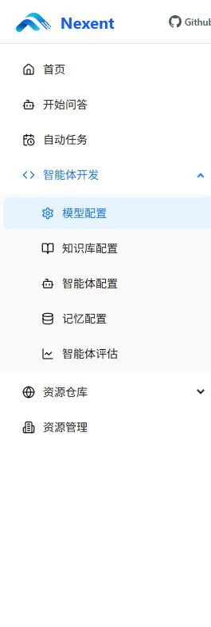

# 政务多智能体协作系统：工程与验收记录

## 仓库同步状态（2026-10-13）

M1 工程、验收证据、团队交接和 M2 启动规划已提交并推送。团队查看或拉取本轮成果，请使用 [feat/m1-complete-m2-plan 分支](https://github.com/miller7-lan/huaweiICT/tree/feat/m1-complete-m2-plan)。原共享分支为 [fix/local-bootstrap](https://github.com/miller7-lan/huaweiICT/tree/fix/local-bootstrap)；默认分支 main 尚未合并这些改动。此前的 GitHub 403 已在接受协作者邀请后解决。

当前接续见 [负责人记录](docs/2026-10-13负责人接续记录.md)、[M2 启动计划](docs/M2启动实施计划.md) 和 [事项候选核查](docs/M2事项候选与来源核查.md)。M2 已完成规划，事项核定及业务实施尚未开始；以下较早日期的记录保留当时状态。

2026-10-13 补充 [M2 实施前细节清单](docs/M2实施前细节清单.md)：任务创建、材料保存、工作人员接单、人工确认及版本/权限/修订契约仍待定稿。当前 C 盘工作目录已同步团队基线并实际通过 116 项测试；本机 Docker 尚未就绪、M1 私有环境未配置，远程验收记录不能当成本机本轮运行结果。

## M1 空白验收完善（2026-10-12）

小组下一阶段共有三人，建议从 [三人小组分工与交接任务](docs/三人小组下一阶段分工.md) 开始：负责人推进和集成后端，一位同伴负责官方资料与人工标准答案，另一位负责页面、Agent、独立验收与演示；先共同确定一个地区和一个事项。

M1 的 BT01–BT16 已实际执行并全部符合预期，完整回归 116 项通过。新增独立 govx MCP、事项工作台、原生运行容器与沙箱，原服务代码、Agent 配置、角色映射、业务库及 SDK 覆盖保留。原库三表、扩展七表均为空，真实锁/断连及恢复、页面越权和凭据检查通过。完整证据和工程复现见 [执行进度](docs/M1执行进度.md)、[覆盖矩阵](docs/M1验收覆盖矩阵.md)、[复现说明](docs/M1复现说明.md) 和 [完成审计](evidence/m1-completion-audit.json)。这些结论仅适用于空白技术验收；2026-10-13 已提交并推送共享分支，尚未合并 main 或正式赛事提交，未接入真实业务资料。

## 本机复现验收（2026-10-12）

在 `G:\桌面\codex项目\华为ICT\huaweiICT` 完成本机部署：Docker Desktop 4.94.0、Ollama 0.40.3、固定 Nexent v2.7.0 和两个校验过的 Qwen3 模型。基础测试 **92/92**、正式原生对照 **40/40**、五项原生故障 **5/5**、三个账号网页验收 **3/3** 均通过，业务库保持空白。当前状态见 [implementation-status.json](evidence/implementation-status.json)，启动与机器差异见 [本机运行说明](docs/本机运行说明.md)。

本机 Intel Arc 140T 已启用集成显卡推理；4B 正式中位耗时 42.58 秒，8B 为 51.09 秒，选定 4B。真实对照目录为 [native-20261012T042943808072Z](evidence/native-20261012T042943808072Z/summary.json)。网页记录见 [native-ui.json](evidence/native-ui.json)：群众会话 51、工作人员会话 52，开发账号使用原生临时调试模式，以真实工具 request_id 关联审计，未编造普通会话 ID。

换机器的初始化流程已补上原生模型健康检查与必填作者元数据，同时修正 Git 路径查找、本地 SSE 代理绕过和 Windows 监听端口检测。网页验收记录器仅转发原生页面并记录 Agent SSE 响应。所有账号凭据和运行配置仍在本机私有 `.runtime/`。

## 历史环境记录（2026-10-11）

目标是 Nexent **v2.7.0** 原生界面的三 Agent 技术链路，以及固定 Qwen3 4B / 8B 对照。当前已完成 MCP 工具、身份注入验证、部署与原生账号配置脚本、Agent 导入包、验收脚本。2026-10-11 用户已完成个人管理员注册及独立测试账号、模型与三个 Agent 的初始化。完整原生对照已通过：4B 与 8B 各 20/20 个正式用例成功，共 40 个新会话；按预热后中位耗时选择 4B。五项原生故障已通过，三个账号的 UI 验收仍需完成。实际进度见 [实施记录](evidence/implementation-status.json) 和 [修复与接手记录](evidence/fix-status-2026-10-11.md)。

## 历史进度（2026-10-11 初始化及首轮验收后复核）

| 项目 | 实际状态 |
|---|---|
| WSL、Docker 与原生服务 | 已就绪；服务、Ollama、沙箱及 SDK 覆盖哈希检查通过 |
| 本地测试 | 87 项通过；3 条依赖/上游警告 |
| 超级管理员与个人管理员 | 已由用户初始化、注册；单次管理员邀请码已使用 |
| 独立开发、群众、工作人员及测试管理员账号 | 已创建 4 个独立测试账号；平台角色为 DEV、USER、USER、ADMIN |
| 原生模型配置、三个 Agent 与角色映射 | 已配置 2 个模型、3 个 Agent 及真实身份映射；界面两个模型均显示可用 |
| 40 次核心新会话与模型选型 | 已通过 40/40，选择 4B；修复后复测 4B 中位 7.38 秒，8B 中位 8.37 秒 |
| 原生故障验收 | 5/5 通过；保留失败轮次和实际恢复证据 |
| 三个账号的 UI 验收 | 仍需分别登录并验证，不能由 API 对照替代 |
| 业务 evidence/cases/materials | 均为 0，保持空库 |

当前继续修复后核心回归及三个账号 UI 验收。预热和完整核心对照已经由代理按用户授权执行；以下仅预热命令保留为恢复检查入口。账号注册及个人界面登录由用户操作。2026-10-11 用户另行授权代理在 PowerShell 执行验收脚本；代理可运行隔离测试账号的 API 登录、预热、核心与故障验收，分析结果并更新仓库。首轮实际轨迹见 [失败汇总](evidence/native-20261011T080830004301Z/summary.json)，初始化的只读复核见 [native-provisioning.json](evidence/native-provisioning.json)。

```powershell
powershell -ExecutionPolicy Bypass -File "C:\Users\18133\Desktop\ICT\scripts\run_benchmark.ps1" -WarmupOnly
```

首轮 4B 的流读取等待 30 秒后超时；8B 调用了技能、文件等额外工具，未完成子 Agent 链路。本次将流的空闲读取等待改为 120 秒，明确关闭计划和自动任务入口，关闭四个独立测试账号的记忆及后台记忆功能，并添加只使用真实返回值的代码动作示例。每轮发布会同步更新提示词，群众/工作人员子 Agent 先于主 Agent 发布；验收会拒绝额外原生工具调用。该修复已在后续 40 次原生核心对照中通过。个人管理员的记忆配置不在脚本修改范围内。

第二轮 [失败汇总](evidence/native-20261011T082751728836Z/summary.json)在测试管理员设置检查处停止。固定上游接口将关闭值保存并返回为 `"N"`，原校验错误地期待 `false`；已按实际约定修复，并执行上游服务函数作为回归测试。[只读数据库复核](evidence/native-memory-contract-2026-10-11.json)确认该账号两个开关均为 `"N"`。失败日志现在保留安全的操作阶段，避免只有异常类型而无法定位。

第三轮 [实际汇总](evidence/native-20261011T083229058889Z/summary.json)已结束：8B 群众 4/5、工作人员 0/5、自称工作人员 2/5、重复群众 5/5；4B 未通过预热。失败包括重复环境调用、遗漏 JSON 解析、将真实结果改写成错误字典（`null`、`"null"` 或字段丢失），不能据此选型。

提示词现改为一段完整动作，在职责和示例中明确保留真实返回值，不拆分步骤、不重写结果字典。实际 MCP 返回 JSON 字符串；固定上游子 Agent 的 report 模板直接透传最终结果，已核对运行容器中的调用实现。`-WarmupOnly` 只执行两个模型各一次预热，不执行正式采集、不选择模型，也不表示核心验收完成；通过后去掉该参数运行完整对照。2026-10-11 新提示词已通过 [双模型预热](evidence/native-20261011T090557817255Z/summary.json)及 [40 次原生核心对照](evidence/native-20261011T090641128306Z/summary.json)，两个模型均满足全部 20 次通过条件。4B 预热后中位耗时 7235.37 ms，8B 为 8678.82 ms；差距超过 10%，选择较快的 4B。选定模型已重新发布至三个 Agent 的版本 11。历史失败结果保留，不能复用为通过证据。

修复后重新完成 [40 次核心回归](evidence/native-20261011T115445853107Z/summary.json)：两模型各 20/20，通过数合计 40/40。4B 中位 7375.39 ms，8B 为 8367.51 ms；继续选定 4B，三个 Agent 均发布为版本 14。本轮汇总包含实际 SDK 覆盖哈希，成功链路未回归。

五项故障实际结果见 [native-faults.json](evidence/native-faults.json)。Docker 重启后，已有执行沙箱停止且占用名称，SDK 创建失败回退到本地解释器；恢复脚本现在核对固定镜像、所有权及 lightweight 标签，再启动原容器，将默认 `no` 重启策略设置为 `unless-stopped`，不删除或重建容器。就绪检查拒绝已存在但停止或身份不符的沙箱。首次尚未创建沙箱时，仍由原生 SDK 创建，验收入口在结束后补齐重启策略。

存储故障现在由 `gov-blank-mcp` 内的独占锁实际触发：工具返回 `ERROR/TOOL_TIMEOUT`、两次尝试、主 Agent 立即结束，没有调用子 Agent；连接故障停止 MCP 容器后，平台返回 `ERROR/CONNECTION_TIMEOUT`、一次尝试、无模型或工具调用，并在 finally 中恢复服务。失败轮次见 `native-faults-20261011-first.json`、`-second.json`，首个通过轮次见 `-third.json`。

固定 SDK 将嵌套连接异常输出为普通文字，不能满足本项目的机器可读停止约定。因此增加最小运行时覆盖：只在 MCP 地址全部等于 `http://gov-blank-mcp:8765/sse`、异常链/组全部属于连接失败时返回结构化空结果。混合异常、认证失败、工具读取超时及其他 MCP 地址保留上游处理；成功路径和资源清理不变。固定原模块 SHA-256 和覆盖 SHA-256 见 [runtime-error-overlay.json](evidence/runtime-error-overlay.json)，未知源码拒绝应用。`prepare_deploy.py` 生成私有 `.runtime/overlays/run_agent.py` 并配置只读挂载；现有容器首次应用使用 `runtime_error_overlay.py --apply` 校验并重启运行服务。只读挂载在下次官方 Compose 重建时生效；仓库不上传 SDK 副本或私有配置。



## 已有内容

| 文件 | 用途 |
|---|---|
| `src/gov_mcp/core.py`、`server.py` | 仅三个工具；真实空 SQLite；角色映射；独立 Bearer；SSE；实际调用审计 |
| `config/agents.nexent-v2.7.0.json` | 原生 Agent 导入包；主 Agent 4 步、子 Agent 3 步；只绑定各自工具 |
| `models/Modelfile.4b`、`.8b` | 固定基础标签与上下文 8192、温度 0.1、输出上限 1024 |
| `scripts/deploy.ps1` | 固定官方源码提交、官方 Docker 部署、MCP 容器和连通性检查；默认停在账号操作前 |
| `scripts/provision_nexent.py` | 创建隔离租户、账号、模型、SSE 连接、导入并发布 Agent，保存真实 ID |
| `scripts/run_benchmark.ps1` | 校验初始化状态、服务就绪，定位项目 Python 后启动用户授权的验收 |
| `scripts/benchmark_native.py` | 使用原生发布版本、真实登录账号，每模型 4 类 × 5 个新会话，保存 SSE 与工具审计 |
| `scripts/check_native_ready.py` | 无需登录，检查服务、模型、原有沙箱及 SDK 覆盖哈希 |
| `scripts/runtime_sandbox.py` | 校验固定镜像和所有权标签，恢复原有沙箱并保留重启策略 |
| `scripts/runtime_error_overlay.py` | SHA-256 校验固定 SDK，生成仅适用于本项目 MCP 的连接错误映射覆盖 |
| `scripts/container_storage_lock.py` | 在 MCP 容器内获取实际 SQLite 独占锁，结束或异常时释放 |
| `scripts/verify_native_faults.py` | 用户授权的原生 Metadata 拒绝、未映射身份、越权、存储锁超时和连接中断验收 |
| `scripts/record_native_ui.py` | 校验用户操作的截图、原生 SSE 与实际审计，保存三个账号的 UI 验收记录 |
| `scripts/write_status.py` | 实时探测环境，根据最新原生结果及 UI/故障记录重新计算进度 |
| `evidence/unit-tests.xml`、`sse-transport.json` | 已执行的自动测试和真实 SSE 工具证据 |

依赖安装在 `.venv`，锁定清单为 `requirements.lock`。Python 本机环境为 3.12；MCP Docker 镜像使用 3.11。Nexent 后端由官方镜像提供，不在本机 Python 中安装 SDK。

原生接口适配参考固定上游版本的 [nexent-backend 技能](https://github.com/ModelEngine-Group/nexent/blob/519b9b17c7f4cbc623256ac318ea96a20f33772e/.agents/skills/nexent-backend/SKILL.md)，核对了 HTTP 身份与响应契约、配置约定及流资源生命周期。上游源码和 SQL 保持固定提交；运行时对一个 SDK 模块应用连接错误映射覆盖，具体范围和哈希见下文。

## 启动与恢复

首次下载此仓库时，先安装 Git、Python 3.12、Ollama 和 Docker Desktop，并执行：

```powershell
powershell -ExecutionPolicy Bypass -File scripts\setup.ps1
```

此入口创建本地 `.venv`、安装锁定依赖，下载、核对 Nexent v2.7.0 的精确源码提交，并初始化私有 `.runtime`。Windows 权限在写入凭据前限制为当前用户和 SYSTEM，子目录及新文件继承该权限。`vendor`、虚拟环境、私有 `.runtime` 和模型权重不随仓库发布。若 Python 使用独立可执行文件，可传 `-PythonCommand 'C:/Python312/python.exe' -PythonVersion ''`。

1. 在**管理员 PowerShell** 执行 `wsl --install --no-distribution`，按 Windows 提示完成安装和重启。当前进程不具备启用 Windows 可选功能的权限。Docker Desktop 已安装在用户目录；启动它并确认 Linux 引擎可用。
2. 在本目录执行下列命令。下载脚本支持断点续传，校验官方 registry manifest 和每个 blob 的 SHA-256；不会关闭 Ollama 的重定向保护。

```powershell
.\.venv\Scripts\python.exe scripts\download_models.py
powershell -ExecutionPolicy Bypass -File scripts\configure_ollama.ps1
.\.venv\Scripts\python.exe scripts\verify_model_settings.py
powershell -ExecutionPolicy Bypass -File scripts\deploy.ps1
```

`configure_ollama.ps1` 重启当前 Windows Ollama 安装的进程，设置单进程环境 `OLLAMA_NUM_PARALLEL=1`、`OLLAMA_MAX_LOADED_MODELS=1`、监听 `127.0.0.1:11434`，创建 `gov-qwen3-4b:ctx8192-v1` / `gov-qwen3-8b:ctx8192-v1` 两个固定参数别名。再次运行脚本即可恢复这些设置。每轮仅加载一个模型。直连 Ollama 的检查请求传 `reasoning_effort=none`；原生 Nexent 请求省略该顶层字段，通过三个 Agent 固定的 `extra_params.__custom__.reasoning_effort=none` 传给提供方，并关闭平台思考开关。模型检查拒绝思考输出或上下文不符；完整原生验收仍以实际轨迹为准。

Docker 内模型地址为 `http://host.docker.internal:11434/v1`。须在容器中验证可达性；如果当前 Docker Desktop 不能访问主机的 loopback，记录连接错误后先修复本机连接方式。不要直接将 Ollama 暴露给局域网来绕过故障。

`deploy.ps1` 使用从固定官方脚本生成的服务部署副本，跳过其自动注册超级管理员的步骤；原官方脚本保留。它等待原生服务就绪，并在 `nexent-runtime` 容器内检查两个 Ollama 别名可达；检查通过后默认停在账号操作前。**账号初始化和界面登录由用户操作**。准备好后，由用户在本目录手动运行：

```powershell
powershell -ExecutionPolicy Bypass -File scripts\initialize_accounts.ps1
```

此命令先调用官方 `create-su.sh` 初始化平台超级管理员，再使用私有凭据执行原生账号注册/登录、配置模型和发布 Agent；密码不会显示在输出中。不要让代理在用户接手登录期间运行它。只有用户明确希望一个命令完成部署和账号初始化时，才使用 `deploy.ps1 -ProvisionAccounts`。`provision_nexent.py` 的直接入口要求超级管理员已经初始化。

若 PowerShell 当前目录是 `C:\WINDOWS\system32`，相对脚本路径会提示文件不存在。当前机器可在任意目录使用完整路径：

```powershell
powershell -ExecutionPolicy Bypass -File "C:\Users\18133\Desktop\ICT\scripts\initialize_accounts.ps1"
```

换机器时将项目路径替换为实际位置。初始化成功后，由用户启动 `scripts\run_benchmark.ps1` 进行 40 次原生核心对照，再完成三个账号的 UI 验收和原生故障验收；执行方式见下文“实际验收”。

官方脚本选择 `infrastructure,application,supabase`，关闭 Workbench，使用 lightweight 执行环境；没有资料解析服务、业务资产、业务资料导入。给官方 Compose 的宿主机发布端口增加 `127.0.0.1` 绑定，并只读挂载受哈希校验的 SDK 错误映射覆盖，不修改 SQL。Nexent 精确提交：`519b9b17c7f4cbc623256ac318ea96a20f33772e`。MCP 只挂载 `.runtime/mcp`，不挂载账号凭据或 Nexent 数据目录。

2026-10-11 实测：固定 MinIO 旧镜像在官方源和国内镜像源无法拉取。可使用同一服务端发布版本的官方源码构建本地镜像，再部署：

```powershell
powershell -ExecutionPolicy Bypass -File scripts\deploy.ps1 -RegistryProfile mainland -BuildMinioFromSource
```

构建入口核对服务端源码提交 `7a311a3b666a0e5476fbde24d4413220876d9df2`，固定客户端源码版本，验证两个可执行文件并记录 `evidence/minio-source-build.json`。随后显式修改两个镜像源配置的 `MINIO_IMAGE` 为 `ict-minio:RELEASE.2023-12-20T01-00-02Z-source`；其余镜像、Compose 服务和 SQL 保持原定义。该镜像是本地源码构建产物，不能认作原官方二进制镜像。启用后配置会保留，后续部署仍使用它；换机器需先重新构建。PowerShell 部署根据真实退出码判断成败，正常 stderr 下载进度不会中断部署。

当前镜像中的 FastAPI 会独立读取 OTEL 环境配置。Nexent 遥测关闭时，准备脚本同步将 traces/metrics/logs 自动导出器设为 `none`，避免旧的 `http` 协议值阻断启动；显式启用遥测的配置保留。服务探测会跟随前端语言重定向。

### 账号和权限

如果希望使用自己的邮箱在本地界面注册，可由用户在项目目录执行：

```powershell
powershell -ExecutionPolicy Bypass -File scripts\create_admin_invite.ps1
```

此入口先初始化本地超级管理员，再通过原生 API 登录、创建或复用验证租户，生成仅可注册一次的管理员邀请码并显示在终端。将它填入本地注册页面即可；个人邮箱和密码由用户在界面填写。重复运行会复用尚可用的邀请码。邀请码保存在私有 `.runtime/manual-admin-invitation.json`，不提交仓库。页面中的开源社区提示是通用文案，本地部署的邀请码由本地管理员管理。此入口不创建测试账号、配置模型或发布 Agent；完整技术验收仍需用户运行 `initialize_accounts.ps1`。

凭据保存在私有 `.runtime/accounts.json`，真实平台 ID 在 `.runtime/nexent-state.json`。**凭据文件生成不代表账号已创建。** 必须以原生 API 成功返回为准。Windows `.runtime` ACL 限制为当前用户和 SYSTEM；不要复制到知识库、提示词、对照证据或提交仓库。

| 账号 | 平台角色 | 工具业务角色 |
|---|---|---|
| developer | DEV | citizen（用于调试） |
| citizen | USER | citizen |
| staff | USER | staff |
| tenant_admin | ADMIN | 未映射（管理及负向验证） |
| super_admin | SU | 未映射（仅平台引导） |

后两个账号是官方权限体系要求的引导管理账号，不能代替两个独立 USER 测试账号。初始角色映射为空；初始化脚本只能根据登录接口取得的真实 tenant/user ID 写入 `.runtime/mcp/role-map.json`。普通用户的 Metadata 和聊天自称身份不能更改该文件。

### 工具行为和停止条件

每个结果保留 `status`、`items`、`citations`、`knowledge_version`、`message_code`，并附 `data.request_id` 关联实际审计。`knowledge_version=null` 表示没有业务知识版本。

- 配置正常且库为空：环境工具返回 `OK/ENVIRONMENT_READY`，附角色和资源计数。
- 检索空库：`EMPTY/NO_KNOWLEDGE`，记录、引用均为空，结束。
- 工作人员无事项、无材料：`BLOCKED/MISSING_CASE_AND_MATERIALS`，列明缺失项，结束。
- 群众调用工作人员工具：`BLOCKED/FORBIDDEN`；未映射身份：`BLOCKED/ROLE_NOT_CONFIGURED`。
- 业务库意外非空：`ERROR/BLANK_BOUNDARY_VIOLATED`，拒绝使用这些数据。
- 存储超时最多尝试两次；连接超时提示词要求最多重试一次。`EMPTY/BLOCKED/ERROR` 结果均不可通过重复业务调用“修复”。模型格式错误单独记录。

工具身份字段在 MCP schema 中声明，Nexent v2.7.0 的可信会话包装器移除模型可见参数，并覆盖模型提供的同名字段。MCP Bearer 是平台服务间连接凭据，模型不接触它。审计记录以 tenant/user 的 SHA-256 标识调用人，保留工具返回结果和耗时。

## 实际验收

先用三个账号在原生界面验证入口：开发账号使用调试界面；群众和工作人员账号分别登录 `http://127.0.0.1:3000`，在已发布主 Agent 点击“开始问答”。保留实际 UI 会话 ID、截图及调用轨迹。当前尚未执行 UI 验收，不能凭配置文件认定通过。

```powershell
.\.venv\Scripts\python.exe -m pytest -q --junitxml=evidence\unit-tests.xml
.\.venv\Scripts\python.exe scripts\verify_sse.py
powershell -ExecutionPolicy Bypass -File scripts\run_benchmark.ps1
```

原生对照脚本调用原生 UI 使用的运行 API，每轮先发布三个 Agent 的同一模型版本，再预热一次；预热不进入中位数，预热失败的模型不进入核心采集。四类提示分别是群众空库自检、工作人员缺前提、群众自称工作人员、重复群众自检。普通用例省略 Metadata 更新字段；伪造 Metadata 被拒绝属于独立负向验收。每类 5 个新会话，顺序执行。该脚本会通过 API 登录测试账号，须在账号初始化完成且用户授权后启动。不要在采集期间人工触发其他会话，以免混入工具审计。

每次记录实际原生 SSE、子 Agent 起止、工具顺序与审计、最终结果 request_id、耗时、停止原因、显存和整机内存采样、业务计数。只有文字、没有真实工具轨迹，或最终结果无法关联实际工具请求，均失败。到达步数上限、运行错误、仍出现深度思考或调用额外原生工具也失败。

验收还核对中文显示名与真实子 Agent ID、调用 ID、起止顺序，以及最终结果保留的全部约定字段；工作人员的缺失项不得丢失。核心及预热会话必须独立。采集前检查上下文、温度、输出上限与量化级别；每次调用后核对实际只加载当前模型且上下文为 8192。异常中断保存部分结果及失败汇总，不据此选型。

只有某模型全部 20 个核心用例通过，才进入选择比较。仅一方通过选该模型；双方通过时比较预热后中位数，差距（以较快者为分母）不超过 10% 选 4B；双方均未通过不选择模型。原生 UI 和额外故障验收独立标记，核心性能比较不能替代它们。

额外验证需分别保留：可信身份覆盖、未映射账号、群众工具越权、技术超时停止。现有测试已经覆盖工具层和上游身份包装器，且五项原生平台故障验收已经通过。故障只能模拟技术状态，不创建政策、案例、事项或材料。

完整核心验收后，在用户授权下运行下列命令；将 `<native目录名>` 换成此次 `evidence/native-*` 目录名。两个故障参数分别会短暂持有业务库独占锁、停止并恢复 `gov-blank-mcp`。在无其他会话运行时执行。独占锁由 MCP 容器内的进程持有，避免 Windows 和 Docker 之间文件锁不互通；异常或结束均释放锁。不符合实际停止契约的项目不会算通过。

```powershell
.\.venv\Scripts\python.exe scripts\verify_native_faults.py --benchmark <native目录名> --storage-lock --connection-outage
```

UI 验收由用户分别登录开发、群众、工作人员账号并执行前述操作。保存真实 PNG/JPEG 截图，以及对应 `/agent/run` 响应的解析后 SSE：JSON 文件仅含 `conversation_id` 和 `events` 数组，不含请求头或登录令牌。为每个账号执行以下命令，将示例路径换成实际文件；脚本会用私有真实身份、实际工具审计和子 Agent ID 校验轨迹，再要求用户输入 `VERIFIED` 确认截图及会话对应。

```powershell
.\.venv\Scripts\python.exe scripts\record_native_ui.py --role citizen --benchmark <native目录名> --screenshot <截图.png> --trace <原生SSE.json>
.\.venv\Scripts\python.exe scripts\write_status.py
```

另两次将 `--role` 改为 `developer`、`staff`。UI 和故障记录绑定本轮核心目录，不能复用旧轮次结果；截图与轨迹的哈希不符或缺文件时不会通过。`implementation-status.json` 区分核心链路、UI、故障和整体完成状态，并保留实际检查时间。

本批只证明核心工程链路；不表示 BT01–BT16、业务准确率、算法效果或审批能力已经验证。
