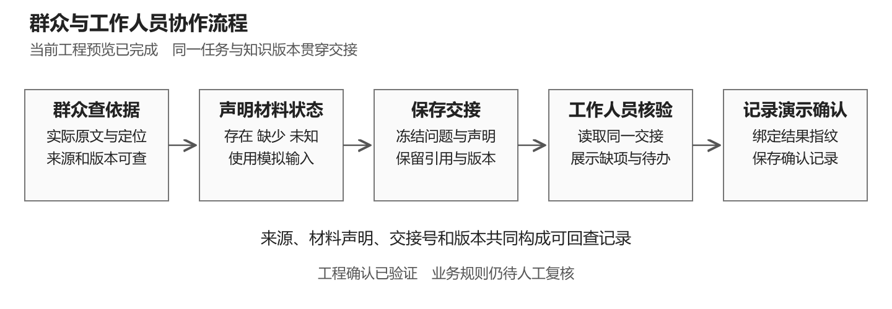
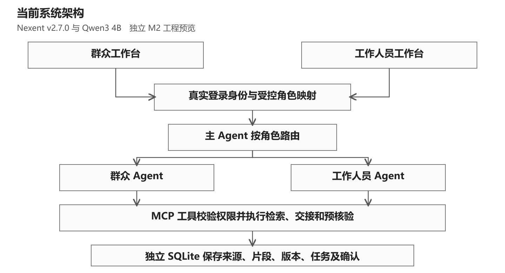
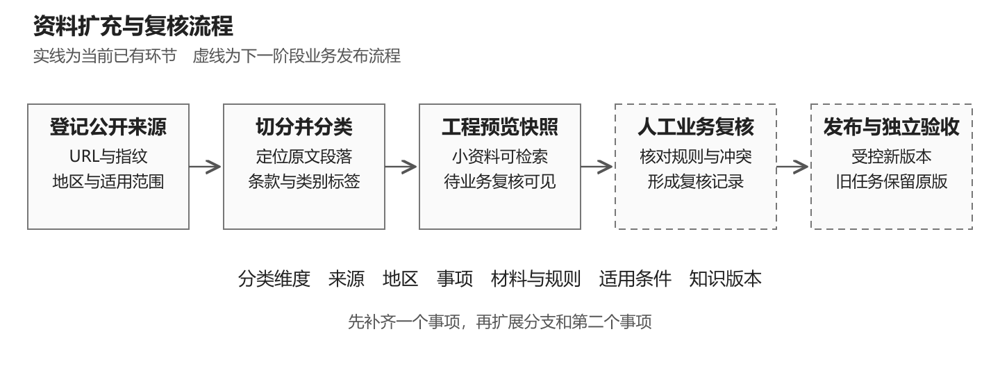

# 政务多智能体协作系统参赛策划书

华为 ICT 大赛创新赛道　项目方案与展示准备

版本 1.0　编制日期 2026年10月13日　适用对象 项目组与指导教师

## 一 项目定位与阶段结论

我们准备一个面向政务办事咨询与窗口材料预核验的协作原型。群众端查阅有来源的办事依据并保存问题和材料状态；工作人员端接收同一份交接记录，查看缺项、未知项和需要人工复核的规则。系统把来源、知识版本、交接状态和工具调用记录连接起来，让双方可以回看一次建议形成的依据。

当前已经跑通少量资料下的完整工程流程。接下来用约六周时间补齐单事项规则、扩大分类资料、开展独立评测，再把结果整理成比赛展示。项目名称暂沿用仓库名称；正式报名名称由团队统一登记。

| 项目 | 当前依据与安排 |
| --- | --- |
| 参赛方向 | 用户已确认创新赛道，预计答辩不超过8分钟 |
| 展示时长 | 主讲目标6分40秒，含60秒演示，预留80秒处理切换和停顿 |
| 截止安排 | 用户提供11月末；内部目标11月25日前交付可提交包，具体官方截止日待核定 |
| 起步场景 | 郑州市二七区成年人本地户籍身份证到期换领，仍是候选业务范围 |
| 已验证 | 2个官方来源、8段原文、1条群众至工作人员流程、132项自动回归通过 |
| 优先补齐 | 事项与材料规则复核、独立业务评测、需求访谈、可复用演示素材 |

**项目主张：让办事建议的依据能够随任务交接，并在工作人员复核时保留同一知识版本。** 创新性需要通过机制演示和对照结果支撑。目前可展示的是工程机制，业务收益仍需测量。

本版事实基于仓库提交 `c5bdda49f86b23f2157e9dc62fe83235f381c744` 及其公开证据。132项是自动测试数量，8项是另外执行的真实接口边界检查；两者不能相加后写成业务准确率。页面中的材料状态是模拟输入，确认记录由受控账号下的浏览器自动化产生。

<!-- pagebreak -->

## 二 使用对象与需求验证

项目先服务两个操作角色：需要理解办事要求的群众，以及需要核对材料前提的工作人员。第三类使用者是维护资料的项目成员，负责来源登记、规则复核和版本管理。正式政府用户与机构合作尚未建立。

### 需要验证的问题

我们提出三项需求假设：群众可能难以区分相近事项和适用条件；咨询结果转到工作人员时可能丢失依据和上下文；资料变化后，旧任务使用了哪个版本可能不易解释。这些假设来自项目场景分析，尚未形成用户访谈结论，也没有“减少跑动次数”或“节省窗口时间”的实测数字。

| 对象 | 典型任务 | 产品提供的信息 | 验证方式 |
| --- | --- | --- | --- |
| 群众 | 确认事项、查找材料要求 | 事项范围、原文定位、模拟材料状态 | 观察能否找到依据并完成交接 |
| 工作人员 | 接收咨询并复核前提 | 同版本引用、缺项、未知项、复核待办 | 检查是否需要重新询问已填写的信息 |
| 资料维护者 | 收集、分类、更新资料 | 来源指纹、适用条件、复核状态、快照 | 检查能否定位原文和追溯旧版 |

### 十月需要补的需求证据

建议先邀请3至5名同学进行模拟办事可用性走查，并在能够正常取得同意的情况下邀请1至2名熟悉办事流程的人复核需求。参与人数是招募目标；同学的体验不能代表真实窗口工作人员评价。记录任务、观察到的问题、原话摘要和改进意见，使用匿名编号，不记录身份证号和实际申请材料。

访谈围绕三个具体动作：请对方找到一条材料要求的依据；请对方说明交接后还缺什么信息；请对方判断系统标出的未知项是否清楚。不要先告诉对方“系统能提高效率”再征求赞同。

### 首版范围

首版集中于一个地区、一个事项和可定位的公开文字资料。先完成查询、交接、预核验、复核记录及版本追溯。正式审批、真实政务系统对接、证件 OCR、多地区推广和大规模模型训练均不属于目前已交付能力。材料真伪和最终受理意见需要具备相应职责的人判断。

<!-- pagebreak -->

## 三 产品流程与最小演示

一条演示使用同一个事项、任务和知识快照。群众端先登录并建立任务，系统按身份路由至群众 Agent，检索公开依据。用户声明两项模拟材料的状态后保存交接。工作人员登录后接收交接，运行预核验，查看缺项、未知项与业务复核待办，再记录演示确认。

| 环节 | 可见结果 | 需要保留的证据 |
| --- | --- | --- |
| 依据检索 | 原文、来源链接、定位、版本和待复核提示 | 页面与实际 MCP 返回值 |
| 材料声明 | 身份证和户口簿的存在、缺少或未知状态 | 明确标注模拟输入 |
| 保存交接 | 固定任务、材料声明、引用与版本 | task_id、handoff_id及审计 |
| 工作人员核验 | 演示缺项及尚需人工核对的规则 | 工作人员真实工具调用 |
| 演示确认 | 绑定核验结果指纹的确认记录 | 确认类型、同意状态与持久化结果 |

已经完成的演示输入为“原身份证声明缺少、户口簿声明存在”。这只能说明预览清单可以显示缺项。户口簿在该申请分支的具体要求仍待核对，不能用这个演示推导正式办事材料清单。

当前工作人员按钮核验最新交接，历史任务选择界面尚未完成。准备比赛演示时使用专门测试账号和明确的最新任务，避免误选。下一轮页面改进优先补充交接选择、中文分类名称与清晰的待复核提示。

演示中的“人工确认位置”已经实现；历史确认动作由自动化执行。下一阶段需要队员独立操作并记录实际复核意见，才能展示人员参与复核的过程。机构认可或真实业务办结需要另有事实证明。

<!-- pagebreak -->

## 四 技术架构与实现边界

现有实现使用 Nexent v2.7.0 编排主 Agent、群众 Agent 和工作人员 Agent，使用 Qwen3 4B 完成模型调用。MCP 工具处理身份、检索、交接和预核验；独立 SQLite 保存来源、片段、知识快照与流程记录。本机工作台、MCP及原生运行服务分别使用8771、8770和5018端口。

服务端从真实登录会话和受控映射获得角色，工具层再次校验权限。页面传入的自称身份不能授予工作人员权限。任务创建时固定知识版本，交接冻结材料和引用；确认操作绑定具体结果指纹，减少确认内容与展示内容不一致的风险。

当前检索按事项、地区和固定版本筛选，再用中文字符二元片段匹配排序。系统保存四类片段标签，并制定六维分类结构；尚未实现按任意六个维度自由检索，也没有完成向量语义检索评测。材料核验目前围绕两个模拟声明，完整条件规则引擎仍需开发。

| 来源或组件 | 在项目中的作用 | 团队贡献的边界 |
| --- | --- | --- |
| Nexent与Qwen3 | 既有平台、模型和运行能力 | 明确注明上游来源，不申报为自研基础平台或模型 |
| 项目MCP与工作台 | 权限、引用、固定版本、交接及确认 | 本项目实现与集成的主要部分 |
| 分类与证据机制 | 原文定位、来源指纹、阶段审计 | 当前小资料实现及后续扩充方案 |

架构图只表示当前已实现的工程关系。尚无华为云、昇腾或 ModelArts 的实际部署证据。正式赛题若要求指定技术，先确认资源、许可和适配要求，再安排一次真实接入与复测；接入成功后才纳入成果页。

<!-- pagebreak -->

## 五 创新主张与验证设计

创新赛展示应集中在能够解释、演示和验证的项目贡献。多 Agent、RAG 和 MCP 本身是已有技术，团队的工作是把它们用于有来源、可交接、可复核的具体办事流程。现阶段不使用“首创”“领先”或“效果提升百分之多少”等缺乏证据的结论。

### 同一份依据贯穿两个角色

群众得到的引用随交接保存，工作人员读取同一份任务与知识快照。这个设计希望减少交接时重新寻找依据和复述问题。现有端到端审计已验证同一任务、交接和版本贯通。业务价值要通过相同任务下的重新询问次数、复核时间和人工判定来验证。

### 把不确定性作为可处理结果

系统区分材料缺少、材料未知、业务规则待复核和工具异常。权限由工具层校验，模型不能仅凭提示词获得更高权限。现有接口与页面证据支持这些边界；面对更多业务条件和表达方式时是否稳定，需要独立验收集补证。

### 来源与版本进入任务记录

原文定位、来源指纹和固定快照让一次结果可以回查。知识变更后的差异定位与影响分析是下一阶段增强项。目前只有一个实际预览快照，不能宣称已完成真实政策更新检测或图谱推理。

| 对照方案 | 固定条件 | 主要观察 |
| --- | --- | --- |
| 文档检索问答 | 相同资料、问题与可用时间 | 找依据的质量及交接时信息是否齐全 |
| 单 Agent工具调用 | 相同模型、资料、工具能力与身份约束 | 完成率、工具次数、延迟和结果一致性 |
| 当前多 Agent流程 | 相同任务和评分标准 | 角色协作的收益与额外调用成本 |

三组对照尚未执行。公平对照需要给单 Agent 相同的安全与工具能力，不能先削弱基线，再把安全差异全部归因于多 Agent。若多 Agent 在质量上没有改善且耗时更多，应如实报告，并评估简化编排。架构选择服务于任务效果。

<!-- pagebreak -->

## 六 资料扩充与数据库分类

先补齐一个事项的有效依据与适用条件，再增加分支和第二个事项。当前9条候选来源记录并不等于9份已入库资料；工程预览实际使用2个来源、8段原文。30条问题草案尚无人工标准答案，属于开发准备资料。

| 分类维度 | 必须保存的信息 | 复核重点 |
| --- | --- | --- |
| 来源 | 官网URL、发布主体、文种、指纹、原文定位 | 转载关系、可访问性与使用依据 |
| 地区 | 国家、省、市、区及受理范围 | 当前事项是否适用 |
| 事项 | 名称、内部ID、申请原因、办理阶段 | 初领、换领、补领分别归类 |
| 材料与规则 | 身份、户籍、条件、流程等类别 | 必交、条件交、择一或共享取得 |
| 适用条件 | 年龄、户籍关系、申请分支 | 条件缺失时保留未知状态 |
| 知识版本 | 发布时间、生效时间、采集时间、复核状态 | 日期类型分清，旧版可追溯 |

来源登记后保留原件与指纹，按条款或语义完整段落切分。每个片段连接原文位置和业务适用范围。重复网页、同条款转载与镜像归为同一来源组，不能靠重复复制增加资料数量。

程千城复核材料规则和来源差异，负责人按复核结论导入固定快照，陈子炫用独立任务检查页面与引用。未核定、冲突、失效或使用依据不清的资料保留在待复核队列。当前工程预览继续显示待复核状态；面向业务发布需要单独完成范围复核。

收集通过正常公开访问完成，遇到登录、验证码或访问限制时记录状态并寻找正常授权渠道。公开可访问与可任意复制、训练、公开再分发是不同事项，应记录使用依据。演示继续使用明确标注的模拟材料状态，不采集个人办证记录。

扩充验收以“选定事项的规则覆盖与可追溯性”为主。条数只作规模说明，不设先凑满某个数量再验收的目标。全文、中文分词或向量检索的选型在独立任务上比较后决定。

<!-- pagebreak -->

## 七 业务评测与可展示指标

现有自动回归和接口检查证明工程行为。正式业务表现需要经人工复核的任务、标准答案和独立执行记录。当前不展示业务准确率、节省时间比例或用户满意率。

第一轮建议准备至少30个独立验收任务，覆盖材料齐备、缺项、证据不足、规则冲突、版本一致性和越权六类。任务要符合已核定范围；没有真实新旧资料时，版本类只检验工程一致性，不计算政策影响识别效果。公开的30条草案用于开发，不转名充作未见过的留出集。

| 指标 | 计算与判定方法 | 内部目标或报告方式 |
| --- | --- | --- |
| 引用支持率 | 被引用原文完整支持的业务陈述数除以全部带引用业务陈述数 | 建议目标95%，待测；同时报告无引文陈述 |
| 关键结论有据率 | 有有效原文支持的关键结论数除以全部关键结论数 | 逐条人工核对，报告分子与分母 |
| 缺项召回与误报 | 正确识别缺项数除以人工缺项总数；另报错误缺项提示数 | 召回建议目标95%，同时报误报，待测 |
| 交接完整率 | 必填任务字段、材料状态、引用与版本均保留的任务数除以总交接数 | 逐项验收，缺一项计失败 |
| 权限与版本边界 | 指定越权请求全部阻断；历史任务读取固定版本 | 列出测试范围，不外推所有攻击安全性 |
| 时间与稳定性 | 端到端耗时中位数、P95、失败任务数除以总任务数 | 同机同配置记录，失败与超时不删除 |

先冻结资料快照、模型、提示词和任务集，再运行三种方案。开发集与验收集按任务或案例组分开，同一问题改写放在同组。共享同一官方语料并不自动构成泄漏，但验收题、答案和评分反馈不得提前用于调提示词。

程千城形成参考答案并核对依据，陈子炫独立执行和记录，负责人汇总日志及指标。关键争议由另一位队员交叉复核，记录不同意见及处理理由。规模较小时展示原始计数与典型失败，不能只给一个百分比。

建议完成20次连续工程流程检查，并记录同机条件下的耗时分布；这属于稳定性测试，不充当20个独立业务样本。没有完成的实验在PPT中保留为后续计划，不绘制虚构结果柱状图。

<!-- pagebreak -->

## 八 到十一月末的工作安排

以下是团队建议排期，不是官方赛程。以11月25日为内部可提交包目标；若核实的官方截止日更早，整体前移，至少保留3天处理上传与格式问题。每阶段以证据通过为准，人员可用工时由团队每周校准。

| 时间 | 主要交付 | 责任人与通过条件 |
| --- | --- | --- |
| 10月14日至18日 | 正式规则核对、单事项范围、规则冲突表 | 负责人核对赛制；程千城签署范围复核记录；陈子炫复现演示 |
| 10月19日至25日 | 单事项分类资料包、开发样例、页面改进 | 程千城提交可定位来源；负责人导入快照；陈子炫完成独立走查 |
| 10月26日至11月1日 | 规则分支、异常处理、稳定性记录 | 三人完成一次按清单验收；列出未通过项与证据 |
| 11月2日至8日 | 冻结验收集、三组对照；可选真实版本变更验证 | 业务范围完成复核后测量；无真实版本前提时缩减M3展示 |
| 11月9日至15日 | 结果复核、PPT第一版、60秒演示视频 | 图表可回查原始结果；讲稿与画面一致 |
| 11月16日至22日 | 独立复现、完整排练、修复展示问题 | 三次排练均不超过6分55秒；另一成员能按说明启动 |
| 11月23日至25日 | 功能冻结、文件检查、提交包准备 | 版本、文件清单、许可证说明和素材全部核对 |
| 11月末实际截止前 | 缓冲与正式上传 | 负责人按正式通知提交并保留平台回执 |

### 分工与每周协作

负责人主抓后端、版本、集成、比赛规则核对和最终成果核验。程千城主抓官方资料、规则与人工答案，并负责PPT场景和数据说明。陈子炫主抓页面、独立验收、截图录屏及演示操作。主讲人由团队排练后确定，优先一人连续主讲，另一人操作演示。

每周一次短会只检查本周交付、证据链接和阻塞项。共享记录保存任务、唯一负责人、预期完成日、实际完成日、证据及下一动作。11月15日前若业务复核或对照结果仍未完成，缩减范围为一个事项的可靠演示，优先完成核心验证。

### 工作量与资源

当前沿用已有电脑、Docker和本地模型，不承诺零成本。记录成员实际工时、模型调用耗时、内存占用和录屏准备时间。华为平台适配仅在正式要求、可用资源和成本明确后纳入关键路径；额度、硬件和部署费用均待测算。

<!-- pagebreak -->

## 九 八分钟展示与提交材料

建议准备10页主讲内容，按6分40秒控制。第6页安排60秒演示，其余页面集中讲场景、流程、架构、项目贡献、真实结果与后续计划。逐页标题、上屏要点和口播见配套《PPT逐页内容与讲稿》。当前版本保留“待测”位置，取得结果后再替换。

60秒演示优先用实机录制片段，保留日期、版本和模拟输入标识。关键画面是引用、交接号、工作人员缺项和复核提示。若使用剪辑或倍速，应明确标注，不把压缩后时长当作系统真实响应时间。是否允许视频、是否计入答辩时长和问答安排，需要按正式通知核定。

采用白底黑字、普通线框图和真实界面。表格只比较同类信息，不用蓝白交替条纹、装饰性渐变和大段口号。PPT每页只承担一个结论，路径、日志和参数放进备份页。

| 材料 | 当前准备情况 | 下一步 |
| --- | --- | --- |
| 详细策划书与技术路线 | 本文及配套架构图 | 依据正式题目与评测结果迭代 |
| PPT逐页提纲与讲稿 | 本轮形成10页内容脚本 | 11月上旬加入实际结果，制作PPT文件 |
| 演示截图与证据索引 | 已有真实两端截图与审计 | 补独立复核操作、录制60秒视频 |
| 数据来源与使用说明 | 来源登记和分类结构已具备 | 完成业务范围、现行性和使用依据复核 |
| 运行工程与复现说明 | 已有隔离工程及步骤 | 另一成员在独立环境复现并记录 |
| 正式提交文件 | 尚未核定模板与上传限制 | 核对技术文档、代码、视频等具体清单 |

本轮材料属于项目准备，不等于已制作PPT或完成正式赛事提交。提交包要注明上游平台、模型与开源依赖，区分团队实现、集成工作和第三方能力。AI辅助开发与文档整理按赛事要求披露，团队必须理解并能够解释代码和验证结果。

### 提交前需要锁定的信息

负责人尽早取得本届、本赛区、本阶段的正式通知，登记届次、赛题、评分维度、指定技术、知识产权与AI辅助规则、文件模板、截止时间及上传入口。用户提供的8分钟和11月末作为当前策划依据，历史赛事网页只供参考。

<!-- pagebreak -->

## 十 风险处理与下一步清单

| 风险或缺口 | 可观察触发条件 | 处理方式与责任人 |
| --- | --- | --- |
| 材料规则存在冲突 | 不同官方文件对同一申请分支要求不同 | 程千城核对适用范围和版本，未解决项继续标待复核 |
| 展示效果缺少业务证据 | 只有测试通过，没有人工评分结果 | 陈子炫执行独立任务，负责人保留分母与失败记录 |
| 多Agent增加延迟 | 工具重复调用或展示超时 | 负责人评估调用成本；保留真实轨迹，优化后重新测量 |
| 现场服务不可用 | 模型加载慢、容器未就绪或登录失效 | 提前预热与检查；使用已标注日期版本的本地录屏备份 |
| 扩充超出三人产能 | 资料长期待复核、分支无法稳定复现 | 先完成一个事项，暂停增加地区和事项 |
| 赛事技术要求不匹配 | 正式通知要求尚未接入的组件 | 先完成适配可行性和资源验证，及时调整排期 |

### 最近一周可以直接执行的任务

1. 负责人取得正式比赛通知，补齐规则对应表，确认8分钟是否包含演示或问答。
2. 三人共同核定候选地区和事项；程千城提交材料差异、依据位置和复核结论。
3. 陈子炫独立重走群众和工作人员流程，记录页面问题和确认操作，补两张可投影的关键截图。
4. 负责人根据复核结论完善规则分支与交接选择，继续保留原/M1空库边界。
5. 程千城与陈子炫开始建立开发任务和独立验收任务，负责人记录版本与执行配置。
6. 用配套逐页稿进行一次不追求完整结果的试讲，只检查逻辑和时长，记录听众不理解的术语。

### 本阶段完成的判断

一份可用的参赛方案应同时具备：明确的使用者与任务、能够独立复现的流程、可追溯的数据与规则、能够解释的技术取舍、带分母的验证结果，以及在规定时间内可讲清的展示。当前工程流程已具备，接下来把资料复核和独立业务验证放在最前面。

<!-- pagebreak -->

## 附录 证据与参考资料

以下路径相对于仓库根目录。完整的“可用表述、证据、局限”对应关系见配套《演示证据与素材清单》。本轮核对的是已归档结果，没有重新运行完整业务评测。

| 编号 | 证据文件 | 能支持的结论 |
| --- | --- | --- |
| E01 | evidence/m2/minimal-flow-audit.json | 一条实际工程流程通过，任务与版本贯通，业务复核未完成 |
| E02 | evidence/m2/source-preview.json | 2个来源、8段、4类片段和6维分类定义 |
| E03 | evidence/m2/native-citizen.json | 群众Agent实际路由、调用与结果 |
| E04 | evidence/m2/native-staff.json | 工作人员Agent实际路由、调用与结果 |
| E05 | evidence/m2/actual-api-boundaries.json | 8项真实接口边界检查及幂等性 |
| E06 | evidence/m2/regression-tests.xml | 132项自动回归结果 |
| E07 | output/playwright/m2/citizen-handoff.png | 群众检索与保存交接画面 |
| E08 | output/playwright/m2/staff-confirmed.png | 工作人员预核验与演示确认画面 |
| E09 | config/m2-data-taxonomy.json | 分类字典、复核状态与扩充顺序 |
| E10 | docs/M2最小流程与资料扩充.md | 复现步骤、当前限制及资料扩充说明 |

**赛事背景参考。** [华为ICT大赛2025至2026全球总决赛官网](https://www.huawei.com/minisite/ict-competition-2025-2026-global/cn/)介绍创新赛的展示形式；[华为关于ICT大赛的官方文章](https://www.huawei.com/cn/huaweitech/publication/202501/huawei-ict-competition)讨论创新应用、功能完成度与社会价值。它们是历史资料，不能代替本届本赛区评分表、时间和技术要求。检索日期为2026年10月13日。

**技术来源参考。** [Nexent官方代码仓库](https://github.com/ModelEngine-Group/nexent)用于说明上游平台来源；本项目以本地锁定的v2.7.0版本及配置为准，不能将上游后续新增能力自动列为本项目功能。

**业务来源入口。** [新密市公开的居民身份证法文本](https://public.xinmi.gov.cn/D0107Y/2107317.jhtml)与[二七区换领办事指南](https://eq.jiceng.zhengzhou.gov.cn/004008002/3394639.jhtml)是首批预览资料。现行性、具体申请分支与材料要求仍待业务复核；实际归档指纹在来源清单中保存，不依据策划书直接指导真实办理。

**配套文件。** 策划书保留可修改的Markdown和Word版本；PPT逐页稿、演示脚本、答辩备问、可编辑SVG图及PNG图分别保存，方便按真实进度替换，避免在多个文件中手工编造不一致数字。
