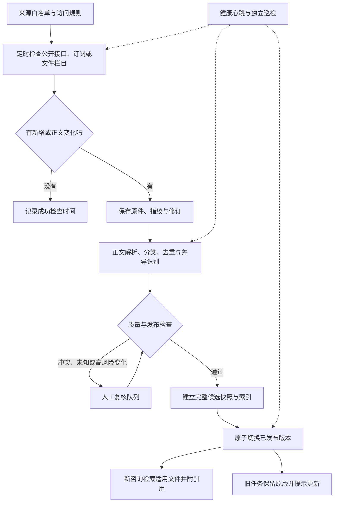

# 知识库扩充与自动更新实施计划

2026-10-16执行补充：用户已将原程千城的资料与复核准备交由Codex接手，现有结果见[AI核查记录](知识库AI业务核查记录.md)。用户同时明确目标完成后的最终一步是提交并推送GitHub共享仓库，核验远端提交并交回链接。下文分工表保留原规划历史，不代表继续等待程千城交回。

编制日期：2026-10-15（北京时间）。状态：执行中。数据库与采集底座已开始落地，正式来源接入和业务发布仍待核验；实时接续信息见[执行进度](知识库自动更新执行进度.md)。

目标：把现有少量官方资料的工程预览，扩展为能够持续发现公开文件、自动处理和分类、形成可追溯知识版本，并为访问者提供当前适用依据的知识库。

## 1. 预期使用效果

系统定时检查已登记、允许自动访问的官方来源。有新文件或原文件发生变化时，保存原件与指纹，提取正文、日期和适用范围，分类、去重、检查质量，生成候选版本。通过发布检查后，新的咨询使用新版本，并展示文件来源、发布日期、生效日期及最近检查时间。

例如：某办事指南新增材料要求，系统发现后能定位变化条款，列出受影响事项，完成复核后发布。此后新建的咨询使用更新后的指南；已经交接的任务仍能还原当时使用的依据，并提示有新版本可供重新核验。

“最新”是来源覆盖范围内、截至最近成功检查时，已发现且适用于该地区、事项和办理时间的最新可用版本。抓取时间不能冒充发布日期；发布时间较新也不自动表示规则已经生效或效力更高。

## 2. 当前基础与缺口

计划制定时检查了仓库文档、分类配置和相关代码。下表中的原有预览数字来自既有工程记录；2026-10-15新增实施和新测结果单独记入[执行进度](知识库自动更新执行进度.md)。

| 已有基础 | 本次核对依据 | 下一步缺口 |
| --- | --- | --- |
| M2 预览记录为2份官方网页、8段原文、固定预览版本 | [M2最小流程与资料扩充](M2最小流程与资料扩充.md)、来源清单 | 持续发现新文件、周期更新和正式发布流程 |
| SQLite 中有 sources、versions、chunks、tasks、handoffs、reviews | `src/gov_mcp/m2.py` 的 M2Store | 网站登记、不可变文件修订、任务队列、发布指针和审计 |
| 分类包含来源、地区、事项、材料/规则类别、适用条件和版本 | [现有分类字典](../config/m2-data-taxonomy.json) | 层级编码、多标签关系、有效期及分类质量检查 |
| 原文检索按固定版本、事项和预设地区过滤，使用中文二元字符片段匹配 | `M2Tools.evidence` | 可配置地区、类别/条件过滤、全文与语义检索评测 |
| 任务及交接记录绑定知识版本 | M2 的 tasks、handoffs 及现有流程说明 | 新咨询选择已发布版本、旧任务更新提示及重核验 |
| 当前导入只支持工程预览；同一 source_id 不接受不同指纹 | `M2Store.seed_preview` | 逻辑文件与修订分离，不能直接把预览导入函数作为自动更新器 |

用户已于2026-10-15确认沿用“郑州市二七区、成年本地户籍居民身份证到期换领”作为试点范围，已写入[范围配置](../config/knowledge-scope.json)。这项确认不替代来源使用依据、现行规则和材料分支的业务复核。

## 3. 总体流程

采集与处理在后台运行；访问者提问时查询已发布知识。后台发现的待复核文件可以在维护页面展示，不能混进正式答案。

## 4. 内容扩充与分类

### 4.1 扩充顺序与首批规模

1. 补齐一个地区、一个事项分支的依据链：上位规范、地方实施文件、官方指南、必要解读和官方问答。
2. 核对当前9条候选来源，按实际访问、使用依据和业务核验结果决定纳入、暂存或排除。
3. 试点计划登记3—5个官方站点或栏目，形成20—50份独立有效文件的候选语料；不足时按覆盖缺口说明，不用转载或重复页面凑数量。
4. 当前事项通过独立评测后，先加同事项的初领/补领等分支，再加居住证等第二事项，最后考虑更多地区。

这些是建议规模，不是已取得的数据量。省、市、区的文件可以共同提供依据，但要分别登记适用范围和相互关系，不能把其他地区的指南当作本地区要求。

### 4.2 分类字典

| 维度 | 建议字段或类别 | 必须遵守的规则 |
| --- | --- | --- |
| 地区及受理范围 | 国家、省、市、区县、街道、受理机构 | 使用稳定内部编码及父子关系；适用范围单独登记，不只看发布机构所在地 |
| 事项与分支 | 身份证到期换领/补领/初领、居住证申领等 | 内部编码与官方事项编码分开；未知官方编码留空 |
| 文种 | 法律法规、规范性文件、办事指南、政策解读、官方问答、公告、表格附件 | 区分原文与解释性资料；文种本身不能单独决定冲突裁决 |
| 内容类别 | 适用条件、申请材料、办理流程、时限、费用、受理渠道、表格 | 从现有4类逐步扩展；全文可多标签，片段标注具体类别 |
| 适用条件 | 年龄、户籍、申请原因、办理阶段、必交/条件交/择一/共享取得 | 正文必须支持分类；模型只能提出标签，未知条件不得补造 |
| 时间状态 | 待生效、现行、已替代、已废止、未知 | 分开保存发布日期、生效起止日和采集日期；状态附证据 |
| 来源与审核 | 发布者、原始出处、转载关系、访问依据、使用依据、复核状态 | 官方域名和可访问状态都不能代替内容有效性、使用范围核验 |

分类优先用来源配置和明确规则，模型辅助识别主题、生成摘要和提出标签。模型输出要通过字段校验，低置信、未知地区或未知生效状态进入复核。摘要与原文分开保存，回答引用原文位置。

### 4.3 覆盖矩阵

维护“地区 × 事项分支 × 内容类别”的覆盖表，标出已有依据、缺失、冲突、待复核和最近核查时间。每次扩充优先补真实问题无法回答的缺口，并报告独立文件数、可定位片段数和事项覆盖率。

## 5. 来源接入与允许访问的判断

建立来源登记表，优先官方公开 API、RSS/Atom 等订阅，其次 sitemap 与政策/指南栏目。逐站配置入口、允许路径、附件域名、解析器、检查周期、限速、联系说明和暂停开关。发现站外链接只登记候选，新域名不自动获准抓取。

每个来源保存访问规则及核查时间、使用依据、允许保存/引用/再分发的范围。遵守网站条款和 robots.txt，不绕过登录、验证码或访问控制，不采集个人申请记录。robots.txt 规则不是内容使用授权，标准也明确区分了访问规则与授权；因此不能用“robots 允许”或“官网公开”直接判定所有用途均可行。[RFC 9309](https://www.rfc-editor.org/info/rfc9309/)

规则不明、站点拒绝访问或限制发生变化时，暂停相关来源并记录原因，等待核验；已有资料如何展示按其原使用依据处理。附件、图片和第三方转载分别核验，不能继承正文页面的许可判断。本计划没有逐站完成新的许可审查。

建议初始限速为每域名并发1、请求间隔至少5秒，并以站点更严格要求为准。403或验证码停止自动访问；429按 Retry-After 退避；网络及5xx故障有限重试，连续失败触发暂停。禁止通过更换代理规避限制。

下载器只允许配置的公网 HTTP(S) 来源；每次跳转重新验证域名和目标地址，阻断本机、内网和云元数据地址。限制类型、大小、解析耗时与跳转次数；附件按不可信输入隔离解析，不执行宏或脚本。网页里的指令不得成为模型的系统指令。

## 6. 自动处理与增量更新

1. **发现链接**：周期读取订阅、公开接口或栏目分页，同时覆盖公告和附件。不能只依赖发布日期筛选，需回看近期窗口并周期复查旧链接，以发现补发、回填和原链接修改。
2. **减少重复下载**：保存 ETag、Last-Modified，服务器支持时发送条件请求，304记为未修改；不支持时按周期下载比对。条件请求的行为依据 HTTP 标准。[RFC 9110 条件请求](https://httpwg.org/specs/rfc9110.html#conditional.requests)
3. **归档与去重**：保存实际原始字节、最终URL、HTTP元数据、采集时间和SHA-256。另算去掉导航后的正文指纹，区分网页装饰变化与实质内容变化。同一原文的转载归组，保留出处关系。
4. **解析与定位**：首版支持HTML和有文本层的PDF。按标题、条款和材料表格切分，保存段落/条款/页码定位及解析器版本。扫描PDF通过可选OCR通道处理，识别不清不得发布；DOCX等格式放在后续接入。
5. **结构化与分类**：提取标题、发布者、文号、时间、地区、事项和条件；原文没有的字段标记未知。切分保留适用条件，避免把一张材料表截断成无上下文的要求。
6. **识别变化与影响**：对比新增、删除和修改条款，关联受影响事项、材料类别和未完成任务。页面下架/404只标为不可访问，不能自动推断政策废止；修订、替代和废止关系需有依据。
7. **质量检查**：检查空正文、乱码、重复、定位丢失、日期矛盾、缺少来源、跨地区误分类、规则冲突及敏感个人信息。失败进入隔离队列，展示原因，支持修正后重跑。
8. **建立候选快照**：按适用范围生成完整文件与片段清单，构建检索索引，验证引用和评测问题，再发布。未变化的文件继续进入完整快照，不能只把本轮新增文件当作整个知识库。

各阶段持久化状态，任务按“来源/修订指纹/处理管线版本”去重，保证重复调度不重复入库。工作进程领取任务时设置租约，超时可恢复；同一来源与范围发布加锁，防止重叠执行和旧候选覆盖新发布。

## 7. 数据库和文件存储改造

首版在隔离的更新运行目录使用SQLite、原件目录和持久任务表，继续对接现有Python/MCP，不先增加大规模分布式依赖。原件保存到按指纹组织的文件目录或已有对象存储，数据库保存元数据和引用路径；不把大附件直接塞进片段表。

新增前先备份、制定schema迁移和回滚脚本，在副本验证数量、引用与历史任务。保留原/M1空白基线和M2预览复现入口。自动更新使用独立模式标记；不能仅删除当前 `engineering_demo` 检查就宣称支持正式运行。

| 对象 | 用途与关键字段 |
| --- | --- |
| source_sites | 网站/栏目、允许域名路径、访问及使用依据、限速、check_interval、next_check_at、最近成功检查、失败数、enabled |
| documents | 稳定逻辑文件ID、发布主体、文号、原始来源、转载归组；无文号时用来源和规范化链接辅助识别 |
| document_revisions | 不可变revision_id、document_id、原件路径、原件/正文指纹、日期字段、抓取元数据、解析版本、质量及有效性状态 |
| document_scopes / document_tags | 文件与地区、事项、类别、条件的多对多关系；记录标签来源与复核结果 |
| chunks | revision_id、原文定位、正文、类别与条件；检索项必须能定位到同一不可变修订 |
| crawl_runs / ingest_jobs | 调度批次、阶段、状态、租约、尝试数、下次重试、错误、开始/完成时间 |
| review_items | 变化摘要、冲突、待决字段、影响范围、复核人、意见及复核对象指纹 |
| knowledge_versions / version_members | 候选或已发布状态、完整revision清单、清单指纹、索引指纹、评测结果、发布记录 |
| publication_heads | 按租户/可见范围/地区/事项标记当前发布版本；带revision计数用于并发控制 |
| audit_events / worker_health | 来源配置变更、处理/复核/发布/回滚记录，以及工作进程心跳 |

现有sources可通过映射接入documents和document_revisions；旧source_id及旧引用保留。迁移需明确旧versions与新knowledge_versions的对应，避免出现两套不一致的当前版本。

文件修订与知识版本都不可覆盖：前者表示一份文件某次取得的内容，后者表示一次问答可见的整组依据。发布前原件和索引就绪，事务内切换publication_heads，失败保留旧指针。查询开始即固定该版本；检索结果、引用、缓存键和审计都带版本。回滚切回旧指针并清理相关缓存，不删除历史记录。

SQLite方案先采用单写入处理进程和有界事务。只有实际出现并发写入、规模或检索延迟瓶颈后，再评估迁移PostgreSQL及向量存储；数据库条目变多本身不是必须换数据库的理由。

## 8. 心跳、调度与无人值守

这里分开设计“检查更新”和“检查采集器活着”。由项目后台调度与工作进程执行，部署为能重启恢复的服务；不依赖某个聊天窗口持续打开。

| 任务 | 建议初始频率 | 具体行为 |
| --- | --- | --- |
| 调度扫描 | 每5分钟 | 领取next_check_at已到期的来源；扫描调度表不会每5分钟访问全部站点 |
| 高频官方栏目 | 每1小时 | 在来源规则允许范围内检查新链接及已知链接变化；加随机抖动 |
| 普通指南/规范来源 | 每24小时 | 条件请求、增量发现；支持按来源单独调整 |
| 近期回看与完整对账 | 每日回看近30天；每周完整对账 | 防止分页移动、回填发布日期、订阅遗漏和旧URL变更 |
| 进程心跳 | 每60秒 | 记录worker、当前任务、最近进度；超过5分钟无心跳由独立巡检标记异常 |
| 数据新鲜度巡检 | 每15分钟 | 对比每来源的检查周期、最近成功检查、队列积压和待复核时长 |
| 备份与恢复检查 | 每日备份；每周抽查恢复 | 数据库与原件清单一致；能恢复已发布快照及其索引 |

频率是起始配置，正式值由来源规则、预算和实际更新节奏决定。运行环境需保持联网、存储可用；本机关机/休眠时不能检查。要求持续服务时部署到常开主机或服务器。独立巡检与操作系统/容器重启策略覆盖整个采集进程退出的情况，不能只让进程自己检测自己。

启动后补跑到期来源并按顺序合并积压，避免一次性重放大量历史调度。每任务最多3次自动尝试，退避建议1、5、30分钟，来源限制优先；超过上限进入失败队列。任务无变化时安静记录；仅新版本发布、重要变化待复核、持续失败或新鲜度超时产生维护提醒。通知渠道后续配置，首版先在维护页和日志显示。

## 9. 自动发布与人工复核的边界

为最终实现无人值守，采用逐步放开策略：

- **第一阶段：自动采集、解析、分类和候选入库，人工复核后发布。** 用真实变化记录验证处理可靠性，业务规则不交给模型自行裁定。
- **第二阶段：固定白名单和已验证解析器下，明确低风险的变化自动通过。** 例如导航样式变化、完全相同正文的重复发现可自动归档并跳过新知识版本。新增纯资讯是否自动发布，必须预先限定用途和可回答范围。
- **第三阶段：满足既定规则的内容自动生成快照并发布。** 前提是适用范围/生效状态明确、使用依据有效、质量检查和回归全部通过、无冲突；每次自动决定可审计、可回滚。

新站点、未知有效期、规则冲突、OCR低质量，以及材料、费用、时限、申请资格等实质规则变化，默认进入人工复核。系统持续自动完成其他来源的更新；维护页应显示“新文件已发现但待复核”，并在受影响问答中提示不确定性。自动采集成功不等于已经能保证全自动正式回答。

发布权限由独立维护角色持有，服务账号不能兼任工作人员审批身份。复核记录绑定内容及分类指纹，候选内容修改后旧复核失效。

## 10. 访问者提问时如何使用新文件

1. 识别地区、事项、办理分支和咨询时间；关键条件不足时补问，不把多地区规则拼接。
2. 读取该范围的已发布版本指针并固定查询快照；按租户和可见权限过滤。
3. 筛选适用且有效的依据。未来生效文件可单独说明生效日期，但不得代替当前规则；历史问题按明确时间查询历史依据。
4. 第一版改善现有关键词检索，增加类别/条件过滤，再以同一评测集比较全文检索与“关键词+向量”混合检索，按结果决定是否引入向量索引和重排。
5. 回答中的关键要求附标题、发布机构、原文链接、条款/页码和版本；最近成功检查时间与文件发布日期分别展示。模型负责组织表达，依据不足则明确说明。
6. 来源检查超时、相关新文件待复核或规则冲突时显示对应提示。受到已发现变更直接影响且无法判断的关键要求，暂停确定性回答并转复核；无证据时不能靠模型记忆补齐。

当前新建任务选择“最后插入版本”的逻辑需改为选择明确的已发布指针，并校验状态；不能让最新候选或工程预览成为正式默认值。检索中的固定地区和固定事项也需改为配置与上下文约束。

已有任务/交接继续绑定原版；发现适用的新规则时显示变化提示，由工作人员发起新版本重核验并保留两次结果。已废止版本仅用于历史还原，不继续充当当前办理依据。

## 11. 分阶段排期与分工

建议首版按10—15个有效工作日安排，取决于三人投入、来源访问和人工复核进度；不作为赛事截止日期或完成承诺。每阶段以出口条件为准。

| 阶段 | 建议投入 | 负责人主线 | 程千城：资料与复核 | 陈子炫：页面与验收 | 出口条件 |
| --- | --- | --- | --- | --- | --- |
| A 范围和数据底座 | 2天 | 字段、迁移、版本映射和来源配置 | 核对试点及9条候选，制定覆盖表和使用依据 | 设计分类筛选与状态展示 | 范围清楚；迁移副本可恢复；来源可逐一追溯 |
| B 首批扩充与分类 | 2—3天 | 解析、不可变修订、去重和导入 | 补齐依据链、日期/条件与原文定位 | 抽检文件、分类和引用展示 | 一项业务覆盖完整；未知/冲突可见；无重复充数 |
| C 自动更新和心跳 | 3天 | 调度、持久队列、限速、重试、心跳 | 核验增量变化和暂停来源 | 维护页、失败恢复及重复执行验收 | 两个连续周期可运行；重启后可补跑且不重复 |
| D 发布与问答切换 | 2—3天 | 快照、索引、发布指针、回滚及MCP接入 | 复核生效/替代关系和答案依据 | 新旧咨询切换、权限和缓存验收 | 新咨询读新版，旧交接可还原，发布失败不污染线上 |
| E 独立验收与试运行 | 1—4天 | 修复、备份恢复与运维说明 | 核对独立问题及引用支持性 | 页面端到端与异常场景、短演示 | 指标、失败项及证据完整，试运行通过后再扩事项 |

## 12. 验收标准

以下为待执行标准，不能用历史PASS替代。首版先定义30条独立人工核对问题，覆盖范围内常见问题、时间变化、地区不符、冲突和证据不足；与开发调参样例分开管理。

| 检查 | 通过条件 |
| --- | --- |
| 可追溯与分类 | 已发布文件100%有原始出处、原件指纹、适用范围、状态和可定位片段；抽查20份，不足则全查；关键地区/事项误分类为0 |
| 有效期 | 未来生效、替代、废止和未知日期分别测试；当前问题不引用不适用文件作现行依据 |
| 增量发现 | 受控测试来源分别新增文件、修改旧URL正文、补发旧日期文件、修改附件，均在对应周期及队列处理预算内发现 |
| 幂等与装饰变化 | 同一批次执行3次无重复修订/片段；导航变化不产生无意义业务版本 |
| 访问边界 | 未授权域名、403/验证码、robots限制、限速、恶意跳转及内网目标均按规则停止或阻断 |
| 解析和内容安全 | 空正文、损坏PDF、低质量OCR、个人信息及文档指令注入进入隔离/受限处理，不能改变系统权限或发布规则 |
| 发布一致性 | 故障注入到原件、索引及数据库提交阶段，旧版仍可查；并发发布不会发生版本倒退 |
| 新旧任务与回滚 | 发布后新咨询用新版；旧任务引用仍能还原；回滚后指针、缓存及引用一致 |
| 质量评测 | 对有充分依据的问题，人工相关证据Recall@5目标≥90%；关键规则引用支持率100%；越地区和已失效规则作现行回答为0 |
| 证据不足处理 | 所有无依据、冲突及未知关键条件用例均明确提示或转复核；不能编造依据 |
| 时效与监控 | 模拟失联后5分钟被独立巡检识别；来源超过自身周期和配置宽限仍未成功检查时明确显示过期风险 |
| 备份与历史兼容 | 可从备份恢复完整已发布版本、原件和索引；相关M2回归及原/M1基线审计通过 |

建议队列低负载时从发现变化到候选可复核不超过15分钟；人工复核耗时单独报告。1小时检查的来源，正常发现延迟通常受该1小时周期约束，不能承诺文件一发布即进入问答。自动发布时还要计入解析、评测及索引耗时。

验收证据分别保存来源检查记录、处理批次、变化前后指纹、复核/发布日志、评测分母和结果、页面截图、故障恢复及回滚记录。受控测试文件明确标为模拟数据，不能混入正式语料或冒称官网真实更新。

## 13. 维护页面与交付物

维护页显示来源状态、最近成功检查、下次检查、新增/变更数量、失败队列、待复核原因、当前已发布版本和受影响事项；支持暂停来源、重试、查看差异、复核、发布和回滚。普通访问者只看到有助于判断答案适用性的日期、出处与更新提示。

实施完成应交付：来源白名单及依据记录、分类字典、可回滚迁移、采集与处理模块、持久调度/心跳配置、首批语料及覆盖矩阵、版本发布接口、两端页面、独立评测和验收证据、备份恢复与日常运维说明。

第一轮优先完成“一个事项资料齐全、一次新增文件自动发现并入候选、一轮复核发布、新咨询使用新版、旧交接可还原”的闭环，再逐步扩大内容和自动发布范围。

## 14. 参考与相关记录

- [M2最小流程与资料扩充](M2最小流程与资料扩充.md)
- [M2事项候选与来源核查](M2事项候选与来源核查.md)
- [现有分类配置](../config/m2-data-taxonomy.json)
- [现有候选来源清单](../data/discovery/2026-10-13/source_manifest.json)
- [三人小组下一阶段分工](三人小组下一阶段分工.md)
- [RFC 9309：Robots Exclusion Protocol](https://www.rfc-editor.org/info/rfc9309/)
- [RFC 9110：Conditional Requests](https://httpwg.org/specs/rfc9110.html#conditional.requests)

参考标准用于说明访问协议与增量请求；它们不替代逐站使用依据和具体内容的业务核验。
