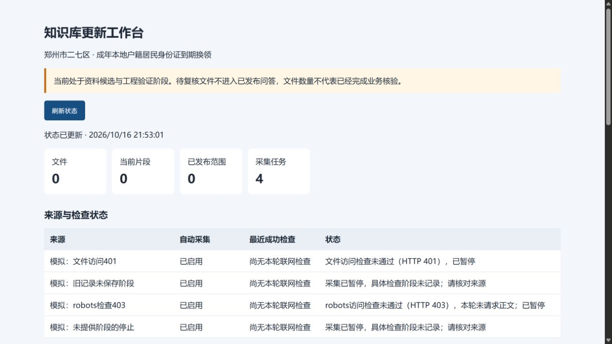

# 访问停止诊断与地方指南对照

2026-10-16。补上采集停止原因的实际阶段记录，同时保留地方指南的范围和日期缺口。核查者为Codex AI，本轮没有核发业务效力结论或正式发布资料。

## 地方指南观察

正常采集的一次新中牟指南探查被拒，没有取得原件。该探查发生在诊断修复前，只留下通用错误，不能倒推是robots还是正文阶段被拒；修复后没有再次请求这个入口。二七既有来源继续暂停，没有通过新建同域来源重抓。

网页工具只读观察到：[二七分局县级指南](https://eq.jiceng.zhengzhou.gov.cn/004008002/3394639.jhtml)和[铭功路街道指南](https://eq.jiceng.zhengzhou.gov.cn/004008002/3404478.jhtml)均把户口簿、本人的原身份证分项列出；[中牟青年路指南](https://zm.jiceng.zhengzhou.gov.cn/004008002/3351721.jhtml)的普通成年分支则先列原身份证。这种地区差异不能用来宣布二七已取消某项材料，也不能据此取代国家、省级和本地规则关系核定。

三份网页本次可见内容均未提供可核定的发布/施行日。没有新增正常归档，也没有把网页预览转写成政策原件。本轮有界检索仍未取得河南“六个月调整”的原文件和完整起止日期，媒体报道日期、其他省份期限不作替代。见[观察记录](../evidence/knowledge-update/local-guide-comparison-observation.json)。

## 诊断修复

原先robots请求与文件请求遇到401/403都只记录同一句通用错误，工作台又按错误字符串猜测“访问规则请求被拒绝”。这不足以判断实际停止环节。现在：

- 采集停止异常保存准入检查、robots检查、文件访问或未知阶段，以及当次确知的HTTP状态。诊断字段不复制网址查询参数、请求头或响应正文。
- 工作进程把结构化信息写入既有失败审计；状态接口只读提取当前暂停来源的最近失败。按来源查失败使用局部索引，避免长期审计增长后反复扫描全表。
- robots检查未通过时，工作台明确说明本轮未请求正文；文件阶段单独展示。旧审计没有结构化字段时显示阶段未记录，不按旧错误文字补造状态。
- 既有公开IP、TLS、robots、重定向、限速、响应大小和暂停规则继续执行。此次变更不自动恢复暂停来源，也不请求登录或受限文件。

## 实际验证与部署

[完整回归502项](../evidence/knowledge-update/regression-tests.xml)通过，3项既有依赖警告。新增8项覆盖robots403、文件401、robots返回错误HTML、规则禁止、重定向到禁止路径、未知异常、旧只读库和准入失败。其中6项先复现缺少阶段记录，再确认修复；测试确认被拒来源不会自动重试，禁止目标没有被请求。

[8项隔离诊断核对](../evidence/knowledge-update/access-stop-diagnostics.json)通过。四份模拟来源调用实际任务处理函数，核对失败审计、只读API和工作台展示；只使用进程内模拟响应，外部请求数为0，不算官方抓取成功。浏览器实际显示了不同阶段与未知记录，见下图。

[9项实际部署核对](../evidence/knowledge-update/access-stop-deployment.json)通过：无运行中的采集任务时，仅重启知识库自有监督和组件；网页、只读MCP、采集与维护心跳正常，既有Windows恢复任务健康。37份来源配置、暂停状态、业务候选和发布策略指纹保持。旧来源未补造阶段，也没有借部署重试拒绝入口。

[Nexent运行环境核对](../evidence/knowledge-update/consultation-runtime.json)确认原/M1/M2模块哈希保持；[完整备份恢复](../evidence/knowledge-update/full-backup-restore.json)仍为33原件、39文件，7项通过。真实库保持37来源、33归档、83修订、261当前片段，0资料批准、0独立业务评测、0正式版本和0发布头。本轮不运行模型问答，不改变旧30题开发结果或新30题草案。

部署与短时心跳正常不等于重启/登录验收、完整自然周或常开部署完成。二七材料、现行效力、六个月依据、减免/邮费及独立业务验收继续列为剩余工作。
