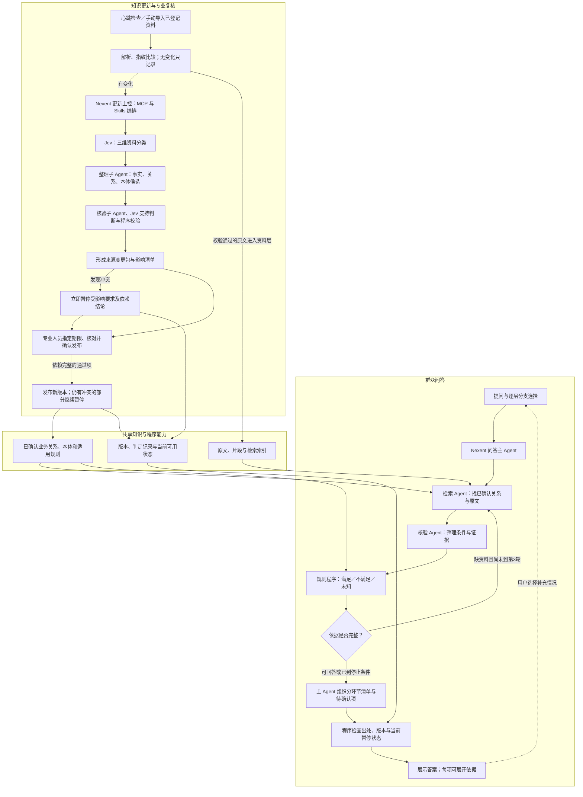
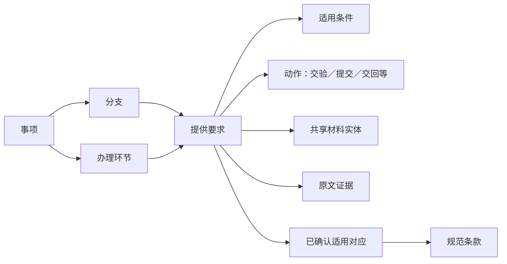
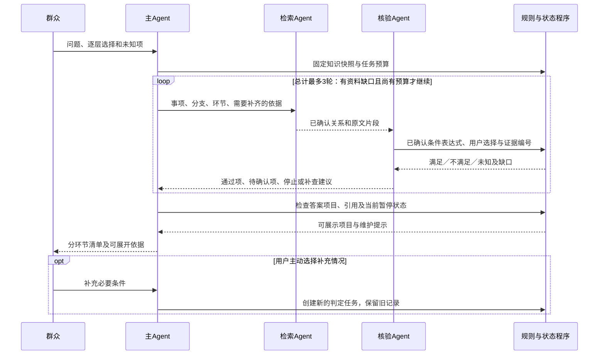
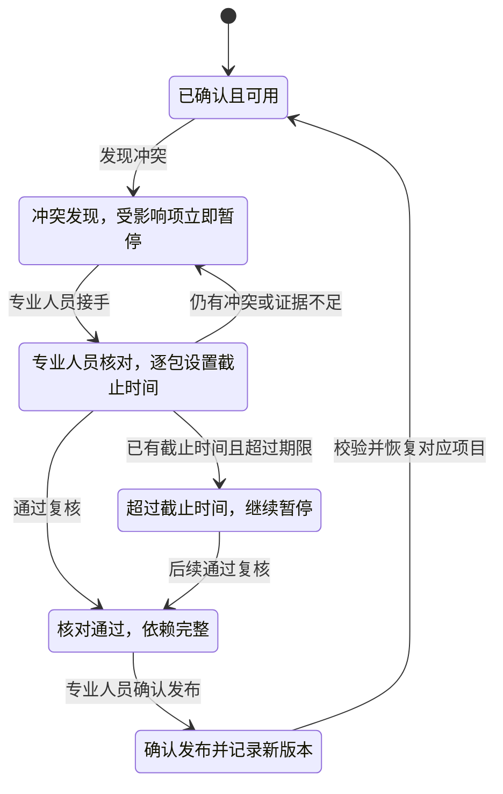

# 政务 Agent 整体架构草案

日期：2026-10-17。版本：设计草案 v0.1。

本草案依据用户八轮选择形成，原始决定见 [架构规划问答](Agent架构规划问答.md)。它定义目标架构和首版工程范围；其中字段、状态和模块契约是工程建议，并非已经实现的代码。API 接入留空，当前运行配置不因本文件改变。

2026-10-17 第一阶段已落实知识对象、三值规则和模拟演练，见 [第一阶段实现与演练](Agent第一阶段实现与演练.md)。随后已连通离线三角色查询、持久化变更包与独立工作台，见 [全流程接入与运行](Agent全流程接入与运行.md)。下列图仍是目标架构：真实模型、新 Nexent 原生编排和真实官网尚未在这套新流程内验收。

## 1. 第一版要做到什么

群众选择自己的情况后，系统根据已确认知识给出分环节的材料、步骤及待确认项。每项结果可展开查看适用条件、依据路径、原文位置和知识版本。

首版用一个模拟地区、一个模拟事项验证流程，分别记录申请、受理、领取等环节。资料和事项通过配置替换。先完成模拟工程验收，真实官网资料、真实政策核对与独立业务验收放在后续阶段。

已确定的关键约束：

- 查询侧采用主 Agent、检索 Agent、核验 Agent 三个角色。
- 分支逐层展示；条件不明时先给已确认内容，再提供可选的“补充情况”追问入口。
- 模型整理条件，程序计算“满足、不满足、未知”，模型解释有依据的结果。
- 先查已确认关系并核对原文；缺证据自动补查，总计最多 3 轮，包含首次。
- 来源原文事实与当前适用关系分别管理；待核实资料可以展示出处，不进入确定办事清单。
- 材料实体共享，具体提供要求单独绑定分支、环节、动作、条件和出处。
- 未受变化影响的已确认内容沿用；冲突项立即暂停，交专业人员处理。
- 专业人员逐包指定截止时间，核对并确认发布，核对和发布分别留记录。

## 2. 整体结构

Nexent 承担角色调度与工具调用。MCP 提供受控能力，Skills 描述可重复的任务步骤。程序控制任务轮次、规则计算、权限、发布和版本切换；模型负责理解、建议和组织表达。

原文资料层更新与正式知识发布是两条路径。新增片段可以作为待核实资料检索，但不能仅因被召回就进入确定清单。

## 3. 角色与权限

| 角色／模块 | 输入与输出 | 权限边界 |
| --- | --- | --- |
| 问答主 Agent | 接收问题、所选分支和核验结果；组织清单、缺口和补充选项 | 使用查询工具；不能发布知识或扩大来源范围 |
| 检索 Agent | 根据事项、分支、环节和缺口，返回已确认关系及原文片段 | 只读选定版本及已登记资料；不把待核实关系升级为事实 |
| 查询核验 Agent | 整理用户条件、匹配规则、识别证据缺口，调用规则程序并汇总结果 | 只读核验；不改用户已选条件、不自行判定政策现行适用 |
| 更新主控 | 读取本轮变化，安排分类、整理、核验，提交处理汇总 | 仅处理当前任务授权的来源与工具；不能正式发布 |
| 整理子 Agent | 提出事实、提供要求、关系、同义项和本体扩展候选 | 仅写候选，必须附原文定位 |
| 更新核验子 Agent | 检查候选出处、遗漏、新旧差异及冲突 | 写核验意见，不能代替专业人员确认 |
| Jev | 三维资料分类，候选是否受原文支持的信号 | 概率是辅助信号，不决定业务适用或发布 |
| 规则与版本程序 | 计算条件、检查依赖、维护暂停状态及版本 | 执行已确认规则，不运行文档或模型提供的任意代码 |
| 专业人员 | 核对变更、确认同义合并与本体修改、设置期限、确认发布 | 同一角色可完成全过程；核对和发布各留审计记录 |

查询核验与更新核验是不同任务权限。可以使用同一个模型服务，但应使用隔离的 Agent 配置或工具权限，不让群众会话获得候选写入或发布能力。API 留空阶段不决定模型供应方或最终模型 ID；前轮本地 8B/4B 演练只是现有运行基线。

试训 Qwen 问题分类器保留为可选实验组件，当前不作为正式清单生成的前置依赖；接入与升级在后续评测后决定。

## 4. 知识怎样保存

### 4.1 业务对象

| 对象 | 最小信息 | 作用 |
| --- | --- | --- |
| 事项 Matter | 编号、名称、地区、允许的办理原因 | 限定回答业务范围 |
| 分支 Branch | 所属事项、父分支、选项、条件、显示顺序 | 形成逐层选择；只展示当前相关选项 |
| 环节 Stage | 申请／受理／领取等标识、所属事项、顺序 | 分开管理各环节要求 |
| 材料 Material | 稳定编号、规范名称、已确认别名 | 共享材料身份，不直接承载所有提供义务 |
| 提供要求 Requirement | 事项、分支、环节、材料、动作、条件、出处、适用关系、状态 | 表达何时交验、提交、交回或使用某材料 |
| 条件 Condition | 受控表达式、所需用户字段、证据、未知原因 | 交给程序计算三值结果 |
| 步骤／部门 | 所属事项和环节、前后关系、办理主体、出处 | 组织步骤与办理位置，保留资料未确认状态 |
| 规范条款 StandardClause | 文件身份、条款定位、原文、明示日期 | 保存规范事实，不自动断定现行适用 |
| 适用对应 Applicability | 知识与条款的对应、地区、对象、环节、时间边界、确认状态 | 将“文件写了什么”和“当前用于哪种情况”分开 |
| 本体定义 OntologyDefinition | 类型、关系、约束、示例、版本、确认记录 | 少量种子起步，支持有复核记录的扩展 |

动作、份数、原件／复印件等属性只在原文明确且确认后填写。未知值不自动补成“必交”“免交”或默认份数。相同材料可被多条提供要求引用；申请时交验与领取时交回必须是不同要求。

同义建议保存两个原名、各自出处和建议理由，经专业人员确认后建立统一关联。合并不删除原始名称或改写历史引用，不因名称相似就把不同用途的材料义务合并。

### 4.2 证据、版本和记录对象

| 对象 | 建议保留内容 |
| --- | --- |
| 来源 Source | 登记网址、允许范围、检查频率、解析配置、最近检查结果 |
| 原件 Asset | 原件指纹、来源、抓取时间、格式、解析器版本及解析质量 |
| 证据 Evidence | 片段编号、修订、原件指纹、页／段／单元格／图像区域、原文区间 |
| 关系 Relation | 两端对象、关系类型、条件、证据、确认状态、本体版本 |
| 问答任务 QueryTask | 问题、用户选择、未知条件、知识快照、检索轮次和停止原因 |
| 判定 Decision | 所用规则、输入条件、三值结果、已选证据、缺口、依赖编号 |
| 答案 Answer | 分环节项目、每项判定与证据引用、待确认项、生成时的版本 |
| 变更包 ChangeSet | 原／新来源修订、候选、影响项、冲突项、依赖、专业人员及截止时间 |
| 复核／发布记录 | 操作人、时间、实际对象及指纹、核对决定、发布版本；两类事件分别记录 |
| 当前可用状态 Availability | 暂停对象、原因、影响依赖、关联变更包、恢复记录 |

首版可用现有本地存储承载逻辑图谱；图数据库和向量库的具体产品暂不选定。知识对象、关系与版本契约独立于存储产品。

## 5. 问答执行流程

1. 根据事项配置展示逐层分支；保存用户主动选择及未确定项。
2. 新建问答任务并固定资料、正式知识、本体和 Skill 等版本。当前暂停状态单独读取。
3. 主 Agent 安排检索 Agent 按事项、分支和环节查已确认关系，同时获取原文证据。
4. 核验 Agent 整理所需条件，调用规则程序；程序返回满足、不满足或未知及对应缺口。
5. 缺少资料证据时，主 Agent 安排针对缺口补查，总计最多 3 轮。缺用户信息时进入可选补充入口，不用重复检索替代用户选择。
6. 主 Agent 基于通过核验的项目组织分环节清单；未知或冲突项进入待确认区。
7. 返回前由程序检查每项引用、版本、判定与当前暂停状态；受影响项替换为维护提示，其余仍可返回。
8. 保存答案与可复查的依据路径。用户选择“补充情况”后形成新的判定记录；不覆盖旧任务证据。

工程建议：提供新信息的补充请求作为新任务执行，仍独立受 3 轮上限约束；不得通过空补充、刷新或内部重试自动绕开单次任务上限。跨任务的总会话预算在实施阶段配置。

### 5.1 条件程序的三值语义

首版表达式采用受控运算，如字段比较、集合包含、同时满足、任一满足和否定。规则编译与语义由专业人员确认，不接受任意 Python、SQL 或文档中的指令作为可执行规则。

| 运算 | 判定原则 |
| --- | --- |
| 同时满足 AND | 有一项明确不满足则不满足；全部满足才满足；其余未知 |
| 任一满足 OR | 有一项满足则满足；全部明确不满足才不满足；其余未知 |
| 否定 NOT | 满足与不满足互换；未知仍未知 |
| 无法表示、缺信息、无法确定日期边界 | 返回未知和具体原因 |

必须把例外和减免纳入要求的完整条件。基础条件满足但例外条件未知时，不能默认不存在例外并给出确定材料义务。对时间边界、单位和缺失属性保留原文语义，不自行把自然日换算为工作日或推定生效日期。

### 5.2 结果分类

| 结果 | 对群众的表现 |
| --- | --- |
| 满足、出处完整且当前可用 | 进入对应环节的确定清单 |
| 明确不满足 | 展示有依据的不适用说明，不强行放入该分支清单 |
| 条件未知 | 展示已确认部分和缺少条件，提供可选“补充情况” |
| 原文有事实、适用性未确认 | 仅在依据区展示原文并标注适用性待核实 |
| 来源冲突导致暂停 | 对受影响部分显示“工作人员正在更新相关政策，暂不提供服务” |
| 已到第3轮仍缺证据 | 返回可确认部分及未解决缺口，停止自动补查 |

来源文本作为资料输入，不能改变系统权限、检索来源、发布策略或规则运算。规则计算结果与引用由程序检查，不能仅接受模型自称“已核验”。

## 6. 本体、规范和更新如何演化

### 6.1 少量种子启动

专业人员给出少量事项、条件、材料、步骤、规范条款等定义、关系和示例。整理 Agent 按种子抽取候选；遇到无法表达的关系，提出扩展建议和支持它的原文。

新类型、关系、同义关联或规范对应均属于待确认对象。专业人员可以接受、修改或驳回。新增定义通过后建立本体版本，检查已有关系是否兼容，并与所依赖的业务候选一起发布。旧版本和原先定义保持可回看。

已有种子是起点；新增的提供要求、适用对应等对象仍需在实施时纳入本体并确认，不把草案直接写入当前运行本体。

规范对应须同时保留文件身份、条款、明示时间、适用地区、对象和环节。系统不根据“更晚”“更具体”或发布机构名称自动宣告替代、废止或某文件优先；这类适用关系须有依据并经过确认。

### 6.2 更新与影响传播

影响路径至少保存：原文区间 → 事实或规则 → 提供要求／关系 → 判定 → 已保存答案。原文中的非正文噪声、原文事实变化、本体结构变化和适用关系变化分别记录。

更新执行顺序：

1. 心跳或手动触发检查已登记来源。无变化只记录；抓取失败标检查失败，不能记录为无变化。
2. 保留新旧原件与定位，提取变化并建立来源变更包。资料解析失败不覆盖已验证版本。
3. 分类、整理和核验变化，定位对应知识和依赖。无法确定影响范围时提交专业人员核查，不能据此证明不受影响。
4. 一旦发现冲突，立即写入当前暂停状态，并沿依赖传播到相关要求和结论；不等待整个变更包处理结束。
5. 专业人员接手，逐包指定截止时间并核对。未指定截止时间时显示待指定；过期后记录超时并保持暂停。
6. 通过项按依赖完整的组发布；引用了尚未通过类型、规则或冲突项的候选不能混入发布组。
7. 发布前比较基础版本并再次检查依赖；基础版本变化时重新核验，不覆盖其他更新。
8. 专业人员确认并发布后，仅恢复本次已解决且检查通过的暂停项；剩余冲突继续暂停。

本轮机器执行预算与专业人员处理截止时间是不同概念。原计划的存活心跳 30 秒、默认检查每小时、更新轮次最多 3 个子文档／20 片段／10 分钟可继续作为工程基线；它们与群众问答最多 3 轮分别计数。

### 6.3 暂停与发布状态

这是单个受影响项目的状态示意。一个变更包可以同时包含可发布组和暂停组，整体显示部分发布；不要求所有项进入同一个状态。专业人员核对和确认发布可以在同一工作台完成，但分别保存操作人、时间、对象与版本记录。

### 6.4 固定版本和实时暂停的衔接

问答固定知识快照用于复现；当前可用状态用于控制此刻可以给出的服务，两者分别管理。开始时可用的规则若在回答期间发现冲突，最终返回前也必须被暂停状态拦截。

历史答案保留当时原文、版本和判定。再次打开历史答案时，受当前冲突影响的项目显示指定维护提示，不能把它复用成新的确定办事清单；原始历史记录本身不被改写。未受影响内容继续提供。

回退仅切换版本引用，不自动删除冲突记录或恢复暂停项。回退版本与当前来源状态仍有冲突时继续暂停，恢复仍须核验与发布确认。

## 7. 模块之间交换什么

本节只定义逻辑契约，所有 API 地址、鉴权配置、密钥和实际服务接入保持空白。

| 模块 | 输入 | 输出 |
| --- | --- | --- |
| 分支选择 | 事项、已选条件 | 当前可选分支、未知项、可选补充项 |
| 关系与原文检索 | 版本、事项、分支、环节、缺口、轮次 | 关系编号、证据编号、来源定位、候选／确认状态 |
| 规则核验 | 已确认表达式、用户条件、证据及适用对应 | 三值结果、已知事实、缺口、依赖编号 |
| 答案检查 | 分环节项目、判定编号、原文与版本 | 可展示项、待确认项、当前暂停提示 |
| 影响分析 | 原／新修订、变化位置和现有依赖 | 直接／间接受影响对象、冲突、待核查范围 |
| 复核发布 | 已登录专业人员、变更包、确认决定、基础版本 | 核对审计、发布审计、新版本和仍暂停项目 |
| 任务与审计 | 任务身份、阶段、预算、调用与产物编号 | 可恢复状态、失败原因和完整关联记录 |

查询工具保持只读，更新工具只能写候选，专业人员工作台执行复核与发布。文档内容、模型参数或对话自称身份都不能授予发布权限。

API 接入未配置时显示待接入。工程测试可以使用明确标注的模拟返回或接口回放，不能记录为真实模型成功调用。不同角色可以使用可替换的模型适配器；云端或本地变化不改变上述契约。

## 8. 首版页面

群众端包含问题输入、逐层分支、已选情况、分环节清单、待确认项及“补充情况”。清单每项可展开查看条件、规则路径、原文、知识版本及当前可用状态。

专业人员工作台包含来源状态、变更包、新旧差异、影响项目、冲突、待确认本体／同义／规范对应、处理截止时间、核对与确认发布、历史版本和回退。首版可以用关系列表和依据路径呈现图谱，不要求先建设复杂图谱可视化编辑器。

模拟环境统一显示工程演练标记。指定维护文案中的“工作人员正在更新相关政策”表示本系统政策资料维护与核验，不能用它证明真实发文机关正在修订政策。

## 9. 工程验收场景

本轮首版先做模拟资料工程验收。以下是建议的场景清单，未声称已按新架构执行通过。

| 场景 | 必须观察到的行为 |
| --- | --- |
| 正常分支 | 只展示当前相关选项，返回对应环节清单 |
| 同材料不同动作 | 申请交验与领取交回独立保存和判断 |
| 条件未知 | 保留已确认部分，提供可选补充入口，不自动套相近分支 |
| 条件组合与例外 | 同时满足、任一满足、否定和未知例外均按明确三值语义计算 |
| 两份以上资料联合判断 | 形成可复查的条件、要求及证据关系路径，而非只拼接片段 |
| 资料不足 | 针对缺口补查，最多 3 轮，最终仍可部分回答并说明缺口 |
| 未确认适用关系 | 原文可在依据区展示，不能变成确定材料义务 |
| 新类别与同义建议 | 作为候选复核，通过前不能改变正式关系 |
| 无变化、抓取失败 | 无变化不调用模型、不重复发版本；失败与无变化明确区分 |
| 冲突及关联影响 | 立即暂停受影响项目和依赖结论，其余继续提供 |
| 无截止时间与超时 | 待指定不冒充超时；专业人员设置期限后才据此计时 |
| 变更包部分发布 | 依赖完整的通过项成组发布，冲突组继续暂停 |
| 同一专业人员核对发布 | 生成分别绑定实际对象的核对记录与发布记录 |
| 固定快照期间发生冲突 | 返回前的当前状态检查阻止继续输出受影响确定要求 |
| 历史与回退 | 原件、版本和判定可追溯；回退不能绕过当前暂停状态 |
| API 缺失、模型失败与文中诱导指令 | 明确待接入或失败，保留旧知识与权限边界，不虚报成功 |

工程指标包括条件判定与预期一致、引用及依赖完整、错误分支隔离、暂停响应、版本一致、发布可恢复和轮次约束。真实业务准确率、本体节省人工效果、多跳推理收益及独立留出测试均留待真实资料阶段；现有分类试训的 7 题诊断不作为这些指标的验收结果。

## 10. 实施顺序与当前差距

| 顺序 | 下一步产物 | 与已有代码的关系 |
| --- | --- | --- |
| 1 | 提供要求、条件、适用对应、证据与依赖等数据结构；少量模拟种子 | 扩展已有本体种子与候选结构，保留旧版本 |
| 2 | 三值规则程序及独立的当前可用状态检查 | 现有引用检查和版本管理可复用，新增结构化业务判定 |
| 3 | 三角色问答 Skill 与最多 3 轮的模拟执行流 | 现有查询 Agent 尚不能当作该三角色流程已完成 |
| 4 | 逐层分支和分环节答案、原文与判定依据展开 | 复用已有来源定位和原文预览，补齐群众交互 |
| 5 | 变化位置到要求／结论的依赖传播、变更包及专业人员复核发布 | 复用心跳、任务和版本能力；新增细粒度影响、截止时间与部分发布 |
| 6 | 模拟验收场景、重启恢复和审计检查 | 与既有工程测试分别记录，防止复用历史结果冒充新架构完成 |
| 后续 | 选择真实事项与来源、接入 API、专业核对及独立业务验收 | 本轮保持待定 |

目前已有解析、来源定位、分类适配、候选、心跳、版本和本地模型试验基础；本草案新增或细化的材料义务结构、三值判定、查询协作、细粒度暂停与变更包机制需要逐项实施。文档完成不等于这些业务能力已经完成。

当前无需继续等待 API 的部分是数据结构、规则程序、模拟关系与证据、任务状态和验收场景。技术栈具体选型、真实事项和 API 凭据均不在本轮擅自确定。
