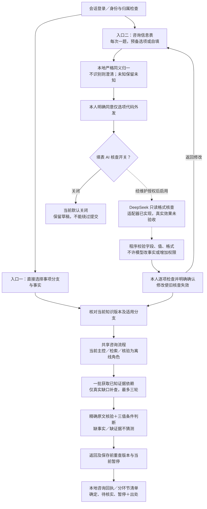
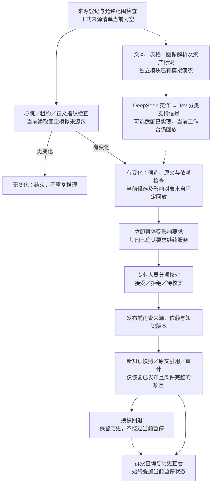

# 完整流程与大赛达标核对

核查日期：2026-10-18（Asia/Shanghai）。源码基线：`c5b083407fbb29c48c3fb7c42e40b66cb5263226`，分支 `codex/sync-m1-m2`。本报告覆盖新问答填表入口、原咨询流程、资料更新、权限隐私和比赛交付；不启用模型，不修改业务配置，不执行正式提交。

## 1. 总结：方向符合，但还不能认定全部达标

**目前是“有较完整安全边界和更新机制的模拟决策系统”，还不是“已完成真实资产、本体演化、多跳推理和业务效果验收的参赛成品”。**

- **方向符合**：政务是第三题允许的行业，不必为了参赛扩展到医疗、金融等多个行业。
- **工程闭环基本具备**：直接咨询、结构化证据核验、冲突暂停、人工分项复核发布、版本回退和追溯均有模拟验证。
- **新入口有明确阻断**：可以逐项填写，但默认 `form_verifier_enabled: false`，真实 DeepSeek 核查未启用时不能继续完成该入口的核查与提交。离线回放通过不代表默认服务已能全程调用 AI。
- **核心任务仍有缺口**：低资源本体半自动构建及可执行演化、真实跨文档多跳、新流程的 Nexent 原生模型编排、独立业务评测尚未证明完成。
- **不能宣布可正式交付**：代码已推送不等于作品已提交赛事；官方模板原件、当前材料截止时间、提交包与干净环境复现仍需核定。

本报告更新此前 [10-17 匹配度复核](参赛匹配度与竞争力复核-2026-10-17.md) 和 [10-18 缺口图](当前流程与参赛缺口图-2026-10-18.md) 的当前状态。旧文中的测试数量、未提交文件和未上传描述是历史快照；本次核查开始时工作区干净，当前源码与证据已纳入上述提交，但这不会自动补齐业务和算法缺口。

## 2. 官方依据与核查范围

赛题为第十一届创新赛第三题：**基于华为 ModelEngine Nexent 打造可进化决策智能体**。任务及历史评分依据 [官方赛题摘录](官方赛题摘录.md)，该文在 2026-10-13 对照了官网。2026-10-18 再次读取 [官方赛事入口](https://e.huawei.com/cn/talent/#/ict/innovation-details?zoneCode=027425&zoneId=98269700&compId=85132021&type=C002)，仅得到需要 JavaScript 的页面外壳，未重新取得任务、评分表或提交期限。因此，下文是**按已归档官方要求与当前项目证据的对照**，不是赛事方认证，也不声称已实时确认规则没有更新。

归档中的初赛四维为：智能体编排与 MCP/Skill 深度集成、资产激活的业务价值、算法创新与低资源本体效率、交互体验与复用能力，**各 25%**。缺口会交叉影响多个维度，不能把权重相加当扣分，也没有依据给出完成百分比或获奖概率。

## 3. 完整流程：先分清正在运行与准备接入

图例：实线是当前程序路径；虚线是已准备但真实接入或效果尚未验收的路径。整个现有工作台仍处于模拟资料范围，实线不代表真实政务业务已验收。

### 3.1 群众咨询与新增问答填表

关键细节：

1. 新入口是模拟事项的**咨询信息表**，不是正式申请表，不采集姓名、证件号、手机号、地址或附件，也不连接政务正式提交系统。
2. 四个字段为办理原因、年龄组、是否本人办理、模拟电子表校验结果。固定问题由字段规范驱动，不是每句都调用 AI；自由输入也不是开放式意图理解，仅接受已注册、无歧义的同义表达。
3. DeepSeek 只核查规范选项代码和显示格式，不接收原始回答或会话标识，不判断真实资格，不补全未知，不具有工具、发布或提交权限。
4. 编辑后必须重新核查和人工确认；知识版本改变也不能使用旧核查提交。重复提交同一核查仅生成一个本地咨询记录。
5. 遗失、代办或关键条件未知，不自动套用成年本人分支。模拟电子表“通过”不表示系统校验过真实电子表或身份。
6. 原入口不要求先经过新填表 AI，继续保留结构化咨询能力；两者最终共用证据、规则、暂停与追溯链，而非维护两套答案逻辑。

### 3.2 资料、知识更新与专业人员复核

这里有两条尚未合并验收的路径：独立多模态资产准备模块，以及新决策工作台的模拟更新模块。已有解析器不代表真实多模态资产已经贯通到正式知识和决策；已有英译/Jev 适配器也不代表工作台正在调用它们。

当前工作台显式使用 `SyntheticReplay` 和 `WiredRoles` 的离线调度；变更对象由模拟包预先指定。发布的新本体建议仍为 `executable: false`。因此，“收到变更后可暂停与发布”已经有工程机制，但“自动从真实资料发现新关系、识别影响并让新本体参与查询”仍缺实现及验收。

### 3.3 权限与隐私贯穿全程

| 边界 | 已有控制 | 仍不能宣称完成的部分 |
| --- | --- | --- |
| 群众与其他会话 | 草稿与历史归属校验、同源 POST、HttpOnly/SameSite cookie；别人包括专业人员不能读写其草稿 | 不等于正式实名身份认证或政务账号对接 |
| 群众、专业人员、维护者 | 咨询、知识发布、维护调用分开；模型没有发布或提交权 | 维护 MCP 的租户/用户身份仍依赖可信 Nexent 注入，生产身份绑定待验收 |
| 资料外发 | 嵌套私密/未知标签拒绝；来源授权和撤权检查；译文与原文保持关联 | 翻译不是脱敏；英译链仍会向 DeepSeek 发送中文，再向 Jev 发送英文及必要溯源信息，不能承诺零外发 |
| 新填表外发 | 只发送规范模拟代码及字段选项；单独同意；不发送原回答或凭据 | 代码本身也表达情况，真实个人业务扩展仍需重新评审，不可只改标签 |
| 草稿与审计 | 原回答仅留当前会话内存；提交后清除原回答；30 分钟逻辑过期；不使用浏览器持久化草稿 | 不是后台定时物理擦除、内存加密或云服务商零保留保证 |
| 更新与回退 | 来源有效性、依赖、版本、当前暂停在关键提交点复查 | 不等于已验证所有真实政策影响，也不是安全合规认证 |

这些控制值得保留，是可信政务演示的基础，但不能替代赛题的本体、推理和效果要求。真实资料或模型外发前还应确认授权、用途、最少字段、保存/删除和服务商策略；不要把真实资料改成 `synthetic` 绕过现有限制。

## 4. 对照大赛：哪些达到，哪些还没有

“P0／极高”为核心任务或关键证据缺口；“P1／高”为交付完整性或重要质量风险；“P2／增强”为可选优化。这是项目排期优先级，不是官方扣分或安全漏洞等级。

| 要求／评审关注 | 当前能力与证据 | 达标判断 | 影响与最小补齐条件 |
| --- | --- | --- | --- |
| 选择一个允许行业 | 政务事项模型和咨询窗口 | **方向满足** | 无需为基础达标扩多个行业；先把一个真实事项做透 |
| 多模态异构资产统一识别、理解、标识 | TXT、CSV、PNG/OCR 独立演练，资产 ID、指纹、定位；新工作台仍用模拟文本包 | **部分实现** | **P0／极高**：三类资料进入同一资产→候选→查询链；至少一项结论必须联合表格或图中信息，OCR 不等于图文语义理解 |
| 低资源本体半自动构建 | 手工种子、类型约束、候选复核框架 | **核心方法未验收** | **P0／极高**：少量种子驱动真实候选类型/关系/约束；记录人工投入和正确采纳量，与基线比较；不能用小模型参数量代替少标注效果 |
| 本体持续动态更新 | 知识版本、候选、复核、回退；本体登记建议不可执行 | **部分实现** | **P0／极高**：至少一种新关系/约束从提出到确认、实例兼容、实际查询生效和回退；只改材料要求或版本号不算本体演化 |
| 与行业规范、标准体系对齐 | 条款、适用范围、引用及对齐结构，当前为模拟 | **未取得真实对齐证据** | **P0／高**：真实规范条款、映射理由、地区/对象/生效时间和例外复核，以及可回溯的业务结论 |
| Nexent MCP/Skills 深度集成，检索—推理协同，平台可运行 | 历史原生调用及接线证据；当前主流程为离线角色，DeepSeek 草稿绑定未验收 | **接线有基础，当前原生执行未达验收** | **P0／极高**：当前链路真实主 Agent→子 Agent→MCP/Skill 调度轨迹及失败恢复。打开开关不等于替换离线执行器；旧 Qwen 结果不能替代新 DeepSeek 链路 |
| 跨文档多跳推理 | 固定关系依赖、证据核验、三值规则、一轮取齐及缺口补查 | **未证明真正多跳** | **P0／极高**：留出任务必须联合不同文档，展示每跳关系、出处与条件；多轮检索、条件树或预写路径不能冒充自动多跳 |
| 决策链路可溯源 | 原文、定位、版本、依赖、审计、历史及当前暂停检查 | **模拟工程层较完整** | **P1／高**：迁移真实来源验证；证明错误引用被拒、历史可复现且撤权/冲突不会被旧快照绕过 |
| 激活存量资产的业务价值 | 可理解的咨询和资料变更演示；独立评测模板 `cases: []` | **未证明业务达标** | **P0／极高**：独立答案、真实或经授权脱敏资产；对照人工/普通 RAG，测错误确定项、遗漏、引用支持、复核时间、延迟和费用 |
| 可复用、快速部署的 Skill 模板 | 已有配置、查询/维护 Skill、导出与脚本 | **部分实现** | **P1／高**：第二事项或地区迁移、记录代码/配置改动；在干净 Nexent 实例复现，不把文件存在当作复用已证实 |
| 交互体验 | 两个入口、未知处理、人工检查、回执和刷新恢复；新入口真实核查关闭 | **模拟交互较完整** | **P1／高**：真实核查成功/失败/限流及版本变更情况下的真人使用验证；不增不必要表单和角色 |
| 正式评测材料及可复现交付 | 源码、配置和模拟证据已进入 Git；有历史导出 | **尚未完成交付核验** | **P1／高**：取得官方 Word 原件，填写当前设计、图谱、原始数据、处理、模型工具、调用关系和真实调试截图，配套 Agent JSON、知识库、MCP/Skills；决赛另需 PPT；确认截止时间和上传回执 |
| Jev＋英文翻译 | 批量、预算、缓存及翻译适配已有代码；最新 Jev 证据为 403；英文精度未测 | **可选增强未实测** | **P2／中**：权限恢复后比较中文直连和英译；测否定/数字/限定词、支持判断、延迟和总成本。Jev 不是官方强制组件，不应阻塞其余核心建设 |

归档还记录：同校 3 名学生及 1 名指导教师；入围中国总决赛第三题作品须开源至 GitCode 或 GitHub；多行业迁移和真实脱敏数据属于附加分方向。**仓库已推送不是仓库公开可访问性、数据许可或完整可复现性的证明**；这些仍需在交付时核对。报名截止不能当成作品提交截止，历史的报名/课程/作品列表记录也不是今天的实时状态。

## 5. 已经验证了什么，证据有多强

| 证据 | 本次核对结果 | 不能推出的结论 |
| --- | --- | --- |
| `evidence/guided-intake-20261018/regression.xml` | 562 tests，0 failures，0 errors，0 skipped；此前记录有 3 个既有依赖警告 | 不等于真实模型精度、跨文档业务正确率或大赛给分；本次未重跑全部测试 |
| `evidence/guided-intake-20261018/verification.json` | HTTP 生命周期 14/14；`actual_remote_model_calls: 0`；9 条源码/配置指纹本次全部一致 | 假核查器不是 DeepSeek 实测；不是正式申请验收 |
| `evidence/guided-intake-20261018/existing-workflow/verification.json` | 原流程 21/21；明确为模拟工程；13 条指纹本次全部一致 | 不证明真实官网采集、真实 Jev 或新 Nexent 原生流程通过 |
| `evidence/deepseek-cloud/latest.json` | 10-17 记录真实推理尝试为 0，`native_drafts_bound: false` | 不是当前服务实时探测，也不是可用性保证 |
| `evidence/jev-live/latest.json` | 10-17 最后网关请求 HTTP 403、模型访问受限 | 不是今天重新调用；没有成功结果可算真实分类准确率 |
| 当前配置与源码 | 两个推理开关均 false；正式来源为空；新增云向量 `unconfigured_cloud`；主流程仍离线回放 | 稀疏检索并非不可用；也不能把有适配器当作真实服务已启用 |

重要代码定位：`src/gov_mcp/decision/workflow.py` 的 `Workflow.__init__`、`_execute_query`、`_packet`、`_extract_packet`、`publish`；`src/gov_mcp/decision/connections.py` 的 `WiredRoles.invoke`；`src/gov_mcp/decision/intake.py` 的 `DeepSeekFormVerifier`、`GuidedForm.review/submit`。新入口的完整权限与数据流见 [问答填表入口与隐私边界](问答填表入口与隐私边界.md)。

## 6. 最划算的补齐顺序与验收门

1. **先固定一个真实事项及独立答案。** 一个地区，指南＋材料表＋补充通知/规范；审查公开来源、使用许可与隐私，保存版本和定位。由未参与提示词调试的人核对留出答案；同案例改写不能跨训练/开发/评测分组。真实数据接入前应设计并验证允许路径，不能直接解除 `synthetic` 限制。
2. **统一资产链，同时做一个真正的本体演化案例。** 接现有解析器，少量种子生成可审查候选；演示一种新关系或约束经人工确认后改变查询结果，并能安全回退。衡量每专家分钟正确采纳量和错误发布数。
3. **用同一案例证明跨文档推理和变化影响。** 让单份资料不足以作答；逐跳展示依据。对真实资料做明确标注的受控变更，自动识别依赖影响，比较局部重核和全量重核的漏检与成本，不能预写影响目标。保留独立核验和人工发布。
4. **最后授权真实模型，并验收当前 Nexent 原生链路。** 不仅启用开关，还要完成离线执行器替换、严格输出转换、模型/Skill 绑定、真实轨迹和异常恢复；填表核查单独验收，不联动开启其他外发。云向量仅在召回实验需要时配置，不能用聊天模型替代 embedding。Jev 作为独立辅助路线测量，不为了用而用。
5. **补对照、复用和正式提交包。** 同资料同模型比较普通 RAG、关系/条件方案及增量方案；测正确性、引用、专家时间、变化影响、延迟和费用。迁移第二事项并在干净环境复现；再按当前官方模板整理上传材料、核对期限与回执。

建议保留：双入口共享查询链、只对真实缺口补查、未知不猜、原文与正式知识分层、模型无发布权、人工复核发布、当前暂停、来源撤权和版本重查。建议暂缓：增加更多 Agent、扩多个行业、重复小样本试训、大库扩容和继续堆页面功能。

**下一阶段的主线应从“再加一个入口”转为“一条真实且可复现的资产→本体→多跳决策→变化影响→人工确认闭环，并用独立对照证明有效”。这条证据链补齐后，才适合宣布核心要求达到。**
