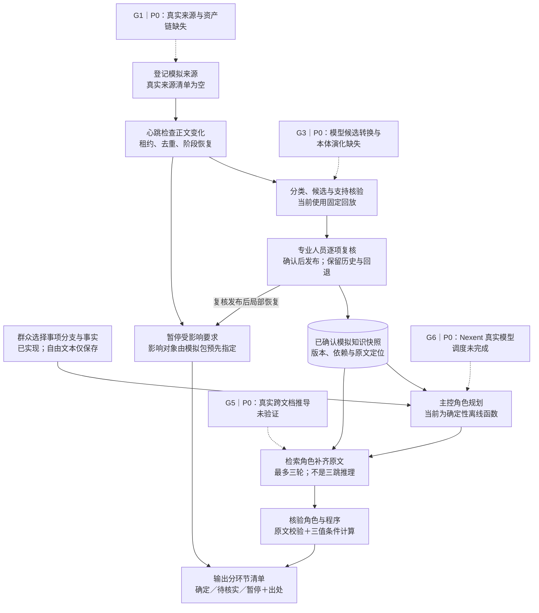
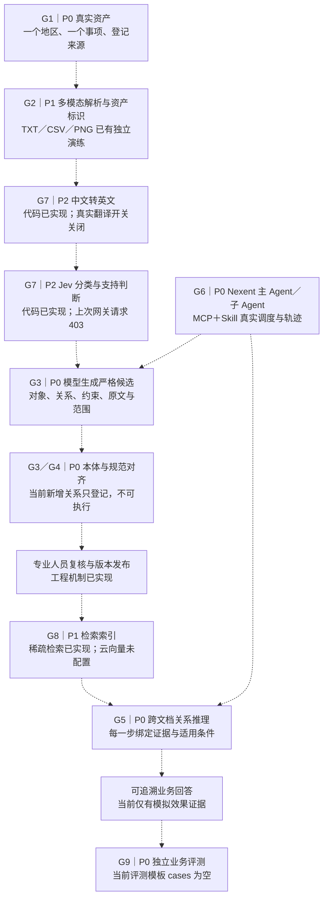

# 当前程序流程、参赛缺口与优化优先级

核查日期：2026-10-18，Asia/Shanghai。依据当前源码、配置及已有验证产物；本轮只做分析与文档整理，没有调用模型、启用服务或改变业务配置。

后续 [流程复查与精简](流程复查与精简-2026-10-18.md)已将已知证据合并为一轮获取，真实缺口仍最多三轮，当前回归为 443 项；下文保留首次缺口核查时的证据范围。核心参赛缺口未因取证批次减少而自动补齐。

## 先看结论

当前已有可操作、可持久化的模拟业务闭环，强项是证据追溯、条件未知处理、冲突暂停、分项复核发布和历史回退。距离完整参赛作品的主要差距是：**真实资产进入同一流程、少量种子引导的本体构建与可执行演化、真实跨文档推理、新流程在 Nexent 中实际由模型调度、独立业务效果评测。**

Jev 批量判断与英文翻译层已实现，但主工作台显式注入 `SyntheticReplay`，不会自动使用这些真实模型适配器。把推理开关改为 `true` 也不会自动替换 `WiredRoles` 的离线执行函数。

“已实现”指有代码或工程验证；“未实测”指尚无当前路线的真实模型/真实业务证据；“缺失”指核心实现或闭环尚未完成。影响与优先级是工程判断，不是官方扣分、完成百分比或获奖预测。

## 图一：当前真正执行的工作台流程

图中所有资料、知识和发布操作均处于模拟工程范围。实线表示当前执行，虚线表示缺口标注，不能把虚线理解为已经接通。

关键代码：`src/gov_mcp/decision/workflow.py` 的 `_execute_query`、`_packet`、`_extract_packet`、`_process`、`publish`；`src/gov_mcp/decision/connections.py` 的 `WiredRoles.invoke`。

## 图二：已准备的模块与仍待接通的参赛主线

下图是需要补成的统一主线；虚线均表示待集成或待验收。模块有实现不代表整条链已经运行。

这里将 Jev 画为现有设计中的可选辅助环节，不把它视为赛题强制组件。规范推理与正式发布条件仍由可审查的知识结构、程序和专业人员控制。

## 影响程度如何理解

- **P0／极高**：阻碍核心任务达标，或无法证明作品确实满足要求，应优先补。
- **P1／高或中高**：主线已有基础，但影响完整性、质量或复现能力，随后补齐。
- **P2／中或较低**：增强效果与工程效率；应在核心链路可评测后决定投入。

P0 是项目优先级，不是安全漏洞等级。多项缺口会影响同一评分维度，不能把百分比相加当作扣分。

官方赛题的本地归档记录：初赛“编排与 MCP/Skill”“资产业务价值”“算法创新与低资源本体效率”“交互与复用”四维各 25%。本轮重新访问赛事入口仍只能读取动态页面外壳，未实时核验评分表；这里只按 2026-10-13 的归档解释影响。报名期限不能代替作品提交期限，正式提交时间仍需单独核定。

## 缺失细节、影响与完成标准

| 标记 | 现状与具体缺失 | 对比赛的影响 | 优化与验收标准 |
| --- | --- | --- | --- |
| G1／P0 | 当前地区和事项为 synthetic；正式来源数组为空；工作台读取固定模拟包。真实公开来源的授权边界与主流程尚未贯通 | **极高**。真实资产价值缺证据，后续图谱、推理与效果都缺可信输入；重点影响业务价值维度 | 固定一个真实地区和事项，登记公开指南、材料表、补充通知及规范。统一进入资产登记、候选、复核和查询；来源、抓取时间、版本、页码/单元格/图像区域可追溯。不能把真实资料标为 synthetic 绕过限制 |
| G2／P1 | TXT、CSV、PNG/OCR 已有解析演练，但新决策工作台主要接模拟文本；图文关系和表格语义未完成统一决策验收 | **高**。多模态资产认知属于明确任务，只有 OCR 或文件上传不足以证明统一理解 | 同一事项的文本、表格、扫描件均产生统一资产与片段；至少一个决策必须使用表格字段或图中内容，并能定位回原件 |
| G3／P0 | 有种子、知识类型和复核结构，但候选来自固定回放；新增本体项保存为 `executable: false`，缺少结构、依赖和旧实例迁移的执行支持 | **极高**。直接影响低资源半自动本体构建与持续演化，属于主要算法得分风险 | 少量确认种子引导模型提出实体类型、关系或约束；至少演示一种新关系/约束从候选、人工确认、可执行查询到版本回退。记录专家标注量和分钟数，不能只修改实例或版本号 |
| G4／P0 | 已有标准条款与关系槽位，缺少真实行业规范映射和适用性验证 | **高**。规范、标准体系对齐是明确任务；仅有字段不能证明已完成 | 给真实条款建立精确映射，核查地区、时间、对象及例外；展示一条业务结论怎样沿关系定位到适用规范，冲突时转复核 |
| G5／P0 | 固定关系路径、原文核验和三值计算已实现；自由问题尚未驱动完整检索规划；缺少必须联合多份真实资料才能回答的留出任务 | **极高**。跨文档多跳是核心要求；三次检索不能等同三跳推理 | 使用“指南＋补充通知＋规范/表格”设计联合任务，逐步给出关系、证据和条件。用单文档无法得到完整答案的案例证明跨文档必要性；缺事实或证据时给出未知 |
| G6／P0 | 6 个语言模型角色已配置 DeepSeek，MCP/Skill 接线有历史证据；最新配置推理关闭，原生草稿绑定未验收；`WiredRoles.invoke` 仍执行离线函数 | **极高**。Nexent 可运行是基础要求，并直接影响编排与平台深度集成的证明 | 先实现真实执行器与严格输出转换，保留阶段状态与权限。按既定安排最后启用 API，记录主 Agent→子 Agent→MCP/Skill 的真实 request/conversation/tool 轨迹；切开关本身不算完成 |
| G7／P2 | Jev 批量、英文翻译和缓存已实现；真实翻译未调用；Jev 最后记录为 403；当前工作台显式回放，未使用翻译链 | **中**。影响这条辅助判断路径的可用性与效果；Jev 或英译本身不是官方必选项，不能代替本体和推理 | 在访问问题解决且允许实测后，做同案例中文直连/英译后判断对照。测分类、支持判断、翻译数字/否定错误、总延迟及两类模型费用；保留待复核机制 |
| G8／P1 | 已有本地稀疏检索与旧索引读取；新增云端 embedding 为 unconfigured_cloud，新的稠密索引不能按当前配置建立 | **中高**。影响大库召回与新增索引路线，云向量供应商本身并非赛事硬性要求 | 先固定可运行的检索方案并测召回；稀疏检索＋图路径也可作为基线。需要新增稠密索引时再选定向量路线，重建并记录版本，避免混用不同向量坐标 |
| G9／P0 | 最近回归 427 项通过，但独立业务评测模板 `cases: []`；缺专家标准答案、普通 RAG 对照、专家投入与错误发布统计 | **极高**。业务价值和算法效果无法量化支撑，也削弱其他维度的答辩说服力 | 从原始案例分组留出，独立复核答案；同资料同模型比较普通 RAG、关系/条件方案和增量演化方案。分别测错误确定项、遗漏、引用支持、恰当待核实、时间和费用；开发题改写不能混进留出集 |
| G10／P1 | 来源变化、暂停、复核、回退已实现；影响目标由模拟包 `object_id` 预先指定，缺自动语义差异到依赖影响的真实验证 | **高**。会把“可进化”限制在预设更新演示，影响算法与业务价值 | 从真实或明确标注的受控变更得到条款差异，再沿证据依赖传播到要求与任务；比较全量重核和局部重核的影响准确性、漏检及成本，不能预写目标当作算法发现 |
| G11／P1 | 有查询/维护 Skill 模板与导出基础，尚无第二事项或地区的干净环境迁移验收 | **高**。影响交互与可复用 Skill 维度；有模板文件不等于快速复用已证实 | 第二事项只改允许的配置、种子和资料，记录必须改动的代码；在干净实例导入 Agent、MCP、Skills 与数据，复现核心查询和更新链 |
| G12／P1 | 官方 Word/PPT 原件、当前作品材料完整性、同步的源码/配置/证据及干净环境交付尚未完成核验；工作区仍有未提交文件 | **高**。影响提交完整性和评审复现，未核定的提交时间也有组织风险 | 按官方当前模板补设计、图谱、资产、处理、模型、调用关系和真实调试截图；交付 Agent JSON、MCP、Skills、脱敏数据清单、依赖与一键复现。先本地整理，提交/推送另按用户授权执行 |

说明：G4 的任务优先级列为 P0，是因为“规范对齐”应与 G3、G5 一起纳入核心样例；其独立影响描述为“高”，不表示它有单列官方权重。

## 已有优势应保留并用真实案例证明

| 已有能力 | 参赛展示价值 | 还需要什么证据 |
| --- | --- | --- |
| 原文层与正式知识层分开 | 避免未经确认的资料变成确定要求 | 真实候选被拒绝/待复核时，群众端仍可查原文且不误报要求 |
| 条件三值求值 | 用户事实未知时不过度下结论 | 专家确认的例外、缺失事实和冲突案例 |
| 分项暂停、复核和恢复 | 更新影响局部业务，其他内容继续服务 | 从资料差异自动定位影响，并证明漏暂停率可控 |
| 原文定位、快照、审计、历史回退 | 能解释依据，并复现当时结果 | 一条真实结论到原件和当时版本的完整链；回退后仍遵守当前暂停 |
| 批量分类、翻译缓存、预算检查 | 高频判断可控，便于性能与成本优化 | 含翻译成本的端到端对照，不将请求数减少当作费用/准确率提升 |

## 建议的实施顺序

以下为建议工作顺序，不修改当前 API 关闭安排，也不是承诺工期。

1. **固定真实样例与独立答案：G1＋G9。** 一个地区、一个事项，覆盖文本、表格与扫描件；资料同伴核实来源和答案，开发先完成数据边界、资产结构与回放测试。
2. **打通统一数据与候选结构：G2＋G3。** 接现有解析，定义可验证的实体、关系、约束、适用范围、原文引用和模型输出转换；禁止靠固定 `object_id` 伪装自动提取。
3. **做一个真正的本体演化与规范对齐案例：G3＋G4＋G10。** 用少量种子提出新的关系/约束，确认后改变查询行为；演示依赖影响、局部复核和回退。
4. **完成跨文档任务：G5＋G8。** 先保证证据链和召回可测，再决定是否需要新增云向量，记录普通 RAG 基线。
5. **最后接通并验收模型与平台：G6；按需要验证 G7。** 替换离线执行器，绑定真实草稿模型，跑真实主/子 Agent 调用轨迹；Jev 与翻译按独立质量和总成本决定是否保留在关键路径。
6. **补效果、迁移和交付：G9＋G11＋G12。** 在同一批独立案例上完成对照，然后换第二事项，按模板整理可复现提交包。

暂缓扩更多 Agent、多个行业、重复本地试训、先行大库扩容和界面美化。当前更高价值的投入是：**一条真实且可复现的资产→本体→推理→变化影响→人工复核闭环，以及证明它有效的独立对照。**

## 证据索引与范围

| 证据 | 本次核对到的事实 | 不代表什么 |
| --- | --- | --- |
| `src/gov_mcp/decision/workflow.py:50`、`:184`、`:427`、`:492`、`:522` | 模拟初始化、离线检索核验、固定来源包与候选回放 | 不代表真实自然语言提取或真实官网更新 |
| `src/gov_mcp/decision/connections.py` 的 `WiredRoles.invoke` | 只准备路由后调用 offline.invoke | 不代表云模型已驱动主工作台 |
| `config/decision/connections.json` | 推理关闭，6 个 DeepSeek 角色，Jev 端口凭据引用为空 | 不代表 Vercel 与 TypeSafe 凭据通用或已解除访问限制 |
| `config/knowledge/heartbeat.json`、`config/preparation/profile.json` | 正式来源为空，云向量未配置，准备场景为 synthetic | 不代表现有模拟检索完全不可用 |
| `src/gov_mcp/decision/workflow.py` 的 publish | 新本体项登记为不可执行 | 不代表完整本体结构演化 |
| `src/gov_mcp/jev_translation.py`、`tests/test_jev_translation.py` | 英文输入、缓存、数字检查、原文关联的实现与离线测试 | 不代表实际英译语义正确或 Jev 精度提升 |
| `config/preparation/evaluation.template.json` | 独立评测模板案例为空 | 不代表业务准确率已测量 |
| `evidence/jev-translation/regression.xml` | 最近一次 427 项通过、0 失败，3 条依赖警告 | 工程回归不是业务准确率，也不是本轮重新运行全部测试 |
| `evidence/deepseek-cloud/latest.json` | 2026-10-17 记录推理请求为 0、原生草稿未绑定 | 不是当前运行服务的实时探测 |
| `evidence/jev-live/latest.json` | 2026-10-17 最后网关记录 HTTP 403、免费层模型受限 | 不是 2026-10-18 再次调用的结果 |
| [官方赛题归档](官方赛题摘录.md)、[10-17 匹配度复核](参赛匹配度与竞争力复核-2026-10-17.md) | 核心任务、历史评分摘要与先前差距依据 | 不是新发布规则的实时核验 |

本轮尝试读取 [官方赛事入口](https://e.huawei.com/cn/talent/#/ict/innovation-details?zoneCode=027425&zoneId=98269700&compId=85132021&type=C002)，页面依赖 JavaScript，未取得评分表；[Nexent 官方仓库](https://github.com/ModelEngine-Group/nexent)仍提供平台工具、Skills 和编排背景，当前项目实际状态以上述本地固定代码与证据为准。团队不能把平台原有能力直接当作本项目原创贡献。
