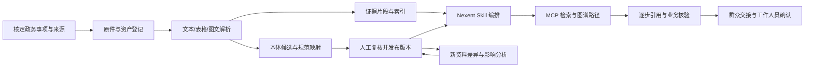

# 政务方向：赛事网上流程与 Nexent 工具链实操

日期：2026-10-13（Asia/Shanghai）。范围：先熟悉比赛入口与工具生命周期，再进入真实政务资料闭环。正式赛题与评分见 [官方赛题摘录](官方赛题摘录.md)。

本轮已恢复本机服务，重新执行群众、工作人员的原生链路，并新增独立 Skill/MCP 演练 Agent。随后已在内置浏览器核实队伍组建成功、选择第三题，加入学习空间和 Nexent 开发课；课程仍为 0%，作品列表为空，资源到账与模板落盘未确认。期间发生 Docker WSL 启动故障，已正常重启恢复，14 个容器重新启动、七项就绪检查全部通过。详细状态见 [网上流程核查记录](网上流程核查记录.md)。

## 先认清每个工具的位置

| 对象 | 做什么 | 本项目怎么用 | 当前状态 |
| --- | --- | --- | --- |
| 华为人才在线 | 报名、队伍、学习空间、通知、附件提交 | 核对第三题选择、队员与教师、资源资格、正式模板和截止时间 | 队伍与第三题已核实；学习已加入；资源和附件待补齐 |
| ModelEngine Nexent | 智能体开发与运行平台 | 配置模型、知识库、MCP、Skills、Agent、版本与会话 | 本机 v2.7.0 完成演练；Docker 故障重启恢复、七项就绪通过 |
| MCP | Agent 调用外部能力的协议 | 自研资产解析、图谱、证据检索、核验、更新工具 | 原政务三工具已实测 |
| Skill | 把工具使用步骤、配置、输入输出和失败规则打成可复用工作流 | 资产认知、证据推理、知识演化三类工作流 | 新技术演练 Skill 已上传、绑定、执行及打包导出 |
| LLM | 理解任务并选择/调用工具、生成有依据的结果 | 现有 Ollama Qwen3 4B/8B | 两个 LLM 配置；本轮运行 4B |
| Embedding | 把文档片段转成可检索的向量 | Nexent 知识库的向量检索 | 2026-10-14 已接入 qwen3-embedding:0.6b；1024 维、原生连通性通过；原生知识库入库另验 |
| VLM/OCR | 理解图文或识别扫描文本 | 图文、扫描件与表格结构处理 | 2026-10-14 独立 RapidOCR 中文图片演练通过；复杂图表与 VLM 尚未验证 |
| 资料处理服务 | 解析文件、切分、入库 | Nexent data-process 或独立解析 MCP | 完整解析链路尚未启用 |
| 数据存储 | 保存原件、索引、关系和业务记录 | 平台已有 MinIO、Elasticsearch、PostgreSQL 等；自研工具现有空 SQLite | 基础服务运行；非空业务模型未实施 |
| GitHub/GitCode | 源码、版本、可复现交付和开源 | 自研工程、Agent/Skill/MCP 配置与说明 | 已有共享分支；本轮未推送或提交赛事 |

Nexent 是平台；MCP 是调用协议；Skill 是指导智能体完成任务的工作流；LLM、Embedding、VLM 分别承担不同模型职责。文档能上传、能向量检索、能抽取图谱、能多跳推理，是不同阶段，应逐一验证。[官方知识库说明](https://modelengine-group.github.io/nexent/zh/user-guide/agent-development/knowledge-configuration.html)、[官方 Skills 说明](https://modelengine-group.github.io/nexent/zh/backend/skills/overview.html)

第三题采用 Nexent 本地开发路线。CodeArts 在第一题被列为必选工具，AgentArts 是第二题的核心平台；公共页面的入口不应合并成第三题必装清单。第三题的官方核心是 Nexent、MCP、Skills 与领域资产/本体/推理/演化。[赛事官方页面](https://e.huawei.com/cn/talent/#/ict/innovation-details?zoneCode=027425&zoneId=98269700&compId=85132021&divisionName=%E4%B8%AD%E5%9B%BD%E5%8C%BA&type=C002&isCollectGender=N&enrollmentDeadline=2026-11-30%2023%3A59%3A59&compTotalApplicantCount=2493)

## 赛事网上流程：按顺序核查

| 步骤 | 在哪里操作 | 完成的证据 | 本轮状态 |
| --- | --- | --- | --- |
| 1. 账号与队伍 | 赛事页面→大赛报名 | 真实队伍状态、第三题选择、3 学生/1 教师及审核结果 | 组队成功与第三题已核实；未显示独立审核状态 |
| 2. 学习空间 | 同一赛事页面→学习空间 | 本届创新赛空间名称、第三题考纲/课程、资源入口 | 学习空间与 Nexent 开发课已加入；课程仍为 0% |
| 3. 下载正式模板 | 第三题的 Word/PPT 链接 | 实际 .docx/.pptx 文件、来源、下载日期、文件指纹 | 链接及 Word 元数据已核实；附件未确认落盘 |
| 4. 资源资格和申请 | 学习空间/赛事通知提供的本队入口 | 可用资源种类、适用赛段、额度、期限及申请结果 | 未核验；不以其他赛题资源说明替代 |
| 5. 附件上传预检 | 赛事页面→附件上传 | 阶段、文件类型/大小、数量、命名和确切截止时间 | 列表为空；压缩包类型/大小/数量/命名限制已读，具体截止时间未显示 |
| 6. 正式提交 | 确认最终材料后提交 | 系统回执、文件清单、版本和提交状态 | 尚未提交 |
| 7. 入围后开源 | GitHub 或 GitCode | 仓库可访问性、许可证、复现步骤和开源截图 | 条件性要求；依入围与团队决定执行 |

报名页面的信息可能涉及学校、人员及联系方式；本机记录保存核验结果，公开证据只保留必要且经核定可公开的内容。资源购买、正式报名及材料提交先准备具体结果再完成相应最终步骤。

报名截止为 2026-11-30；初赛在 2026 年 12 月。作品附件的确切提交日时仍应在登录后的入口和通知核定。

模板入口：

- [第三题初赛开发设计 Word](https://e.huawei.com/cn/talent/backplatform/#/download?fileId=16462&edocId=M3T1A82N1301249787291177249)
- [第三题全国总决赛答辩 PPT](https://e.huawei.com/cn/talent/backplatform/#/download?fileId=16465&edocId=M3T1A82N1301250514189910157)

## 本机已实际跑到哪里

本轮由已有 Docker Desktop 恢复 14 个平台/基础容器。配置服务、原生运行服务、原 MCP、页面、容器到 Ollama、沙箱、SDK 错误覆盖七项检查均通过。日常页面是 `http://127.0.0.1:3000`。

| 实测 | 真实结果 | 意义 |
| --- | --- | --- |
| 群众会话 131 | 15.63 秒；`EMPTY / NO_KNOWLEDGE`；真实主→群众子 Agent→检索工具与审计一致 | 路由、身份、调用与空知识停止通过 |
| 工作人员会话 132 | 8.82 秒；`BLOCKED / MISSING_CASE_AND_MATERIALS`；真实主→工作人员子 Agent→核验工具与审计一致 | 原生核验前提阻断通过 |
| 独立 Skill Agent 会话 136 | 4.05 秒；先 `read_skill_md`、后 `get_environment_status`；真实 `OK / ENVIRONMENT_READY` 与审计匹配 | 已确认绑定的 Skill 在原生 Agent 内实际加载并联用 MCP |
| 配置导出 | ZIP 中包含 `agent.json` 和 `skills/ict-toolchain-probe.zip`；内层含实际 SKILL.md | 已验证 Agent 与 Skill 一起打包；中文内容已核对 |

前两项记录：[本轮原生链路汇总](../../evidence/toolchain/20261013T144548Z/summary.json)。Skills 完整流程：[本轮 Skills 汇总](../../evidence/toolchain/skill-probe-20261013/summary.json)。新增 Skill ID 为 1、Agent ID 为 4，名称“​​ICT工具链演练：Skill与MCP”；原三个 Agent 的发布版本仍为 14。

初次 Agent 导入遗漏必填 `mcp_info`，修正后完成；进一步检查发现仅声明 skill_names 不足以建立该导入路径的实际实例绑定，已显式绑定并重新发布。导出是外层 Agent ZIP 嵌套 Skill ZIP，已按两层结构验证。初次上传的中文自动编码识别异常，经固定平台的 UTF-8 更新入口修复，并核对数据库内容和实际导出的中文。失败/中间检查记录保留在同一证据目录；不把中间通过当作最终完整生命周期通过。

两份入口脚本：

```powershell
Set-Location 'C:\Users\18133\Desktop\ICT'

# 检查环境与资源；不运行模型，不重新发布原 Agent
.\.venv\Scripts\python.exe scripts\probe_topic3_toolchain.py

# 在现有测试账号中创建群众/工作人员各一条新会话
.\.venv\Scripts\python.exe scripts\probe_topic3_toolchain.py --run-native

# 上传/修复演练 Skill，创建或复用独立 Agent，执行并导出
.\.venv\Scripts\python.exe scripts\run_topic3_skill_probe.py
```

原始 SSE、身份信息和完整导出保存在私有 `.runtime/toolchain/`；公共 evidence 只保留去掉凭据的结果摘要。导出文件还未在另一台机器重新导入验证，不宣称已完成跨机迁移。

上述均为本轮技术演练。原业务库的 evidence、cases、materials 三表仍为零；没有导入政务原文，也未实现多模态业务、本体、多跳或动态更新。本轮没有新做本地 Nexent 网页截图验收；官网在线流程核查和课程加入截图见新增记录。最新 Docker 已正常重启恢复，七项就绪通过，未因恢复操作重新采集模型会话。

## 自己在 Nexent 页面走一次

1. 在 3000 页面使用本机平台账号登录。华为官网账号与本机 Nexent 账号属于不同系统。
2. 打开模型管理：检查两种 Qwen3 文本模型及新增 `ict-preparation-embedding` 的真实连通状态；原生知识库入库需另验，图片文字可先使用已准备的 OCR，复杂视觉任务再接 VLM。
3. 打开智能体开发与 MCP 配置：定位 `gov_blank_mcp`，查看三工具名称、输入和用途；注册工具不等于已绑定到某个 Agent。
4. 打开资源仓库→Skill 仓库→我的 Skill，查看 `ict-toolchain-probe`。检查正文、允许工具和元信息；上传源文件见 [SKILL.md](../../config/skills/ict-toolchain-probe/SKILL.md)。
5. 打开“​​ICT工具链演练：Skill与MCP”，检查已启用的 Skill 与环境检查工具、模型和已发布版本。
6. 在开始问答选择该 Agent，用执行模式发送“请按 ict-toolchain-probe 技能执行一次本地空白技术自检”，展开过程观察先加载 Skill、再 MCP 调用及最终停止。
7. 在开发页导出该 Agent，确认包内同时有 agent.json 和 Skill ZIP。截图记录模型、绑定、过程、结果和导出结构；重新导入应放到独立测试空间。

MCP 服务令牌由后台配置，不能复制到页面截图或 Skill 正文；真实 tenant/user 身份由平台注入，不能通过用户输入自称工作人员获得权限。

## 下一个完整政务资料闭环



最小资料链路要另建 M2 环境，先核定来源，再配置解析服务和模型。原/M1 空库保护继续保留。

按依赖补齐：

1. **来源与任务**：核定一个地区/事项，取得可使用的文本、表格、图文，并写出确实依赖多份文档的人工标准任务。
2. **资料接入**：在独立环境配 Embedding，启用 data-process 或解析 MCP；图文采用并验证 OCR/VLM；保存原件、指纹、定位和失败状态。
3. **资产与本体**：建立统一 asset_id、规则与关系；少量种子本体引导候选，人工核定并与规范条款对齐。
4. **检索与推理**：原文检索与图谱路径共同支持结论，每一步有依据和固定版本；无依据/冲突转人工。
5. **Skills 模板**：把资产认知、证据推理、知识演化分别封装成可配置 Skill，并在 Agent 中实际绑定、执行。
6. **变化与交接**：真实版本变化形成候选，显示影响、人工发布和旧版本回放，贯通同一任务/交接。
7. **独立评测与提交**：业务标准答案、方法对照、引用/路径指标、耗时和复现；按正式模板组织 Word、JSON、知识库、MCP、Skill 及截图。

当前没有必要先购买云资源才能运行技术演练。第三题页面明确的一卡算力支持适用于中国总决赛；本队现阶段的其他资源资格、发放形式和实际到账状态应从登录后的学习空间和赛事通知核对。

2026-10-14 用户明确事项暂不定、后续更换数据，已新增可替换的基础准备：三类模拟原件解析、OCR、统一资产指纹和定位、独立向量化/检索演练、本体种子及评测模板。实测 3 原件、9 片段、1024 维向量；不表示真实政务本体、多跳或原生知识库闭环已完成。入口与替换步骤见 [基础准备与课程说明](基础准备与课程说明.md)。

## 每次操作留下什么记录

| 环节 | 最少记录 |
| --- | --- |
| 官网 | 入口、赛段、操作日时、实际状态、回执；未知/未操作明确标记 |
| 环境 | Nexent 提交、容器/模型版本、资源、入口健康与配置清单 |
| 资料 | 来源、使用范围、指纹、页/段/单元格/图像定位、解析和人工复核 |
| 配置 | Agent JSON、MCP schema、Skill 内容及绑定、版本、模型参数 |
| 执行 | 实际会话/请求号、Skill 加载、工具顺序、证据、版本和停止原因 |
| 效果 | 固定任务、人工答案、对照条件、计数分母、失败与复测 |
| 交付 | 文件清单、指纹、部署/导入步骤、干净环境复现及对应截图 |

这是项目的证据管理建议；官方要求完整 Agent 配置、调试经验、示例截图及配套文件，不应把额外的开发编辑器使用日志自行认定为第三题硬性要求。

## Chrome 连接安装入口

按 OpenAI 官方文档，在桌面应用打开“设置→计算机使用（Computer Use）”，找到 Google Chrome，点击“安装（Install）”进入官方扩展商店。安装后返回设置，应显示“管理（Manage）”；在聊天中通过 @Chrome 指定浏览器。使用安装扩展的同一个 Chrome 配置文件。[官方安装与故障排查说明](https://learn.chatgpt.com/docs/chrome-extension)

本轮 Chrome 控制连接未响应，随后改用已登录的内置浏览器完成队伍、学习和上传控件核查。无需为了已完成的核查重复安装扩展；正式模板原件、资源资格和作品截止时间仍待补齐。
