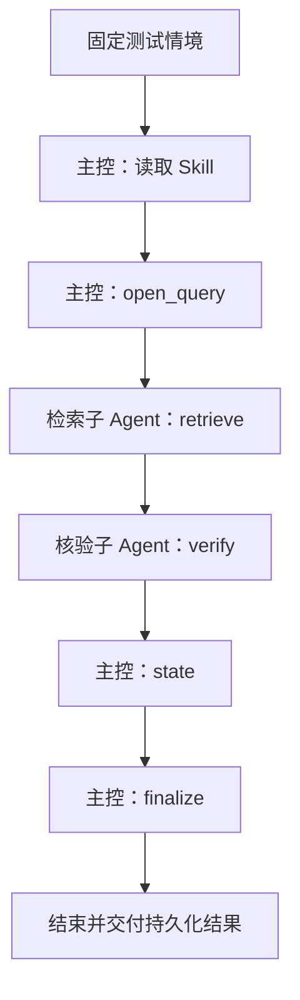

# 第7章 Nexent 智能体配置说明（分章稿）

> 对应本人负责的 7.2、7.4、7.5 节，供陈子炫合稿；7.3、7.6、7.7 节由陈子炫负责。以下配置为所列历史运行时的证据，不代表当前实例实时状态。

## 7.2 工具信息

历史测试使用 SSE 注册项目 MCP 服务，服务凭据通过本地专用令牌管理；正式材料不展示令牌或私有路径。各链业务工具按角色授权：

| 服务或链路 | 历史端口 | 不重复业务工具数 | 用途 |
| --- | --- | --- | --- |
| `govkb_ontology_crossdoc_preview` | 8785 | 5 | 主控 open_query、state、finalize；检索 retrieve；核验 verify |
| 河南新旧资料更新 | 8784 | 5 | 主控 state、finish；整理 get、submit；核验共用 get 并使用 review |
| `govkb_frozen_qa` | 8786 | 2 | `govkb_frozen_retrieve`、`govkb_frozen_verify` |

端口是历史实例配置；部署时须核对实际服务地址、权限和读回结果。更新服务注册名与三个服务的完整注册地址、工具页面截图仍待平台配置读回确认，不以模拟服务截图替代真实业务服务。已停止的辅助服务不应被描述为当前在线。

## 7.4 调用关系图

图 7-1 南京本体推理链调用关系（2026-10-21 归档情境的原生运行，示意图）：

图中完整业务工具名依次为 `govkb_ontology_crossdoc_open_query`、`govkb_ontology_crossdoc_retrieve`、`govkb_ontology_crossdoc_verify`、`govkb_ontology_crossdoc_state` 和 `govkb_ontology_crossdoc_finalize`。图根据该次原生轨迹整理，并非平台运行截图；该次为固定虚构情境、冻结历史资料，执行后本体已回退，业务仍暂停。冻结资料问答是“用户 → 单智能体 → retrieve → verify → 结果”，不应绘成三角色链。Mermaid 源图仍需由合稿人检查显示效果并转换为 Word 可用图像。

## 7.5 调试迭代经验

河南更新链初次运行发现长回执中部内容可能被压缩、整理未提交时仍启动核验等问题；修复时将旧、新材料分为完整视图，增加基于持久阶段的调度门，并在错误时停止。随后 A1—A5 各轮暴露引用校验、子 Agent 结束动作、状态处理及受限导入等问题，经逐项修复后 A6 获得一轮成功：整理和核验子 Agent 均实际提交，产生一条待审候选，正式版本为零。失败记录保留；这不是长期在线更新的证明。

2026-10-31 的独立导入复现另发现：缺少对应 MCP 工具时原始配置无法完整导入；注册仅返回阻断状态的测试占位工具后，两套配置可作为草稿导入，但平台自动创建的本地 V1 中主控 Skill 和子 Agent 关联缺失。该观察基于隔离环境和模拟模型、工具，不是实际业务问答，也未证明正式发布配置完整。建议合稿时将其作为复现限制和待核对问题，而非业务效果。

截图采用说明：配置截图应标明版本、环境、日期并遮盖令牌、账号片段及私有路径；2026-10-31 隔离实例截图仅能证明测试配置，不证明真实 MCP 或真实模型可用。2026-10-30 两题问答截图与南京、河南三角色历史链分别标注，不能混作同一次运行。高清配置图及缺失的历史链截图仍待补。

### 合稿核对来源

- `docs/赛题3资料/南京本体原生统一验收-2026-10-21.md`；`scripts/provision_ontology_crossdoc_native.py`。
- `docs/competition/当前Nexent配置与证据说明-2026-10-21.md` 第三、四节；`scripts/check_successor_autonomy_cloud.py`。
- `docs/competition/自由提问入口与评测运行说明-2026-10-30.md`；同目录 `复现回执-李嘉杰-2026-10-30.md` 和 `截图使用说明-2026-10-31.md`。

