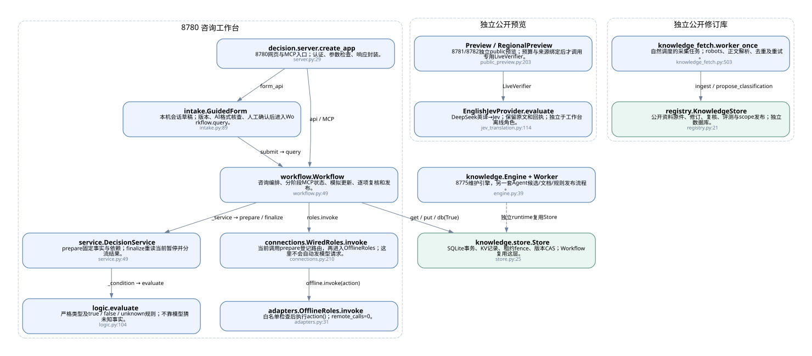
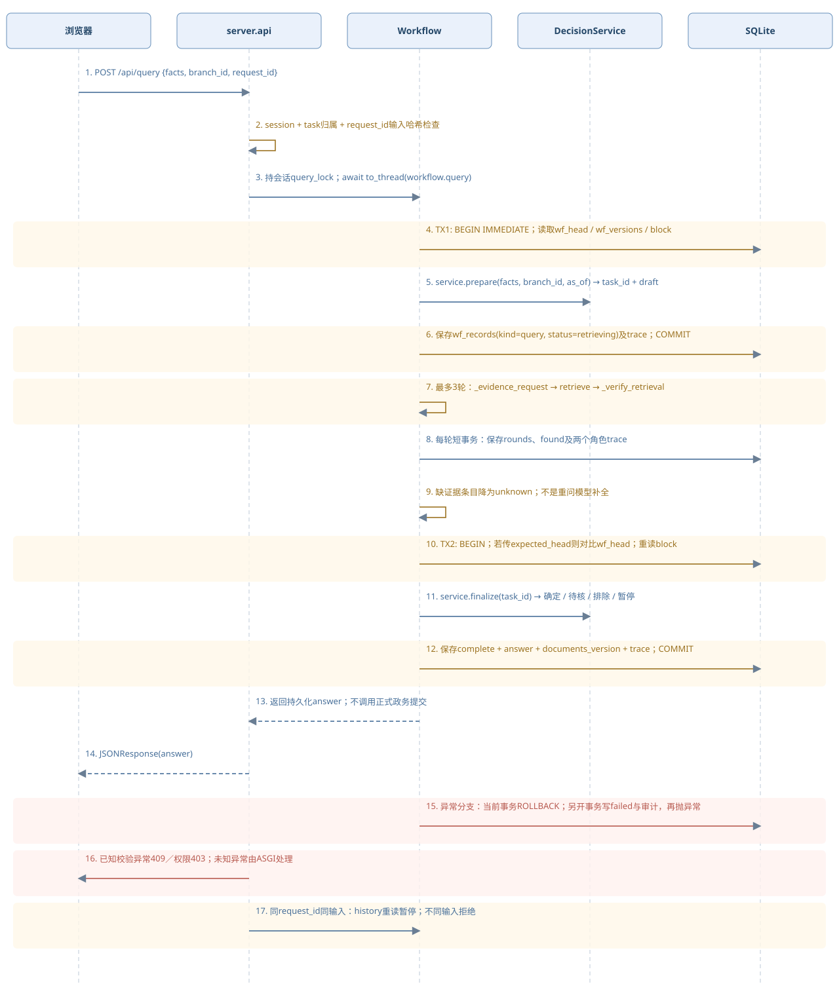
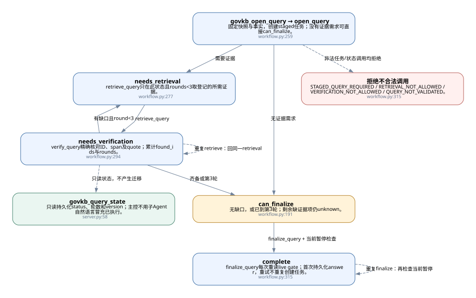
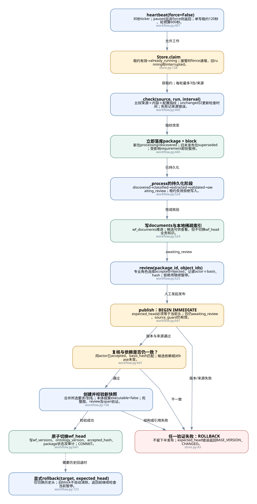
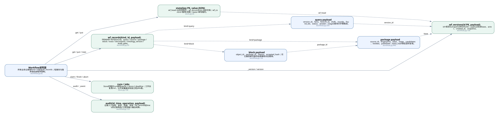
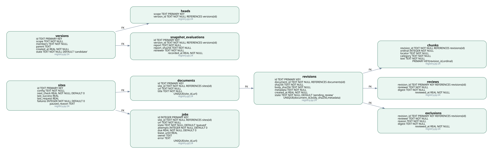
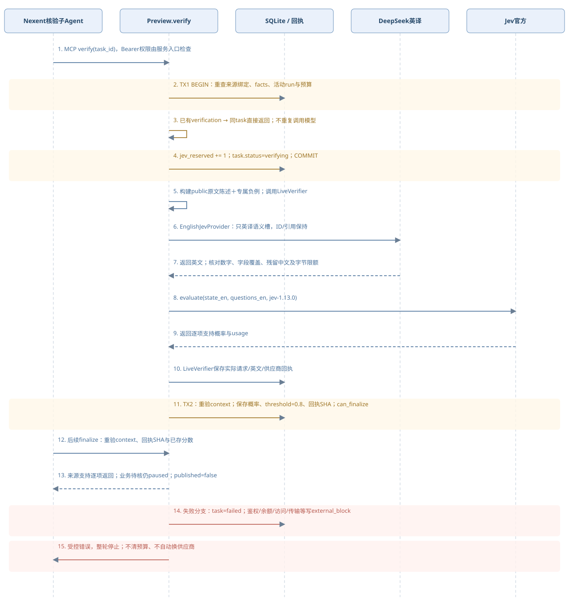
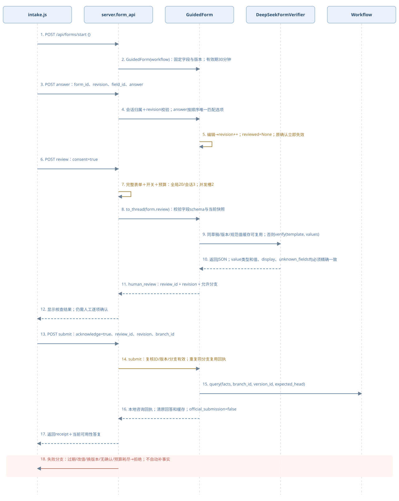

# 开发者流程图：核心调用与数据边界

生成时间：2026-10-19T00:26:25.766312+08:00。按当前工作区源码生成；没有执行业务、模型或采集。

[打开离线交互页面](index.html)。点节点查看对应函数源码；图上保留方法、关键参数、事务、状态、表名及失败出口。

阅读顺序：模块关系→HTTP调用→MCP状态→更新发布→两套数据库→模型预览→表单。蓝色=函数，黄色=校验/事务，绿色=存储，红色=异常；虚线逻辑引用不是DDL外键。

## 01 · 代码模块与调用关系

先看执行入口如何连到代码和存储。虚线表示独立链路，不能理解成已自动互通。

|代码位置|必要说明|
|---|---|
|[src/gov_mcp/decision/server.py:create_app:29](../../src/gov_mcp/decision/server.py#L29)|8780网页与MCP入口；认证、参数检查、响应封装。|
|[src/gov_mcp/decision/intake.py:GuidedForm:89](../../src/gov_mcp/decision/intake.py#L89)|本机会话草稿；版本、AI格式核查、人工确认后进入Workflow.query。|
|[src/gov_mcp/decision/workflow.py:Workflow:49](../../src/gov_mcp/decision/workflow.py#L49)|咨询编排、分阶段MCP状态、模拟更新、逐项复核和发布。|
|[src/gov_mcp/decision/service.py:DecisionService:49](../../src/gov_mcp/decision/service.py#L49)|prepare固定事实与依赖；finalize重读当前暂停并分流结果。|
|[src/gov_mcp/decision/logic.py:evaluate:104](../../src/gov_mcp/decision/logic.py#L104)|严格类型及true / false / unknown规则；不靠模型猜未知事实。|
|[src/gov_mcp/decision/connections.py:WiredRoles.invoke:210](../../src/gov_mcp/decision/connections.py#L210)|当前调用prepare登记路由，再进入OfflineRoles；这里不会自动发模型请求。|
|[src/gov_mcp/decision/adapters.py:OfflineRoles.invoke:31](../../src/gov_mcp/decision/adapters.py#L31)|白名单检查后执行action()；remote_calls=0。|
|[src/gov_mcp/knowledge/store.py:Store:25](../../src/gov_mcp/knowledge/store.py#L25)|SQLite事务、KV记录、租约fence、版本CAS；Workflow复用这层。|
|[src/gov_mcp/public_preview.py:Preview:203](../../src/gov_mcp/public_preview.py#L203)|8781/8782独立public预览；预算与来源绑定后才调用专用LiveVerifier。|
|[src/gov_mcp/jev_translation.py:EnglishJevProvider.evaluate:114](../../src/gov_mcp/jev_translation.py#L114)|DeepSeek英译→Jev；保留原文和回执；独立于工作台离线角色。|
|[src/gov_mcp/knowledge/registry.py:KnowledgeStore:21](../../src/gov_mcp/knowledge/registry.py#L21)|公开资料原件、修订、复核、评测与scope发布；独立数据库。|
|[src/gov_mcp/knowledge_fetch.py:worker_once:503](../../src/gov_mcp/knowledge_fetch.py#L503)|自然调度的采集任务；robots、正文解析、去重及重试。|
|[src/gov_mcp/knowledge/engine.py:Engine:39](../../src/gov_mcp/knowledge/engine.py#L39)|8775维护引擎，另一套Agent候选/文档/规则发布流程。|

## 02 · 一次HTTP咨询的调用时序

必要参数：facts、branch_id、question、可选request_id/parent_task。数据库锁不会贯穿整段检索。

|代码位置|必要说明|
|---|---|
|[src/gov_mcp/decision/server.py:create_app.api:246](../../src/gov_mcp/decision/server.py#L246)|POST /api/query {facts, branch_id, request_id}|
|[src/gov_mcp/decision/server.py:create_app.api:246](../../src/gov_mcp/decision/server.py#L246)|session + task归属 + request_id输入哈希检查|
|[src/gov_mcp/decision/server.py:create_app.api:246](../../src/gov_mcp/decision/server.py#L246)|持会话query_lock；await to_thread(workflow.query)|
|[src/gov_mcp/decision/workflow.py:Workflow.query:160](../../src/gov_mcp/decision/workflow.py#L160)|TX1: BEGIN IMMEDIATE；读取wf_head / wf_versions / block|
|[src/gov_mcp/decision/service.py:DecisionService.prepare:226](../../src/gov_mcp/decision/service.py#L226)|service.prepare(facts, branch_id, as_of) → task_id + draft|
|[src/gov_mcp/decision/workflow.py:Workflow.query:160](../../src/gov_mcp/decision/workflow.py#L160)|保存wf_records(kind=query, status=retrieving)及trace；COMMIT|
|[src/gov_mcp/decision/workflow.py:Workflow._execute_query:205](../../src/gov_mcp/decision/workflow.py#L205)|最多3轮：_evidence_request → retrieve → _verify_retrieval|
|[src/gov_mcp/decision/workflow.py:Workflow._execute_query:205](../../src/gov_mcp/decision/workflow.py#L205)|每轮短事务：保存rounds、found及两个角色trace|
|[src/gov_mcp/decision/workflow.py:Workflow._execute_query:205](../../src/gov_mcp/decision/workflow.py#L205)|缺证据条目降为unknown；不是重问模型补全|
|[src/gov_mcp/decision/workflow.py:Workflow._execute_query:205](../../src/gov_mcp/decision/workflow.py#L205)|TX2: BEGIN；若传expected_head则对比wf_head；重读block|
|[src/gov_mcp/decision/service.py:DecisionService.finalize:250](../../src/gov_mcp/decision/service.py#L250)|service.finalize(task_id) → 确定 / 待核 / 排除 / 暂停|
|[src/gov_mcp/decision/workflow.py:Workflow._execute_query:205](../../src/gov_mcp/decision/workflow.py#L205)|保存complete + answer + documents_version + trace；COMMIT|
|[src/gov_mcp/decision/workflow.py:Workflow.query:160](../../src/gov_mcp/decision/workflow.py#L160)|返回持久化answer；不调用正式政务提交|
|[src/gov_mcp/decision/server.py:create_app.api:246](../../src/gov_mcp/decision/server.py#L246)|JSONResponse(answer)|
|[src/gov_mcp/decision/workflow.py:Workflow.query:160](../../src/gov_mcp/decision/workflow.py#L160)|异常分支：当前事务ROLLBACK；另开事务写failed与审计，再抛异常|
|[src/gov_mcp/decision/server.py:create_app.Gate.__call__:334](../../src/gov_mcp/decision/server.py#L334)|已知校验异常409／权限403；未知异常由ASGI处理|
|[src/gov_mcp/decision/server.py:create_app.api:246](../../src/gov_mcp/decision/server.py#L246)|同request_id同输入：history重读暂停；不同输入拒绝|

## 03 · 分阶段MCP查询状态机

工具调用本身不推理。上游Nexent负责调度；程序以数据库状态决定是否允许下一步。

|代码位置|必要说明|
|---|---|
|[src/gov_mcp/decision/workflow.py:Workflow.open_query:259](../../src/gov_mcp/decision/workflow.py#L259)|固定快照与事实，创建staged任务；没有证据需求可直接can_finalize。|
|[src/gov_mcp/decision/workflow.py:Workflow.retrieve_query:277](../../src/gov_mcp/decision/workflow.py#L277)|retrieve_query只在此状态且rounds<3取登记的所需证据。|
|[src/gov_mcp/decision/workflow.py:Workflow.verify_query:294](../../src/gov_mcp/decision/workflow.py#L294)|verify_query精确核对ID、span及quote；累计found_ids与rounds。|
|[src/gov_mcp/decision/workflow.py:Workflow._verify_retrieval:191](../../src/gov_mcp/decision/workflow.py#L191)|无缺口，或已到第3轮；剩余缺证据项仍unknown。|
|[src/gov_mcp/decision/workflow.py:Workflow.finalize_query:315](../../src/gov_mcp/decision/workflow.py#L315)|finalize_query每次重读live gate；首次持久化answer，重试不重复创建任务。|
|[src/gov_mcp/decision/workflow.py:Workflow.finalize_query:315](../../src/gov_mcp/decision/workflow.py#L315)|STAGED_QUERY_REQUIRED / RETRIEVAL_NOT_ALLOWED / VERIFICATION_NOT_ALLOWED / QUERY_NOT_VALIDATED。|
|[src/gov_mcp/decision/server.py:create_app.govkb_query_state:58](../../src/gov_mcp/decision/server.py#L58)|只读持久化status、轮数和version；主控不用子Agent自然语言冒充已执行。|

## 04 · 变更发现、暂停、复核与原子发布

此图对应8780模拟更新实现。关键点是先暂停受影响项；文档可检索不等于业务规则已发布。

|代码位置|必要说明|
|---|---|
|[src/gov_mcp/decision/workflow.py:Workflow.heartbeat:407](../../src/gov_mcp/decision/workflow.py#L407)|30秒ticker；paused且非force则返回；单写租约120秒、轮预算600秒。|
|[src/gov_mcp/knowledge/store.py:Store.claim:128](../../src/gov_mcp/knowledge/store.py#L128)|租约有效→already_running；接管时fence递增，旧running标interrupted。|
|[src/gov_mcp/decision/workflow.py:Workflow._check:445](../../src/gov_mcp/decision/workflow.py#L445)|比较来源＋内容＋配置指纹；unchanged只更新检查时间；失败记来源错误。|
|[src/gov_mcp/decision/workflow.py:Workflow._check:445](../../src/gov_mcp/decision/workflow.py#L445)|新包processing/discovered；旧未发布包superseded；受影响requirement即刻暂停。|
|[src/gov_mcp/decision/workflow.py:Workflow._process:524](../../src/gov_mcp/decision/workflow.py#L524)|discovered→classified→extracted→validated→awaiting_review；租约失效拒绝写入。|
|[src/gov_mcp/decision/workflow.py:Workflow._process:524](../../src/gov_mcp/decision/workflow.py#L524)|wf_documents推进；候选可供查看，但不切换wf_head业务知识。|
|[src/gov_mcp/decision/workflow.py:Workflow.review:625](../../src/gov_mcp/decision/workflow.py#L625)|专业角色选择accepted/rejected，记录actor＋basis_hash；拒绝项继续暂停。|
|[src/gov_mcp/decision/workflow.py:Workflow.publish:641](../../src/gov_mcp/decision/workflow.py#L641)|expected_head必须等于当前头；包仍awaiting_review，source_guard仍有效。|
|[src/gov_mcp/decision/workflow.py:Workflow.publish:641](../../src/gov_mcp/decision/workflow.py#L641)|同actor已accepted、basis_hash匹配；候选依赖相对base未变。|
|[src/gov_mcp/decision/workflow.py:Workflow._version:106](../../src/gov_mcp/decision/workflow.py#L106)|合并所选要求/别名；本体提案executable=false；完整图、review及span验证。|
|[src/gov_mcp/decision/workflow.py:Workflow.publish:641](../../src/gov_mcp/decision/workflow.py#L641)|写wf_versions、ontology_version、accepted_hash、package状态及审计；COMMIT。|
|[src/gov_mcp/knowledge/store.py:Store.db:43](../../src/gov_mcp/knowledge/store.py#L43)|不留下半发布；expected_head错误返回BASE_VERSION_CHANGED。|
|[src/gov_mcp/decision/workflow.py:Workflow.rollback:723](../../src/gov_mcp/decision/workflow.py#L723)|仅切换历史头；旧block不自动清除，返回前继续检查当前暂停。|

## 05 · 决策工作台的数据结构

实线是代码读写关系；虚线是JSON里的逻辑引用，不是数据库声明的外键。

|代码位置|必要说明|
|---|---|
|[src/gov_mcp/decision/workflow.py:Workflow.put:82](../../src/gov_mcp/decision/workflow.py#L82)|所有业务记录按kind＋id存在wf_records；短事务与版本指纹由程序控制。|
|[src/gov_mcp/knowledge/store.py:Store.__init__:26](../../src/gov_mcp/knowledge/store.py#L26)|wf_head=业务快照ID；wf_documents=当前文档；wf_control=暂停/间隔；lease=单写租约。|
|[src/gov_mcp/decision/workflow.py:Workflow.__init__:50](../../src/gov_mcp/decision/workflow.py#L50)|PRIMARY KEY(kind,id)。query / source / package / block / trace / documents / ontology_version / audit_gate。|
|[src/gov_mcp/decision/workflow.py:Workflow._version:106](../../src/gov_mcp/decision/workflow.py#L106)|id=规范化snapshot的SHA256；payload包含base、actor、created_at、snapshot。|
|[src/gov_mcp/decision/workflow.py:Workflow.open_query:259](../../src/gov_mcp/decision/workflow.py#L259)|version_id、facts、branch_id、draft、rounds、found_ids、status、answer；staged查询分步骤推进。|
|[src/gov_mcp/decision/workflow.py:Workflow._check:445](../../src/gov_mcp/decision/workflow.py#L445)|source_id、fingerprint、base、stage、candidates、reviews、published；basis_hash绑定逐项复核。|
|[src/gov_mcp/decision/workflow.py:Workflow._service:134](../../src/gov_mcp/decision/workflow.py#L134)|object_id、package_id、reason、accepted_hash；仅已接受新内容的哈希解除对应暂停。|
|[src/gov_mcp/knowledge/store.py:Store.claim:128](../../src/gov_mcp/knowledge/store.py#L128)|Store的租约run使用owner＋fence＋deadline；工作台复用run，公开采集器另有自己的jobs表。|
|[src/gov_mcp/decision/workflow.py:Workflow._event:123](../../src/gov_mcp/decision/workflow.py#L123)|记录人工复核、发布、回退、失败；wf_records的trace另记录角色/工具及输入输出哈希。|

## 06 · 公开知识库：真实表关系

仅画声明在DDL中的外键；versions.members/scope/parent等由程序校验。此库与图05使用不同runtime。

|代码位置|必要说明|
|---|---|
|[src/gov_mcp/knowledge/registry.py:KnowledgeStore.__init__:24](../../src/gov_mcp/knowledge/registry.py#L24)|id TEXT PRIMARY KEY
config TEXT NOT NULL
next_check REAL NOT NULL DEFAULT 0
last_success REAL
last_request REAL
failures INTEGER NOT NULL DEFAULT 0
paused_reason TEXT|
|[src/gov_mcp/knowledge/registry.py:KnowledgeStore.__init__:24](../../src/gov_mcp/knowledge/registry.py#L24)|id TEXT PRIMARY KEY
site_id TEXT NOT NULL REFERENCES sites(id)
url TEXT NOT NULL
title TEXT NOT NULL
UNIQUE(site_id,url)|
|[src/gov_mcp/knowledge/registry.py:KnowledgeStore.__init__:24](../../src/gov_mcp/knowledge/registry.py#L24)|id TEXT PRIMARY KEY
document_id TEXT NOT NULL REFERENCES documents(id)
sha256 TEXT NOT NULL
body_sha256 TEXT NOT NULL
metadata TEXT NOT NULL
created_at REAL NOT NULL
state TEXT NOT NULL DEFAULT 'pending_review'
UNIQUE(document_id,body_sha256,metadata)|
|[src/gov_mcp/knowledge/registry.py:KnowledgeStore.__init__:24](../../src/gov_mcp/knowledge/registry.py#L24)|revision_id TEXT NOT NULL REFERENCES revisions(id)
ordinal INTEGER NOT NULL
locator TEXT NOT NULL
category TEXT NOT NULL
text TEXT NOT NULL
PRIMARY KEY(revision_id,ordinal)|
|[src/gov_mcp/knowledge/registry.py:KnowledgeStore.__init__:24](../../src/gov_mcp/knowledge/registry.py#L24)|revision_id TEXT PRIMARY KEY REFERENCES revisions(id)
reviewer TEXT NOT NULL
digest TEXT NOT NULL
reviewed_at REAL NOT NULL|
|[src/gov_mcp/knowledge/registry.py:KnowledgeStore.__init__:24](../../src/gov_mcp/knowledge/registry.py#L24)|revision_id TEXT PRIMARY KEY REFERENCES revisions(id)
reviewer TEXT NOT NULL
reason TEXT NOT NULL
digest TEXT NOT NULL
reviewed_at REAL NOT NULL|
|[src/gov_mcp/knowledge/registry.py:KnowledgeStore.__init__:24](../../src/gov_mcp/knowledge/registry.py#L24)|id TEXT PRIMARY KEY
scope TEXT NOT NULL
members TEXT NOT NULL
parent TEXT
created_at REAL NOT NULL
state TEXT NOT NULL DEFAULT 'candidate'|
|[src/gov_mcp/knowledge/registry.py:KnowledgeStore.__init__:24](../../src/gov_mcp/knowledge/registry.py#L24)|scope TEXT PRIMARY KEY
version_id TEXT NOT NULL REFERENCES versions(id)|
|[src/gov_mcp/knowledge/registry.py:KnowledgeStore.__init__:24](../../src/gov_mcp/knowledge/registry.py#L24)|id TEXT PRIMARY KEY
version_id TEXT NOT NULL REFERENCES versions(id)
report TEXT NOT NULL
report_sha256 TEXT NOT NULL
reviewer TEXT NOT NULL
recorded_at REAL NOT NULL|
|[src/gov_mcp/knowledge/registry.py:KnowledgeStore.__init__:24](../../src/gov_mcp/knowledge/registry.py#L24)|id INTEGER PRIMARY KEY
site_id TEXT NOT NULL REFERENCES sites(id)
url TEXT NOT NULL
state TEXT NOT NULL DEFAULT 'queued'
attempts INTEGER NOT NULL DEFAULT 0
due REAL NOT NULL DEFAULT 0
lease_until REAL
owner TEXT
error TEXT
UNIQUE(site_id,url)|

## 07 · 原生预览的模型调用与事务边界

以Preview.verify为例：先预留预算，释放SQLite事务，再调用网络；失败不会退回已预留次数。

|代码位置|必要说明|
|---|---|
|[src/gov_mcp/public_preview.py:Preview.verify:303](../../src/gov_mcp/public_preview.py#L303)|MCP verify(task_id)，Bearer权限由服务入口检查|
|[src/gov_mcp/public_preview.py:Preview.verify:303](../../src/gov_mcp/public_preview.py#L303)|TX1 BEGIN：重查来源绑定、facts、活动run与预算|
|[src/gov_mcp/public_preview.py:Preview.verify:303](../../src/gov_mcp/public_preview.py#L303)|已有verification → 同task直接返回；不重复调用模型|
|[src/gov_mcp/public_preview.py:Preview.verify:303](../../src/gov_mcp/public_preview.py#L303)|jev_reserved += 1；task.status=verifying；COMMIT|
|[src/gov_mcp/public_preview.py:LiveVerifier.__call__:173](../../src/gov_mcp/public_preview.py#L173)|构建public原文陈述＋专属负例；调用LiveVerifier|
|[src/gov_mcp/jev_translation.py:EnglishJevProvider.evaluate:114](../../src/gov_mcp/jev_translation.py#L114)|EnglishJevProvider：只英译语义槽，ID/引用保持|
|[src/gov_mcp/jev_translation.py:EnglishJevProvider.evaluate:114](../../src/gov_mcp/jev_translation.py#L114)|返回英文；核对数字、字段覆盖、残留中文及字节限额|
|[src/gov_mcp/public_preview.py:LiveVerifier.__call__:173](../../src/gov_mcp/public_preview.py#L173)|evaluate(state_en, questions_en, jev-1.13.0)|
|[src/gov_mcp/public_preview.py:LiveVerifier.__call__:173](../../src/gov_mcp/public_preview.py#L173)|返回逐项支持概率与usage|
|[src/gov_mcp/public_preview.py:LiveVerifier.__call__:173](../../src/gov_mcp/public_preview.py#L173)|LiveVerifier保存实际请求/英文/供应商回执|
|[src/gov_mcp/public_preview.py:Preview.verify:303](../../src/gov_mcp/public_preview.py#L303)|TX2：重验context；保存概率、threshold=0.8、回执SHA；can_finalize|
|[src/gov_mcp/public_preview.py:Preview.finalize:359](../../src/gov_mcp/public_preview.py#L359)|后续finalize：重验context、回执SHA与已存分数|
|[src/gov_mcp/public_preview.py:Preview.finalize:359](../../src/gov_mcp/public_preview.py#L359)|来源支持逐项返回；业务待核仍paused；published=false|
|[src/gov_mcp/public_preview.py:Preview.verify:303](../../src/gov_mcp/public_preview.py#L303)|失败分支：task=failed；鉴权/余额/访问/传输等写external_block|
|[src/gov_mcp/public_preview.py:Preview.verify:303](../../src/gov_mcp/public_preview.py#L303)|受控错误，整轮停止；不清预算、不自动换供应商|

## 08 · 填表核查、编辑失效与咨询提交

表单原回答留本机会话；外发只含选项代码。DeepSeek仅核对格式，无工具和提交权限。

|代码位置|必要说明|
|---|---|
|[src/gov_mcp/decision/server.py:create_app.form_api:149](../../src/gov_mcp/decision/server.py#L149)|POST /api/forms/start {}|
|[src/gov_mcp/decision/intake.py:GuidedForm.__init__:90](../../src/gov_mcp/decision/intake.py#L90)|GuidedForm(workflow)：固定字段与版本；有效期30分钟|
|[src/gov_mcp/decision/server.py:create_app.form_api:149](../../src/gov_mcp/decision/server.py#L149)|POST answer：form_id、revision、field_id、answer|
|[src/gov_mcp/decision/intake.py:GuidedForm.answer:124](../../src/gov_mcp/decision/intake.py#L124)|会话归属＋revision校验；answer按顺序唯一匹配选项|
|[src/gov_mcp/decision/intake.py:GuidedForm.answer:124](../../src/gov_mcp/decision/intake.py#L124)|编辑→revision++；reviewed=None；原确认立即失效|
|[src/gov_mcp/decision/server.py:create_app.form_api:149](../../src/gov_mcp/decision/server.py#L149)|POST review：consent=true|
|[src/gov_mcp/decision/server.py:create_app.form_api:149](../../src/gov_mcp/decision/server.py#L149)|完整表单＋开关＋预算：全局20/会话3；并发槽2|
|[src/gov_mcp/decision/intake.py:GuidedForm.review:140](../../src/gov_mcp/decision/intake.py#L140)|to_thread(form.review)：校验字段schema与当前快照|
|[src/gov_mcp/decision/intake.py:GuidedForm.review:140](../../src/gov_mcp/decision/intake.py#L140)|同草稿/版本/规范值缓存可复用；否则verify(template, values)|
|[src/gov_mcp/decision/intake.py:GuidedForm.review:140](../../src/gov_mcp/decision/intake.py#L140)|返回JSON；value类型和值、display、unknown_fields均必须精确一致|
|[src/gov_mcp/decision/intake.py:GuidedForm.review:140](../../src/gov_mcp/decision/intake.py#L140)|human_review：review_id + revision + 允许分支|
|[src/gov_mcp/decision/server.py:create_app.form_api:149](../../src/gov_mcp/decision/server.py#L149)|显示核查结果；仍需人工逐项确认|
|[src/gov_mcp/decision/server.py:create_app.form_api:149](../../src/gov_mcp/decision/server.py#L149)|POST submit：acknowledge=true、review_id、revision、branch_id|
|[src/gov_mcp/decision/intake.py:GuidedForm.submit:195](../../src/gov_mcp/decision/intake.py#L195)|submit：复核ID/版本/分支有效；重复同分支复用回执|
|[src/gov_mcp/decision/intake.py:GuidedForm.submit:195](../../src/gov_mcp/decision/intake.py#L195)|query(facts, branch_id, version_id, expected_head)|
|[src/gov_mcp/decision/intake.py:GuidedForm.submit:195](../../src/gov_mcp/decision/intake.py#L195)|本地咨询回执；清原回答和缓存；official_submission=false|
|[src/gov_mcp/decision/server.py:create_app.form_api:149](../../src/gov_mcp/decision/server.py#L149)|返回receipt＋当前可用性答复|
|[src/gov_mcp/decision/server.py:create_app.form_api:149](../../src/gov_mcp/decision/server.py#L149)|失败分支：过期/改值/换版本/无确认/预算耗尽→拒绝；不自动补事实|

## 分析边界

以上是静态开发者说明；时序图的异常与幂等分支用于说明可能路径，不表示在一次请求里全部执行。没有据此宣布动态路径、真实模型或业务已经验收。数据库结构只从源码DDL提取，没有打开私有数据库。

生成：`.venv/Scripts/python.exe scripts/build_developer_flow.py`。图布局复用本机已提供的@viz-js/viz，无联网安装；路径由脚本RUNTIME常量指定。

原来的[业务总览与逐函数索引](../项目流程图详解-2026-10-18/index.html)保留作补充。
