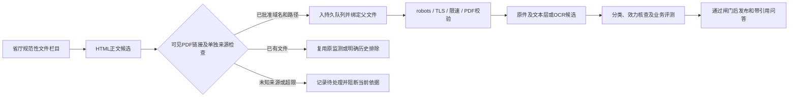

# 官方PDF附件自动发现

2026-10-16。省厅规范性文件页面中新出现的PDF链接已接入自动入队、正常采集、文本层/OCR处理及待复核流程。新增的是文件处理能力，没有自动核定政策效力或发布业务知识。

## 当前接入

- 发布者为`HN-POLICY-DISCOVERY`，仅扫描正文选择器内可见链接；页脚、导航、脚本和明确排除的编辑区域不会触发附件抓取。目录每6小时检查，发现即入队，实际处理时间受工作轮次、队列及来源限速影响。
- 两个单独核查的附件集合为`HN-OSS-PDF-DISCOVERY`和`HN-XCOSS-PDF-DISCOVERY`，分别固定到`https://oss.henan.gov.cn`、`https://xcoss.henan.gov.cn`的`/typtfile/日期/32位十六进制.pdf`布局。它们没有抓取种子，只接受声明的发布者正文链接，不遍历存储桶或凭链接继承权限。
- 用途筛查限发布者规范性文件的原件留存及注明出处的分析，不把官网新闻、配图或对象存储全部内容视为获得许可。每次真实访问仍执行robots、公开IP、TLS、跳转、限速与响应格式检查。参数化/带凭据链接、未知域名和不符布局不会下载。
- 每份父文件默认最多5个PDF链接，每集合最多20个进行中任务；可配置上限分别为20和100。限额或来源问题不会静默记为覆盖完成；链接/错误保留，任务重试或后续轮次可继续处理。未取得正文的304不能记为成功，有已校验原件的304会重放链接。
- 新附件默认地区未知、事项未分类、效力日期未定；保留父修订、父原件SHA256、标题及父页面原始日期观察。页面日期不会自动填成PDF发布日期或生效日。

已有三个精确PDF来源复用原监测，保持同一文件及修订链。两份2019/2022历史扫描件按已校验的原件指纹和既有范围排除明确跳过，不宣称本轮重新抓过它们；对应页面链接变化仍进入复核。没有任务的附件集合显示“等待合法附件链接”，没有伪造成功检查时间，也不会永久阻断已发布范围。集合配置及已有附件来源配置仍参与评测绑定。

HTML的文件名不变而附件URL或title变化时会产生新待复核修订，来源关联能追到包含该链接的原件。多个页面链接同一PDF复用任务，保留各父文件关联及稳定的首次来源绑定；页面移除链接不自动认定PDF废止，已登记PDF继续复查。

## 真实验证

[隔离验证](../evidence/knowledge-update/official-attachment-flow.json)使用两份真实官方HTML，在一个全新私有数据库中首次发现并自动取得两个PDF，实际处理18页OCR；四个任务均正常完成，原件/页码/来源及关联图完整恢复，8项检查通过。主库记录数未变，未启动服务或发布知识。这两份文件早已发布，不能把“新数据库首次发现”称作“今天发布了新政策”。

首次报告阶段遇到备份目标目录约束，已在原先四个任务完成的同一隔离库继续验证，并记录`resumed_completed_store_without_network=true`；没有重新抓取或用模拟结果替换真实结果。

[现有库接入记录](../evidence/knowledge-update/attachment-discovery.json)保留其他来源配置及原访问核查信息。五个实际附件入口分别关联三个原监测来源和两个历史排除；主库仍为20份归档、123段当前片段，新增来源/链接元数据带来修订，未增加重复原件或正式版本。重新保留AI范围排除时均校验原件字节和选入正文指纹，不复用业务批准或冒充真人签字。

完整回归316项通过。真实主库备份恢复含20份原件、26个清单文件，并增加附件关联图一致性检查，共7项通过。来源状态、错误、队列、父子关系及待复核入口可在本机只读工作台查看。OCR的系统要求、误差和页数限制见[扫描PDF处理说明](知识库扫描PDF处理说明.md)。

## 维护

`scripts/prepare_henan_attachments.py --enable-monitoring`仅用于首次配置迁移，已有配置时拒绝重复引导；后续由正常后台任务处理。`scripts/verify_official_attachment_flow.py`使用独立私有目录执行真实链路；`--resume <已完成验证ID>`只复查已完成任务，不重新排队或发起网络请求。

未知域名/布局需要单独补齐来源筛查。当前未宣称覆盖所有政府网站、所有文件格式或全部规范性文件库存。正式业务核定、完整两端问答验收及最终GitHub上传仍未完成。
