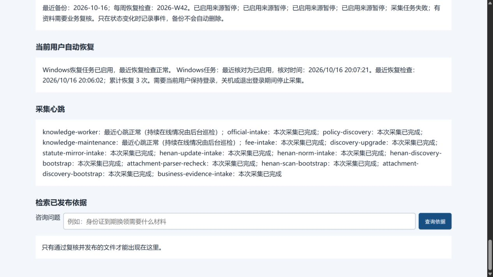

# 知识库恢复任务实时核查

2026-10-16。实际检查发现：本项目既有Windows计划任务处于`Disabled`、`Settings.Enabled=false`，但旧`startup-registration.json`仍记录登记时的`Ready`。网页原先能提示恢复记录过期，却不能说明任务已被停用。任务最后一次成功执行和当前服务仍健康，也不能证明下次故障可以自动恢复。

## 本次修复

已核对独立运行目录标记、任务名称、唯一动作、脚本路径、工作目录、当前用户和非提升权限，确认归属本项目；人工服务暂停标记不存在。随后只启用这一现有任务，没有新建任务，也没有手动触发其动作。启用前后XML比较确认：除启用状态外，动作、触发器和执行身份未变化。原始XML留在私有目录，停用原因没有查明，不归因于任何人。

任务已按既有5分钟触发器自然执行并返回0，恢复记录更新为正常。见[实际核对记录](../evidence/knowledge-update/startup-task-live-audit.json)。本次没有再次停止监督进程来重复故障注入，旧故障恢复证据按原时间保留。

新增[只读观察模块](../src/gov_mcp/knowledge_startup.py)和[Windows查询脚本](../src/gov_mcp/knowledge_startup_windows.ps1)，接入现有维护进程。每次维护巡检查询同一个已登记任务，核对启用状态、归属、当前用户登录及无结束期限的5分钟触发器；调用隐藏运行，最多等待15秒。它不会启用、重建、删除或启动任务；后续任务状态变化仍尊重人工操作。

观察缓存为私有`startup-task-status.json`。状态接口只读缓存，不在访客请求中启动PowerShell。超过3分钟未更新的任务观察、超过7分钟的恢复检查、任务停用/缺失/归属不符/配置变化/最近执行失败/查询失败，都不能显示为健康。正在运行或排队的对应状态码按[微软官方定义](https://learn.microsoft.com/en-us/windows/win32/taskschd/task-scheduler-error-and-success-constants)区分，不能用运行中状态掩盖其他失败码。人工服务暂停按暂停展示，不自动解除。

异常进入现有维护提醒和状态变更日志；同一异常保持不变时不每分钟重复记录。工作台分开显示Windows任务核对时间与恢复检查时间，不再以旧登记状态代替当前状态。

## 实际验证

- [完整回归](../evidence/knowledge-update/regression-tests.xml)492项通过，保留3项已有依赖警告；启动巡检、维护和锁的针对性75项通过。
- 最终运行/排队状态码判断补强后，再以[启动巡检6项检查](../evidence/knowledge-update/startup-task-tests.xml)复验受影响模块；没有重算模型开发结果。
- [新增用例](../tests/test_knowledge_startup.py)覆盖旧成功记录与任务停用冲突、任务缺失/查询失败/归属或触发器变化、过期或无效时间、人工暂停、相同异常保持安静及查询超时。测试不修改真实计划任务。
- 本机既有任务已自然触发完成；新维护进程持续更新观察缓存。恢复脚本及登记任务动作沿用原配置，未增加第二套心跳。
- [浏览器截图](../evidence/knowledge-update/startup-task-live-ui.jpg)来自实际本机工作台，已目视核对恢复状态和时间展示。这是维护工作台验证，不是群众/工作人员Nexent实质性业务UI验收。
- 真实库保持30来源、22份归档、64修订、127当前片段；资料批准、业务评测、正式版本和发布头均为0，发布策略和40个开发问题登记不变，旧模型输入/结果保留。

当前恢复仍依赖本机开机且当前用户登录；没有完成重启/重新登录转换、完整自然周或常开服务器验收。查询和启用状态的当前健康记录不能补造这些证据。复查可在已准备好的项目Python环境调用`gov_mcp.knowledge_startup.observe_startup_task(KnowledgeStore('.runtime/knowledge-update'))`，该操作只更新观察缓存，不改变任务。
