# 项目文件扫描与分层流程详解

扫描时间：2026-10-19T00:12:14.392589+08:00。源码基线：`d51a48366477b7a100a9844440caffd94117d027`，包含扫描时工作区文件（含未提交文件）；不是只按commit扫描。

交互入口：[离线流程图与源码明细](index.html)。无需联网或启动服务。点击图中节点可查看完整注释和源码定位；函数页支持名称、文件、条件和错误码搜索。

范围：1293个项目文件，242个src/scripts Python模块，1146个函数、100个类、11956条结构事件；702个测试函数定义仅作索引，未执行。18张详细流程图，148个有源码依据的节点。

## 阅读与完整性约定

- 业务图按真实入口手工梳理；每个节点标注职责、条件、数据、失败或状态以及源码位置。SVG图面提供摘要，完整说明见下方节点表及交互页。
- Python细节逐函数提取完整源码、签名、条件、循环、with、try/except、raise/return、短路逻辑、条件表达式和推导式。静态调用名保留接收者，不猜测运行时动态绑定。
- 另收录47个前端、PowerShell、Shell和部署源码文件的完整文本与行号，按事件／请求、函数／命令、控制关键字和部署项提供定位。这是文本定位，不声称对这些语言完成语义解析。其他配置、资料与证据逐文件列入清单。
- 排除私有运行目录、密钥文件、Git内部、虚拟环境、缓存、模型权重、vendor与references依赖快照；不把第三方源码当作项目流程。详细排除路径见静态扫描数据。
- 原始文件含源码注释和表达式，函数详情提供完整代码；流程图并不等于已执行所有路径。没有启动服务、读取真实个人回答、调用模型、采集官网、跑业务回归、发布或推送。
- 默认模型和填表AI开关均关闭。公开原文支持、业务适用性、正式发布和赛题达标分别判断；历史证据不能证明当前服务状态。

## 分层结论

1. 当前8780工作台是模拟知识快照上的确定性规则与角色调度；三值规则、精确引用、冲突暂停、人工复核与版本机制真实存在，但路由配置不代表自动真实推理。
2. 公开资料修订库（registry＋knowledge_fetch）和8775维护引擎（Engine＋Worker）是两套独立实现，版本表、任务、发布方式均不同；流程图没有把它们拼成已运行的自动生产链。
3. 8781及8782公开资料原生预览使用独立public权限、运行次数与Jev预算门，输出原文支持信号，现行材料、时限、范围和业务发布仍受暂停保护。
4. 最新接续记录注明：二七原生预览通过；南京通过；北京重试外部阻断且预算封闭；短周期心跳试验结束，测试来源已暂停。此处是已有记录，未在本次重验。
5. 本体登记不等于可执行本体演化；fixture更新不等于真实官网更新；模拟演示不等于独立业务评测；63份共享目录不等于本机63份原件已入库。

## 各入口与数据边界

|入口／实现|主要用途|存储与边界|
|---|---|---|
|8780 decision.server|分支咨询、填表、模拟更新与人工复核|.runtime/agent-workflow；synthetic；默认无模型推理|
|8772看板／8773只读MCP|公开资料采集与修订库查询|.runtime/knowledge-update；原件、修订、复核、评测、scope发布；存在启动配置不代表当前已部署|
|8775维护／8778回放|Agent候选提取与文档／规则版本|.runtime/knowledge及knowledge-demo；回放和真实供应商分别标注|
|8781 public preview|二七固定公开原文的原生预览|隔离库与预算，public；不发布正式知识|
|8782 regional preview|北京／南京固定原文原生预览|隔离候选与场景预算；北京受阻，南京历史通过|
|M1／M2／资产查询|环境底座、模拟交接、多模态检索|各自运行目录；不得跨当成正式办理审批|

## 流程图与逐节点注释

### 01 · 项目全景与实现边界

箭头表示入口或数据关系；各链路使用独立存储，并非自动串接。

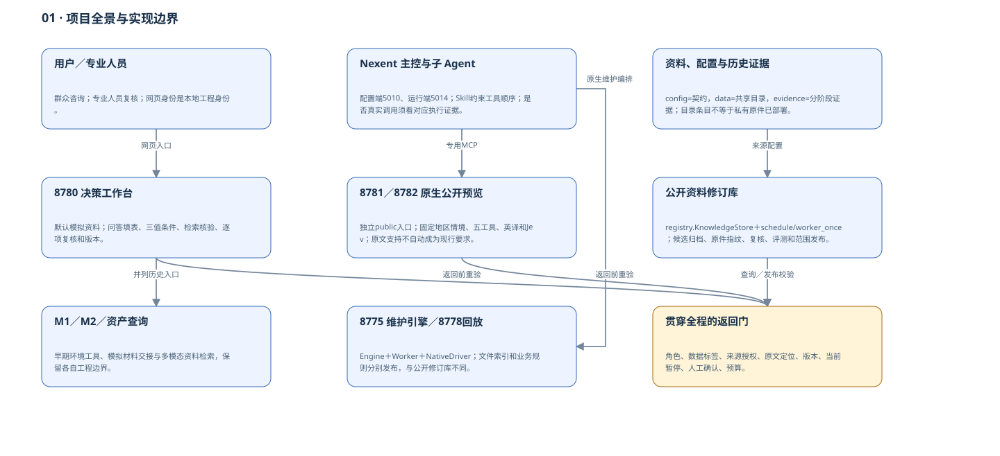

[SVG原图](diagrams/01-overview.svg) · [可编辑Mermaid源](diagrams/01-overview.mmd)

|节点|完整注释|源码|
|---|---|---|
|用户／专业人员|群众咨询；专业人员复核；网页身份是本地工程身份。|[src/gov_mcp/decision/server.py:create_app.login:211](../../src/gov_mcp/decision/server.py#L211)|
|Nexent 主控与子 Agent|配置端5010、运行端5014；Skill约束工具顺序；是否真实调用须看对应执行证据。|[src/gov_mcp/decision/connections.py:Connections.request_nexent:150](../../src/gov_mcp/decision/connections.py#L150)|
|资料、配置与历史证据|config=契约，data=共享目录，evidence=分阶段证据；目录条目不等于私有原件已部署。|[README.md:1](../../README.md#L1)|
|8780 决策工作台|默认模拟资料；问答填表、三值条件、检索核验、逐项复核和版本。|[src/gov_mcp/decision/workflow.py:Workflow:49](../../src/gov_mcp/decision/workflow.py#L49)|
|8781／8782 原生公开预览|独立public入口；固定地区情境、五工具、英译和Jev；原文支持不自动成为现行要求。|[src/gov_mcp/public_preview.py:Preview:203](../../src/gov_mcp/public_preview.py#L203)|
|公开资料修订库|registry.KnowledgeStore＋schedule/worker_once；候选归档、原件指纹、复核、评测和范围发布。|[src/gov_mcp/knowledge/registry.py:KnowledgeStore:21](../../src/gov_mcp/knowledge/registry.py#L21)|
|M1／M2／资产查询|早期环境工具、模拟材料交接与多模态资料检索，保留各自工程边界。|[src/gov_mcp/m2.py:M2Tools:125](../../src/gov_mcp/m2.py#L125)|
|8775 维护引擎／8778回放|Engine＋Worker＋NativeDriver；文件索引和业务规则分别发布，与公开修订库不同。|[src/gov_mcp/knowledge/engine.py:Engine:39](../../src/gov_mcp/knowledge/engine.py#L39)|
|贯穿全程的返回门|角色、数据标签、来源授权、原文定位、版本、当前暂停、人工确认、预算。|[src/gov_mcp/privacy.py:data_classes_allowed:4](../../src/gov_mcp/privacy.py#L4)|

### 02 · 请求、角色与隐私边界

以8780工作台为准；公开预览及其他服务使用各自Bearer和角色配置。

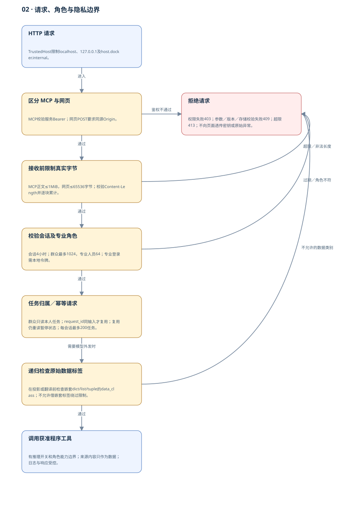

[SVG原图](diagrams/02-auth.svg) · [可编辑Mermaid源](diagrams/02-auth.mmd)

|节点|完整注释|源码|
|---|---|---|
|HTTP 请求|TrustedHost限制localhost、127.0.0.1及host.docker.internal。|[src/gov_mcp/decision/server.py:create_app:29](../../src/gov_mcp/decision/server.py#L29)|
|区分 MCP 与网页|MCP校验服务Bearer；网页POST要求同源Origin。|[src/gov_mcp/decision/server.py:create_app.Gate.__call__:334](../../src/gov_mcp/decision/server.py#L334)|
|拒绝请求|权限失败403；参数／版本／存储校验失败409；超限413；不向页面透传密钥或原始异常。|[src/gov_mcp/decision/server.py:create_app.Gate.__call__:334](../../src/gov_mcp/decision/server.py#L334)|
|接收前限制真实字节|MCP正文≤1MiB，网页≤65536字节；校验Content-Length并逐块累计。|[src/gov_mcp/decision/server.py:create_app.Gate.__call__:334](../../src/gov_mcp/decision/server.py#L334)|
|校验会话及专业角色|会话4小时；群众最多1024，专业人员64；专业登录需本地令牌。|[src/gov_mcp/decision/server.py:create_app.session:129](../../src/gov_mcp/decision/server.py#L129)|
|任务归属／幂等请求|群众只读本人任务；request_id同输入才复用；复用仍重读暂停状态；每会话最多200任务。|[src/gov_mcp/decision/server.py:create_app.api:246](../../src/gov_mcp/decision/server.py#L246)|
|递归检查原始数据标签|在投影或翻译前检查嵌套dict/list/tuple的data_class；不允许借嵌套标签绕过限制。|[src/gov_mcp/privacy.py:data_classes_allowed:4](../../src/gov_mcp/privacy.py#L4)|
|调用获准程序工具|有推理开关和角色能力边界；来源内容只作为数据；日志与响应受控。|[src/gov_mcp/decision/connections.py:Connections.request:98](../../src/gov_mcp/decision/connections.py#L98)|

### 03 · 一问一答填表与人工确认

当前config中form_verifier_enabled=false；完整链路存在，默认不能越过AI核查门。

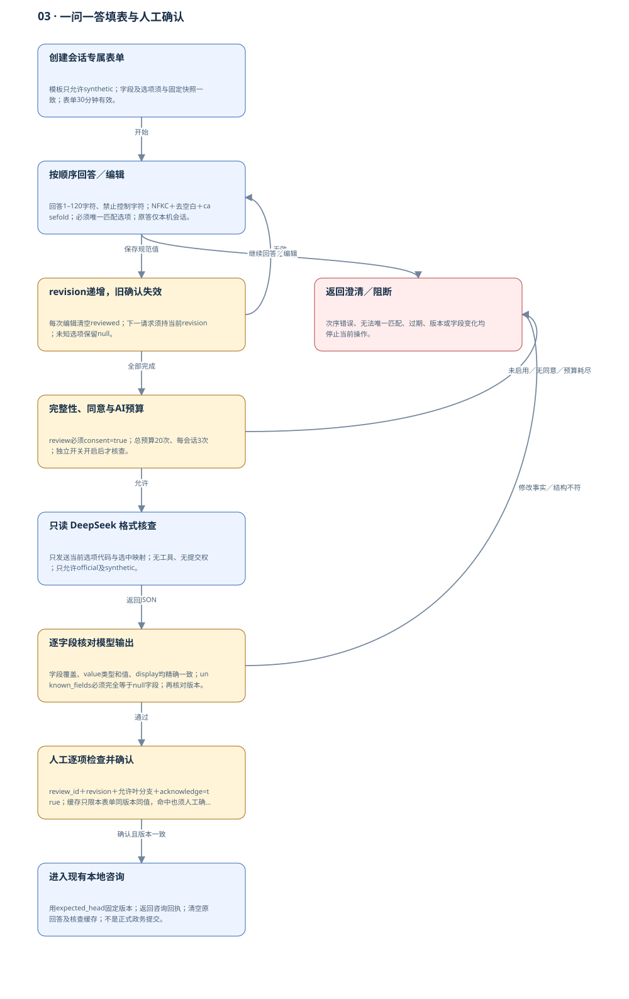

[SVG原图](diagrams/03-form.svg) · [可编辑Mermaid源](diagrams/03-form.mmd)

|节点|完整注释|源码|
|---|---|---|
|创建会话专属表单|模板只允许synthetic；字段及选项须与固定快照一致；表单30分钟有效。|[src/gov_mcp/decision/intake.py:GuidedForm.__init__:90](../../src/gov_mcp/decision/intake.py#L90)|
|按顺序回答／编辑|回答1–120字符、禁止控制字符；NFKC＋去空白＋casefold；必须唯一匹配选项；原答仅本机会话。|[src/gov_mcp/decision/intake.py:GuidedForm.answer:124](../../src/gov_mcp/decision/intake.py#L124)|
|revision递增，旧确认失效|每次编辑清空reviewed；下一请求须持当前revision；未知选项保留null。|[src/gov_mcp/decision/intake.py:GuidedForm.expected:109](../../src/gov_mcp/decision/intake.py#L109)|
|返回澄清／阻断|次序错误、无法唯一匹配、过期、版本或字段变化均停止当前操作。|[src/gov_mcp/decision/intake.py:GuidedForm.answer:124](../../src/gov_mcp/decision/intake.py#L124)|
|完整性、同意与AI预算|review必须consent=true；总预算20次、每会话3次；独立开关开启后才核查。|[src/gov_mcp/decision/server.py:create_app.form_api:149](../../src/gov_mcp/decision/server.py#L149)|
|只读 DeepSeek 格式核查|只发送当前选项代码与选中映射；无工具、无提交权；只允许official及synthetic。|[src/gov_mcp/decision/intake.py:DeepSeekFormVerifier.payload:53](../../src/gov_mcp/decision/intake.py#L53)|
|逐字段核对模型输出|字段覆盖、value类型和值、display均精确一致；unknown_fields必须完全等于null字段；再核对版本。|[src/gov_mcp/decision/intake.py:GuidedForm.review:140](../../src/gov_mcp/decision/intake.py#L140)|
|人工逐项检查并确认|review_id＋revision＋允许叶分支＋acknowledge=true；缓存只限本表单同版本同值，命中也须人工确认。|[src/gov_mcp/decision/intake.py:GuidedForm.submit:195](../../src/gov_mcp/decision/intake.py#L195)|
|进入现有本地咨询|用expected_head固定版本；返回咨询回执；清空原回答及核查缓存；不是正式政务提交。|[src/gov_mcp/decision/intake.py:GuidedForm.submit:195](../../src/gov_mcp/decision/intake.py#L195)|

### 04 · 当前完整咨询链路

Workflow.query执行确定性离线角色；配置DeepSeek路由不意味着此函数自动进行模型推理。

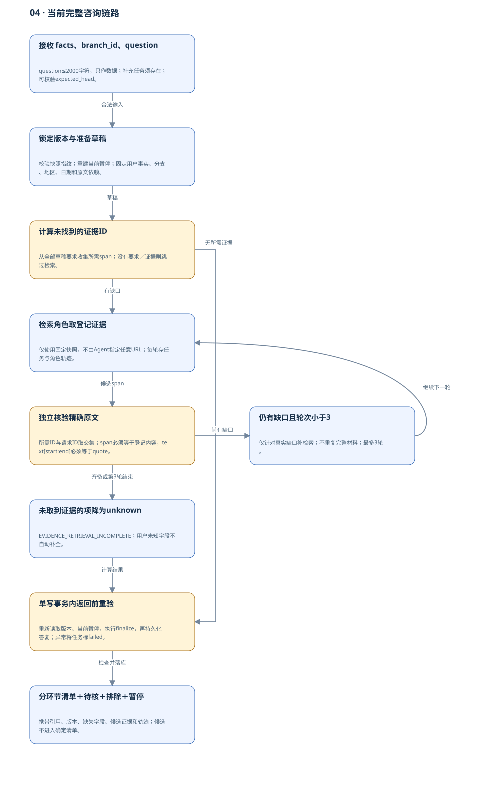

[SVG原图](diagrams/04-query.svg) · [可编辑Mermaid源](diagrams/04-query.mmd)

|节点|完整注释|源码|
|---|---|---|
|接收 facts、branch_id、question|question≤2000字符，只作数据；补充任务须存在；可校验expected_head。|[src/gov_mcp/decision/workflow.py:Workflow.query:160](../../src/gov_mcp/decision/workflow.py#L160)|
|锁定版本与准备草稿|校验快照指纹；重建当前暂停；固定用户事实、分支、地区、日期和原文依赖。|[src/gov_mcp/decision/service.py:DecisionService.prepare:226](../../src/gov_mcp/decision/service.py#L226)|
|计算未找到的证据ID|从全部草稿要求收集所需span；没有要求／证据则跳过检索。|[src/gov_mcp/decision/workflow.py:Workflow._evidence_request:187](../../src/gov_mcp/decision/workflow.py#L187)|
|检索角色取登记证据|仅使用固定快照，不由Agent指定任意URL；每轮存任务与角色轨迹。|[src/gov_mcp/decision/workflow.py:Workflow._execute_query:205](../../src/gov_mcp/decision/workflow.py#L205)|
|独立核验精确原文|所需ID与请求ID取交集；span必须等于登记内容，text[start:end]必须等于quote。|[src/gov_mcp/decision/workflow.py:Workflow._verify_retrieval:191](../../src/gov_mcp/decision/workflow.py#L191)|
|仍有缺口且轮次小于3|仅针对真实缺口补检索；不重复完整材料；最多3轮。|[src/gov_mcp/decision/workflow.py:Workflow._verify_retrieval:191](../../src/gov_mcp/decision/workflow.py#L191)|
|未取到证据的项降为unknown|EVIDENCE_RETRIEVAL_INCOMPLETE；用户未知字段不自动补全。|[src/gov_mcp/decision/workflow.py:Workflow._execute_query:205](../../src/gov_mcp/decision/workflow.py#L205)|
|单写事务内返回前重验|重新读取版本、当前暂停，执行finalize，再持久化答复；异常将任务标failed。|[src/gov_mcp/decision/workflow.py:Workflow._execute_query:205](../../src/gov_mcp/decision/workflow.py#L205)|
|分环节清单＋待核＋排除＋暂停|携带引用、版本、缺失字段、候选证据和轨迹；候选不进入确定清单。|[src/gov_mcp/decision/service.py:DecisionService.finalize:250](../../src/gov_mcp/decision/service.py#L250)|

### 05 · Nexent分阶段MCP查询状态机

上游Nexent推理单独取证；MCP程序工具本身不进行推理。

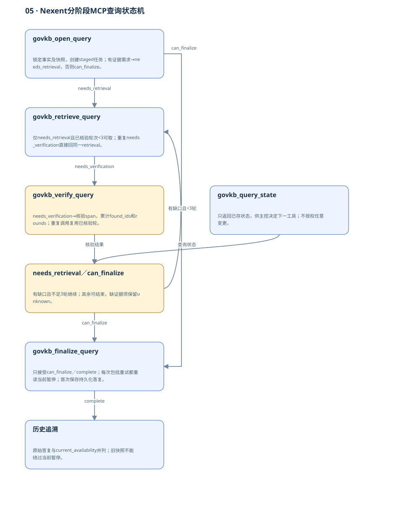

[SVG原图](diagrams/05-staged.svg) · [可编辑Mermaid源](diagrams/05-staged.mmd)

|节点|完整注释|源码|
|---|---|---|
|govkb_open_query|锁定事实及快照，创建staged任务；有证据需求→needs_retrieval，否则can_finalize。|[src/gov_mcp/decision/workflow.py:Workflow.open_query:259](../../src/gov_mcp/decision/workflow.py#L259)|
|govkb_retrieve_query|仅needs_retrieval且已核验轮次<3可取；重复needs_verification直接回同一retrieval。|[src/gov_mcp/decision/workflow.py:Workflow.retrieve_query:277](../../src/gov_mcp/decision/workflow.py#L277)|
|govkb_verify_query|needs_verification→核验span，累计found_ids和rounds；重复调用复用已核验轮。|[src/gov_mcp/decision/workflow.py:Workflow.verify_query:294](../../src/gov_mcp/decision/workflow.py#L294)|
|govkb_query_state|只返回已存状态，供主控决定下一工具；不授权任意变更。|[src/gov_mcp/decision/server.py:create_app.govkb_query_state:58](../../src/gov_mcp/decision/server.py#L58)|
|needs_retrieval／can_finalize|有缺口且不足3轮继续；其余可结束，缺证据项保留unknown。|[src/gov_mcp/decision/workflow.py:Workflow._verify_retrieval:191](../../src/gov_mcp/decision/workflow.py#L191)|
|govkb_finalize_query|只接受can_finalize／complete；每次包括重试都重读当前暂停；首次保存持久化答复。|[src/gov_mcp/decision/workflow.py:Workflow.finalize_query:315](../../src/gov_mcp/decision/workflow.py#L315)|
|历史追溯|原始答复与current_availability并列；旧快照不能绕过当前暂停。|[src/gov_mcp/decision/workflow.py:Workflow.history:249](../../src/gov_mcp/decision/workflow.py#L249)|

### 06 · 三值规则、范围与最终分流

程序判断资格条件；模型仅提供候选与支持信号。

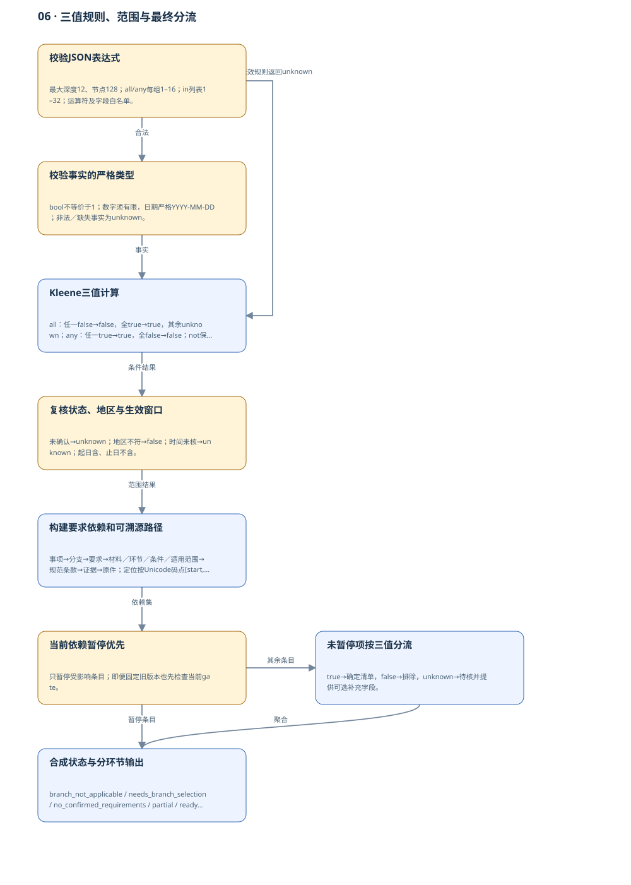

[SVG原图](diagrams/06-rules.svg) · [可编辑Mermaid源](diagrams/06-rules.mmd)

|节点|完整注释|源码|
|---|---|---|
|校验JSON表达式|最大深度12、节点128；all/any每组1–16；in列表1–32；运算符及字段白名单。|[src/gov_mcp/decision/logic.py:validate_expression:43](../../src/gov_mcp/decision/logic.py#L43)|
|校验事实的严格类型|bool不等价于1；数字须有限，日期严格YYYY-MM-DD；非法／缺失事实为unknown。|[src/gov_mcp/decision/logic.py:valid_value:22](../../src/gov_mcp/decision/logic.py#L22)|
|Kleene三值计算|all：任一false→false，全true→true，其余unknown；any：任一true→true，全false→false；not保留unknown。|[src/gov_mcp/decision/logic.py:evaluate:104](../../src/gov_mcp/decision/logic.py#L104)|
|复核状态、地区与生效窗口|未确认→unknown；地区不符→false；时间未核→unknown；起日含、止日不含。|[src/gov_mcp/decision/service.py:DecisionService._scope:153](../../src/gov_mcp/decision/service.py#L153)|
|构建要求依赖和可溯源路径|事项→分支→要求→材料／环节／条件／适用范围→规范条款→证据→原件；定位按Unicode码点[start,end)。|[src/gov_mcp/decision/service.py:DecisionService._requirement:180](../../src/gov_mcp/decision/service.py#L180)|
|当前依赖暂停优先|只暂停受影响条目；即便固定旧版本也先检查当前gate。|[src/gov_mcp/decision/service.py:DecisionService.finalize:250](../../src/gov_mcp/decision/service.py#L250)|
|未暂停项按三值分流|true→确定清单，false→排除，unknown→待核并提供可选补充字段。|[src/gov_mcp/decision/service.py:DecisionService.finalize:250](../../src/gov_mcp/decision/service.py#L250)|
|合成状态与分环节输出|branch_not_applicable / needs_branch_selection / no_confirmed_requirements / partial / ready / paused / insufficient_evidence。|[src/gov_mcp/decision/service.py:DecisionService.finalize:250](../../src/gov_mcp/decision/service.py#L250)|

### 07 · 8780模拟更新、冲突暂停与候选

此链路读取本仓库fixture；不是官网采集或真实政策更新。

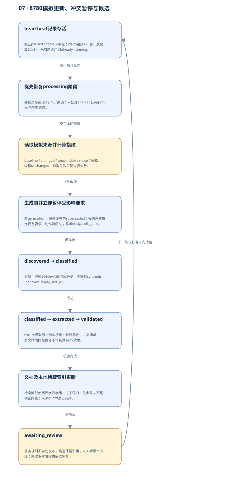

[SVG原图](diagrams/07-wf-update.svg) · [可编辑Mermaid源](diagrams/07-wf-update.mmd)

|节点|完整注释|源码|
|---|---|---|
|heartbeat记录存活|默认paused；force可单轮；claim租约120秒、总预算600秒；已有轮占用则already_running。|[src/gov_mcp/decision/workflow.py:Workflow.heartbeat:407](../../src/gov_mcp/decision/workflow.py#L407)|
|优先恢复processing阶段|每轮至多处理3个包／来源；只处理enabled且approved的到期来源。|[src/gov_mcp/decision/workflow.py:Workflow.heartbeat:407](../../src/gov_mcp/decision/workflow.py#L407)|
|读取模拟来源并计算指纹|baseline / changed / unavailable / noise；同指纹标unchanged；读取失败只记来源失败。|[src/gov_mcp/decision/workflow.py:Workflow._check:445](../../src/gov_mcp/decision/workflow.py#L445)|
|生成包并立即暂停受影响要求|新generation；旧未发布包superseded；候选严格绑定现有要求、动作及原文；写block与audit_gate。|[src/gov_mcp/decision/workflow.py:Workflow._check:445](../../src/gov_mcp/decision/workflow.py#L445)|
|discovered → classified|更新主控规划＋Jev合同回放分类；明确标synthetic_contract_replay_not_jev。|[src/gov_mcp/decision/workflow.py:Workflow._process:524](../../src/gov_mcp/decision/workflow.py#L524)|
|classified → extracted → validated|fixture提取器＋结构检查＋核验角色；冲突清单；原文精确匹配信号不代表真实Jev效果。|[src/gov_mcp/decision/workflow.py:Workflow._extract_packet:494](../../src/gov_mcp/decision/workflow.py#L494)|
|文档及本地稀疏索引更新|检索索引使用汉字双字组／拉丁词归一化余弦；不是稠密向量；来源guard须仍有效。|[src/gov_mcp/decision/workflow.py:Workflow._process:524](../../src/gov_mcp/decision/workflow.py#L524)|
|awaiting_review|业务规则不自动发布；候选保留引用；人工期限带时区；失败保留阶段供后续恢复。|[src/gov_mcp/decision/workflow.py:Workflow.deadline:611](../../src/gov_mcp/decision/workflow.py#L611)|

### 08 · 8780分项复核、发布及回退

这里的professional是模拟工程身份；正式业务审批仍需真实验收。

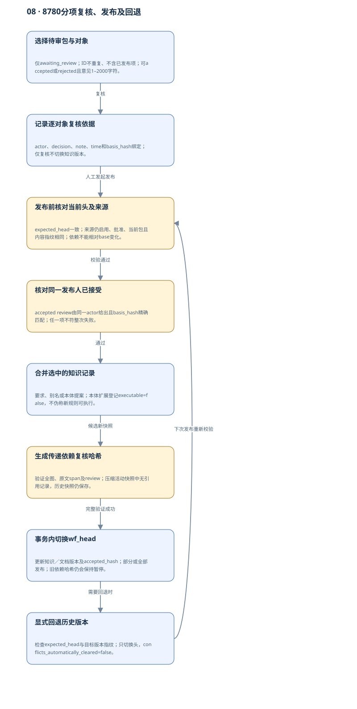

[SVG原图](diagrams/08-wf-publish.svg) · [可编辑Mermaid源](diagrams/08-wf-publish.mmd)

|节点|完整注释|源码|
|---|---|---|
|选择待审包与对象|仅awaiting_review；ID不重复、不含已发布项；可accepted或rejected且意见1–2000字符。|[src/gov_mcp/decision/workflow.py:Workflow.review:625](../../src/gov_mcp/decision/workflow.py#L625)|
|记录逐对象复核依据|actor、decision、note、time和basis_hash绑定；仅复核不切换知识版本。|[src/gov_mcp/decision/workflow.py:Workflow.review:625](../../src/gov_mcp/decision/workflow.py#L625)|
|发布前核对当前头及来源|expected_head一致；来源仍启用、批准、当前包且内容指纹相同；依赖不能相对base变化。|[src/gov_mcp/decision/workflow.py:Workflow.publish:641](../../src/gov_mcp/decision/workflow.py#L641)|
|核对同一发布人已接受|accepted review由同一actor给出且basis_hash精确匹配；任一项不符整次失败。|[src/gov_mcp/decision/workflow.py:Workflow.publish:641](../../src/gov_mcp/decision/workflow.py#L641)|
|合并选中的知识记录|要求、别名或本体提案；本体扩展登记executable=false，不伪称新规则可执行。|[src/gov_mcp/decision/workflow.py:Workflow.publish:641](../../src/gov_mcp/decision/workflow.py#L641)|
|生成传递依赖复核哈希|验证全图、原文span及review；压缩活动快照中无引用记录，历史快照仍保存。|[src/gov_mcp/decision/models.py:reviewed_hash:35](../../src/gov_mcp/decision/models.py#L35)|
|事务内切换wf_head|更新知识／文档版本及accepted_hash；部分或全部发布；旧依赖哈希仍会保持暂停。|[src/gov_mcp/decision/workflow.py:Workflow.publish:641](../../src/gov_mcp/decision/workflow.py#L641)|
|显式回退历史版本|检查expected_head与目标版本指纹；只切换头，conflicts_automatically_cleared=false。|[src/gov_mcp/decision/workflow.py:Workflow.rollback:723](../../src/gov_mcp/decision/workflow.py#L723)|

### 09 · 公开资料注册、调度与增量采集

knowledge_fetch＋registry链路；本次仅静态分析，不触发采集或打开私有资料。

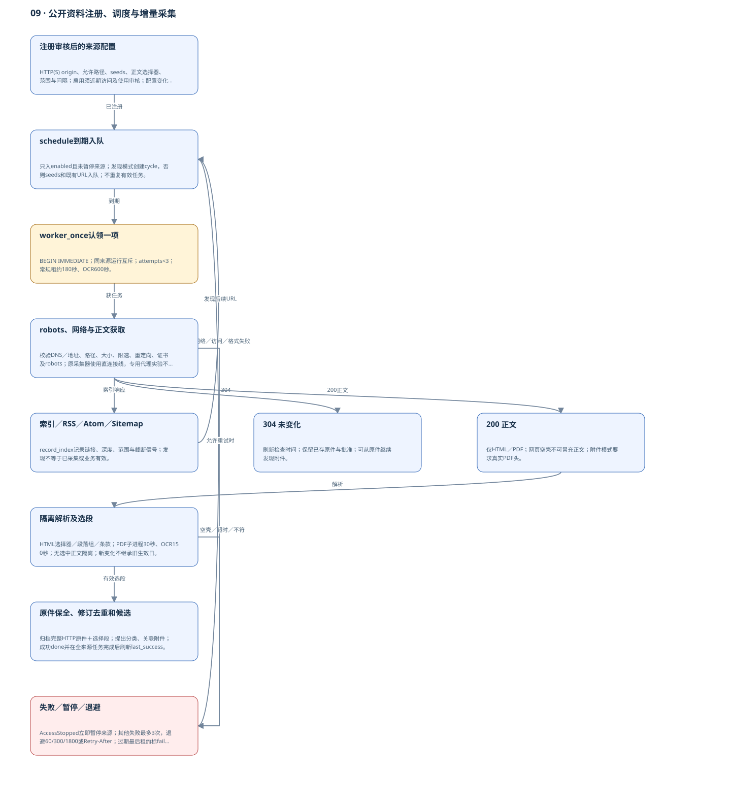

[SVG原图](diagrams/09-acquisition.svg) · [可编辑Mermaid源](diagrams/09-acquisition.mmd)

|节点|完整注释|源码|
|---|---|---|
|注册审核后的来源配置|HTTP(S) origin、允许路径、seeds、正文选择器、范围与间隔；启用须近期访问及使用审核；配置变化清除条件请求缓存。|[src/gov_mcp/knowledge/registry.py:KnowledgeStore.register:164](../../src/gov_mcp/knowledge/registry.py#L164)|
|schedule到期入队|只入enabled且未暂停来源；发现模式创建cycle，否则seeds和既有URL入队；不重复有效任务。|[src/gov_mcp/knowledge_fetch.py:schedule:476](../../src/gov_mcp/knowledge_fetch.py#L476)|
|worker_once认领一项|BEGIN IMMEDIATE；同来源运行互斥；attempts<3；常规租约180秒、OCR600秒。|[src/gov_mcp/knowledge_fetch.py:worker_once:503](../../src/gov_mcp/knowledge_fetch.py#L503)|
|robots、网络与正文获取|校验DNS／地址、路径、大小、限速、重定向、证书及robots；原采集器使用直连接线，专用代理实验不等于通用路径已修好。|[src/gov_mcp/knowledge_fetch.py:Fetcher.fetch:196](../../src/gov_mcp/knowledge_fetch.py#L196)|
|索引／RSS／Atom／Sitemap|record_index记录链接、深度、范围与截断信号；发现不等于已采集或业务有效。|[src/gov_mcp/knowledge_discovery.py:record_index:312](../../src/gov_mcp/knowledge_discovery.py#L312)|
|304 未变化|刷新检查时间；保留已存原件与批准；可从原件继续发现附件。|[src/gov_mcp/knowledge_fetch.py:worker_once:503](../../src/gov_mcp/knowledge_fetch.py#L503)|
|200 正文|仅HTML／PDF；网页空壳不可冒充正文；附件模式要求真实PDF头。|[src/gov_mcp/knowledge_fetch.py:worker_once:503](../../src/gov_mcp/knowledge_fetch.py#L503)|
|隔离解析及选段|HTML选择器／段落组／条款；PDF子进程30秒、OCR150秒；无选中正文隔离；新变化不继承旧生效日。|[src/gov_mcp/knowledge_fetch.py:worker_once:503](../../src/gov_mcp/knowledge_fetch.py#L503)|
|原件保全、修订去重和候选|归档完整HTTP原件＋选择段；提出分类、关联附件；成功done并在全来源任务完成后刷新last_success。|[src/gov_mcp/knowledge/registry.py:KnowledgeStore.ingest:182](../../src/gov_mcp/knowledge/registry.py#L182)|
|失败／暂停／退避|AccessStopped立即暂停来源；其他失败最多3次，退避60/300/1800或Retry-After；过期最后租约标failed。|[src/gov_mcp/knowledge_fetch.py:worker_once:503](../../src/gov_mcp/knowledge_fetch.py#L503)|

### 10 · 原件、修订、复核、评测与发布

KnowledgeStore为独立knowledge_update运行目录；只读分析不创建或切换业务版本。

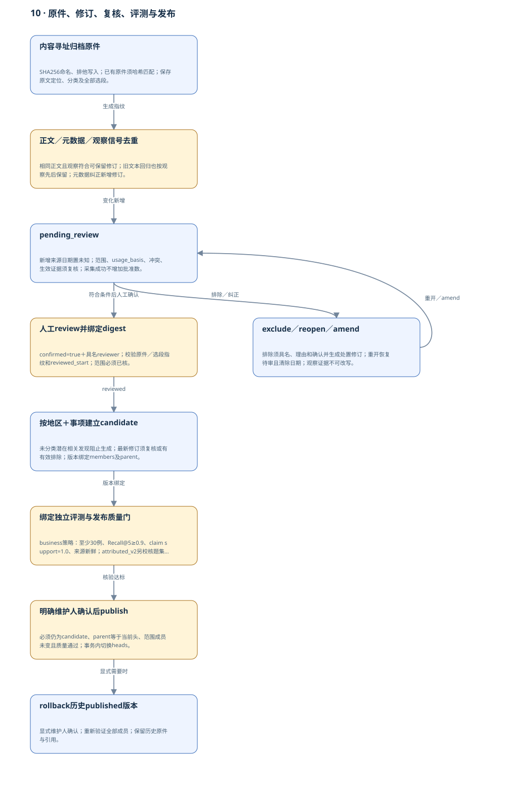

[SVG原图](diagrams/10-kb-lifecycle.svg) · [可编辑Mermaid源](diagrams/10-kb-lifecycle.mmd)

|节点|完整注释|源码|
|---|---|---|
|内容寻址归档原件|SHA256命名、排他写入；已有原件须哈希匹配；保存原文定位、分类及全部选段。|[src/gov_mcp/knowledge/registry.py:KnowledgeStore.ingest:182](../../src/gov_mcp/knowledge/registry.py#L182)|
|正文／元数据／观察信号去重|相同正文且观察符合可保留修订；旧文本回归也按观察先后保留；元数据纠正新增修订。|[src/gov_mcp/knowledge/registry.py:KnowledgeStore.ingest:182](../../src/gov_mcp/knowledge/registry.py#L182)|
|pending_review|新增来源日期置未知；范围、usage_basis、冲突、生效证据须复核；采集成功不增加批准数。|[src/gov_mcp/knowledge/registry.py:KnowledgeStore.review:255](../../src/gov_mcp/knowledge/registry.py#L255)|
|人工review并绑定digest|confirmed=true＋具名reviewer；校验原件／选段指纹和reviewed_start；范围必须已核。|[src/gov_mcp/knowledge/registry.py:KnowledgeStore.review:255](../../src/gov_mcp/knowledge/registry.py#L255)|
|exclude／reopen／amend|排除须具名、理由和确认并生成处置修订；重开恢复待审且清除日期；观察证据不可改写。|[src/gov_mcp/knowledge/registry.py:KnowledgeStore.exclude:274](../../src/gov_mcp/knowledge/registry.py#L274)|
|按地区＋事项建立candidate|未分类潜在相关发现阻止生成；最新修订须复核或有有效排除；版本绑定members及parent。|[src/gov_mcp/knowledge/registry.py:KnowledgeStore.candidate:365](../../src/gov_mcp/knowledge/registry.py#L365)|
|绑定独立评测与发布质量门|business策略：至少30例、Recall@5≥0.9、claim support=1.0、来源新鲜；attributed_v2另校核题集来源与独立性。|[src/gov_mcp/knowledge_quality.py:validate_report:56](../../src/gov_mcp/knowledge_quality.py#L56)|
|明确维护人确认后publish|必须仍为candidate、parent等于当前头、范围成员未变且质量通过；事务内切换heads。|[src/gov_mcp/knowledge/registry.py:KnowledgeStore.publish:382](../../src/gov_mcp/knowledge/registry.py#L382)|
|rollback历史published版本|显式维护人确认；重新验证全部成员；保留历史原件与引用。|[src/gov_mcp/knowledge/registry.py:KnowledgeStore.rollback:455](../../src/gov_mcp/knowledge/registry.py#L455)|

### 11 · 正式知识检索与当前暂停门

共享候选目录及预览资料不自动进入此检索；没有已发布头时返回NO_PUBLISHED_KNOWLEDGE。

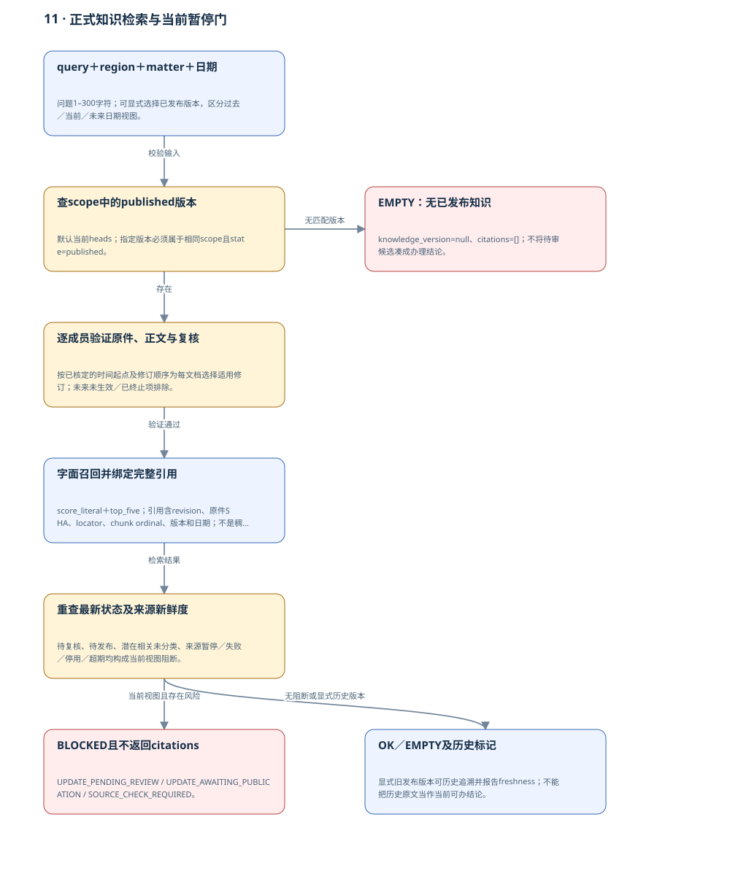

[SVG原图](diagrams/11-kb-query.svg) · [可编辑Mermaid源](diagrams/11-kb-query.mmd)

|节点|完整注释|源码|
|---|---|---|
|query＋region＋matter＋日期|问题1–300字符；可显式选择已发布版本，区分过去／当前／未来日期视图。|[src/gov_mcp/knowledge/registry.py:KnowledgeStore.search:468](../../src/gov_mcp/knowledge/registry.py#L468)|
|查scope中的published版本|默认当前heads；指定版本必须属于相同scope且state=published。|[src/gov_mcp/knowledge/registry.py:KnowledgeStore.search:468](../../src/gov_mcp/knowledge/registry.py#L468)|
|EMPTY：无已发布知识|knowledge_version=null、citations=[]；不将待审候选凑成办理结论。|[src/gov_mcp/knowledge/registry.py:KnowledgeStore.search:468](../../src/gov_mcp/knowledge/registry.py#L468)|
|逐成员验证原件、正文与复核|按已核定的时间起点及修订顺序为每文档选择适用修订；未来未生效／已终止项排除。|[src/gov_mcp/knowledge/registry.py:KnowledgeStore._verify:243](../../src/gov_mcp/knowledge/registry.py#L243)|
|字面召回并绑定完整引用|score_literal＋top_five；引用含revision、原件SHA、locator、chunk ordinal、版本和日期；不是稠密检索。|[src/gov_mcp/knowledge/registry.py:KnowledgeStore.search:468](../../src/gov_mcp/knowledge/registry.py#L468)|
|重查最新状态及来源新鲜度|待复核、待发布、潜在相关未分类、来源暂停／失败／停用／超期均构成当前视图阻断。|[src/gov_mcp/knowledge/registry.py:KnowledgeStore.search:468](../../src/gov_mcp/knowledge/registry.py#L468)|
|BLOCKED且不返回citations|UPDATE_PENDING_REVIEW / UPDATE_AWAITING_PUBLICATION / SOURCE_CHECK_REQUIRED。|[src/gov_mcp/knowledge/registry.py:KnowledgeStore.search:468](../../src/gov_mcp/knowledge/registry.py#L468)|
|OK／EMPTY及历史标记|显式旧发布版本可历史追溯并报告freshness；不能把历史原文当作当前可办结论。|[src/gov_mcp/knowledge/registry.py:KnowledgeStore.search:468](../../src/gov_mcp/knowledge/registry.py#L468)|

### 12 · 8775维护引擎的独立Agent链路

与公开修订库并列；8778使用synthetic replay，不能当作真实Jev准确率证据。

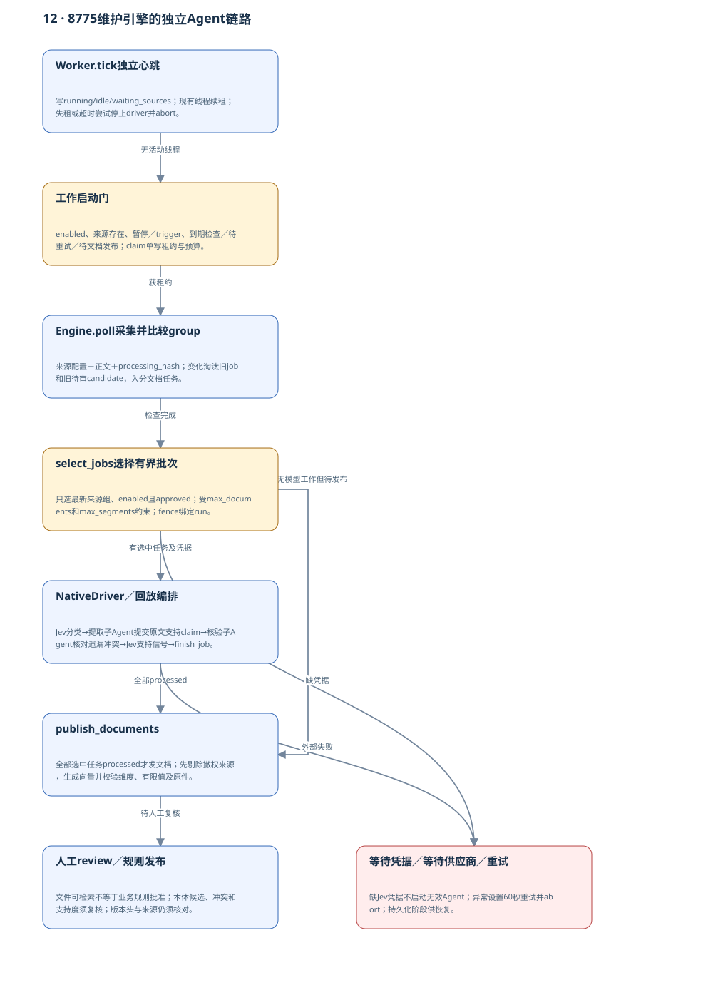

[SVG原图](diagrams/12-engine.svg) · [可编辑Mermaid源](diagrams/12-engine.mmd)

|节点|完整注释|源码|
|---|---|---|
|Worker.tick独立心跳|写running/idle/waiting_sources；现有线程续租；失租或超时尝试停止driver并abort。|[src/gov_mcp/knowledge/worker.py:Worker.tick:54](../../src/gov_mcp/knowledge/worker.py#L54)|
|工作启动门|enabled、来源存在、暂停／trigger、到期检查／待重试／待文档发布；claim单写租约与预算。|[src/gov_mcp/knowledge/worker.py:Worker.tick:54](../../src/gov_mcp/knowledge/worker.py#L54)|
|Engine.poll采集并比较group|来源配置＋正文＋processing_hash；变化淘汰旧job和旧待审candidate，入分文档任务。|[src/gov_mcp/knowledge/engine.py:Engine.poll:86](../../src/gov_mcp/knowledge/engine.py#L86)|
|select_jobs选择有界批次|只选最新来源组、enabled且approved；受max_documents和max_segments约束；fence绑定run。|[src/gov_mcp/knowledge/engine.py:Engine.select_jobs:135](../../src/gov_mcp/knowledge/engine.py#L135)|
|NativeDriver／回放编排|Jev分类→提取子Agent提交原文支持claim→核验子Agent核对遗漏冲突→Jev支持信号→finish_job。|[src/gov_mcp/knowledge/native.py:NativeDriver:11](../../src/gov_mcp/knowledge/native.py#L11)|
|publish_documents|全部选中任务processed才发文档；先剔除撤权来源，生成向量并校验维度、有限值及原件。|[src/gov_mcp/knowledge/engine.py:Engine.publish_documents:267](../../src/gov_mcp/knowledge/engine.py#L267)|
|人工review／规则发布|文件可检索不等于业务规则批准；本体候选、冲突和支持度须复核；版本头与来源仍须核对。|[src/gov_mcp/knowledge/engine.py:Engine:39](../../src/gov_mcp/knowledge/engine.py#L39)|
|等待凭据／等待供应商／重试|缺Jev凭据不启动无效Agent；异常设置60秒重试并abort；持久化阶段供恢复。|[src/gov_mcp/knowledge/worker.py:Worker.round:18](../../src/gov_mcp/knowledge/worker.py#L18)|

### 13 · 多模态资产准备及资料查询

当前AssetQuery只接受synthetic快照；返回原文与定位，不自动给出办理判定。

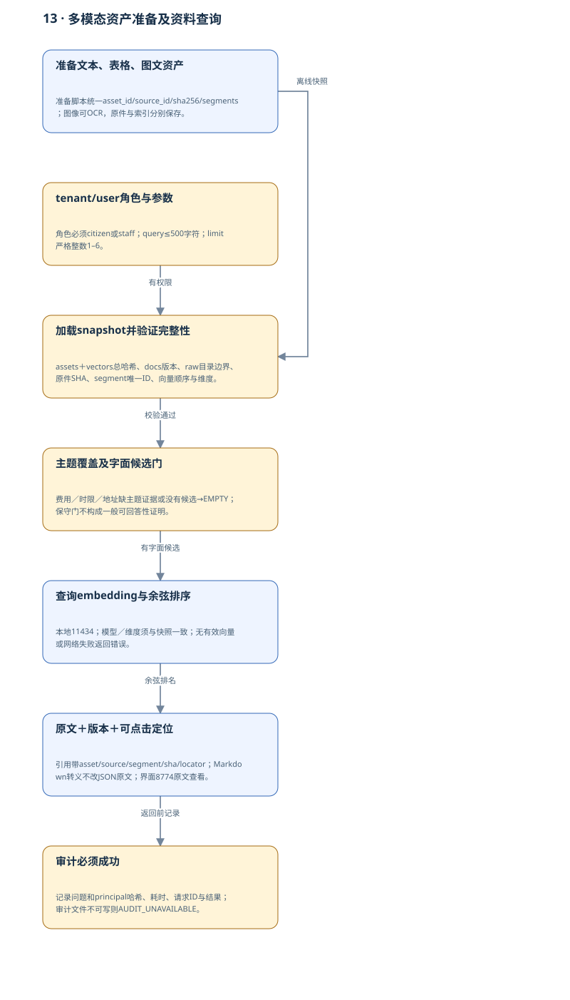

[SVG原图](diagrams/13-assets.svg) · [可编辑Mermaid源](diagrams/13-assets.mmd)

|节点|完整注释|源码|
|---|---|---|
|准备文本、表格、图文资产|准备脚本统一asset_id/source_id/sha256/segments；图像可OCR，原件与索引分别保存。|[scripts/prepare_topic3_data.py:1](../../scripts/prepare_topic3_data.py#L1)|
|tenant/user角色与参数|角色必须citizen或staff；query≤500字符；limit严格整数1–6。|[src/gov_mcp/asset_query.py:AssetQuery.search:93](../../src/gov_mcp/asset_query.py#L93)|
|加载snapshot并验证完整性|assets＋vectors总哈希、docs版本、raw目录边界、原件SHA、segment唯一ID、向量顺序与维度。|[src/gov_mcp/asset_query.py:AssetQuery.load:43](../../src/gov_mcp/asset_query.py#L43)|
|主题覆盖及字面候选门|费用／时限／地址缺主题证据或没有候选→EMPTY；保守门不构成一般可回答性证明。|[src/gov_mcp/asset_query.py:AssetQuery.search:93](../../src/gov_mcp/asset_query.py#L93)|
|查询embedding与余弦排序|本地11434；模型／维度须与快照一致；无有效向量或网络失败返回错误。|[src/gov_mcp/asset_query.py:AssetQuery.embed:82](../../src/gov_mcp/asset_query.py#L82)|
|原文＋版本＋可点击定位|引用带asset/source/segment/sha/locator；Markdown转义不改JSON原文；界面8774原文查看。|[src/gov_mcp/asset_query.py:AssetQuery.search:93](../../src/gov_mcp/asset_query.py#L93)|
|审计必须成功|记录问题和principal哈希、耗时、请求ID与结果；审计文件不可写则AUDIT_UNAVAILABLE。|[src/gov_mcp/asset_query.py:AssetQuery.search:93](../../src/gov_mcp/asset_query.py#L93)|

### 14 · M1空白底座与M2材料交接

早期工程链路；M2仍是候选材料演示，formal_approval=false。

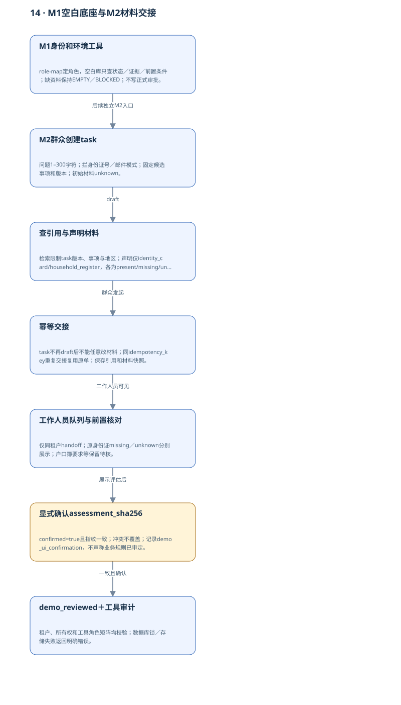

[SVG原图](diagrams/14-m1-m2.svg) · [可编辑Mermaid源](diagrams/14-m1-m2.mmd)

|节点|完整注释|源码|
|---|---|---|
|M1身份和环境工具|role-map定角色，空白库只查状态／证据／前置条件；缺资料保持EMPTY／BLOCKED；不写正式审批。|[src/gov_mcp/core.py:GovernmentTools:49](../../src/gov_mcp/core.py#L49)|
|M2群众创建task|问题1–300字符；拦身份证号／邮件模式；固定候选事项和版本；初始材料unknown。|[src/gov_mcp/m2.py:M2Tools.dispatch:221](../../src/gov_mcp/m2.py#L221)|
|查引用与声明材料|检索限制task版本、事项与地区；声明仅identity_card/household_register，各为present/missing/unknown。|[src/gov_mcp/m2.py:M2Tools.dispatch:221](../../src/gov_mcp/m2.py#L221)|
|幂等交接|task不再draft后不能任意改材料；同idempotency_key重复交接复用原单；保存引用和材料快照。|[src/gov_mcp/m2.py:M2Tools.dispatch:221](../../src/gov_mcp/m2.py#L221)|
|工作人员队列与前置核对|仅同租户handoff；原身份证missing／unknown分别展示；户口簿要求等保留待核。|[src/gov_mcp/m2.py:M2Tools.assessment:203](../../src/gov_mcp/m2.py#L203)|
|显式确认assessment_sha256|confirmed=true且指纹一致；冲突不覆盖；记录demo_ui_confirmation，不声称业务规则已审定。|[src/gov_mcp/m2.py:M2Tools.dispatch:221](../../src/gov_mcp/m2.py#L221)|
|demo_reviewed＋工具审计|租户、所有权和工具角色矩阵均校验；数据库锁／存储失败返回明确错误。|[src/gov_mcp/m2.py:M2Tools.execute:138](../../src/gov_mcp/m2.py#L138)|

### 15 · 8781公开原文原生预览

历史记录：二七预览1次成功后关闭本轮预算；本次没有重新调用或重验。

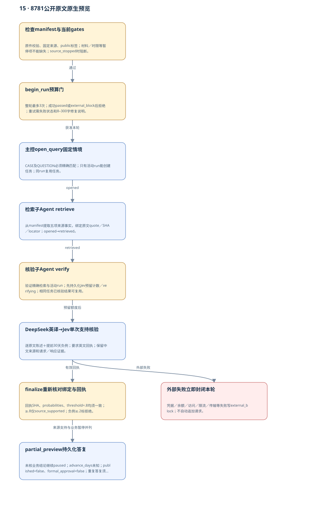

[SVG原图](diagrams/15-preview.svg) · [可编辑Mermaid源](diagrams/15-preview.mmd)

|节点|完整注释|源码|
|---|---|---|
|检查manifest与当前gates|原件校验、固定来源、public标签；材料／时限等暂停项不能缺失；source_stopped时阻断。|[src/gov_mcp/public_preview.py:Preview._context:235](../../src/gov_mcp/public_preview.py#L235)|
|begin_run预算门|整轮最多3次；成功passed或external_block后拒绝；重试需失败状态和8–300字修复说明。|[src/gov_mcp/public_preview.py:Preview.begin_run:248](../../src/gov_mcp/public_preview.py#L248)|
|主控open_query固定情境|CASE及QUESTION必须精确匹配；只有活动run能创建任务；同run复用任务。|[src/gov_mcp/public_preview.py:Preview.open_query:273](../../src/gov_mcp/public_preview.py#L273)|
|检索子Agent retrieve|从manifest提取五项来源事实，绑定原文quote／SHA／locator；opened→retrieved。|[src/gov_mcp/public_preview.py:Preview.retrieve:292](../../src/gov_mcp/public_preview.py#L292)|
|核验子Agent verify|验证精确检索与活动run；先持久化Jev预留计数／verifying；相同任务已核验结果可复用。|[src/gov_mcp/public_preview.py:Preview.verify:303](../../src/gov_mcp/public_preview.py#L303)|
|DeepSeek英译→Jev单次支持核验|逐原文陈述＋提前30天负例；要求英文回执；保留中文来源和请求／响应证据。|[src/gov_mcp/public_preview.py:LiveVerifier.__call__:173](../../src/gov_mcp/public_preview.py#L173)|
|finalize重新核对绑定与回执|回执SHA、probabilities、threshold=.8均须一致；≥.8仅source_supported；负例≤.2标拒绝。|[src/gov_mcp/public_preview.py:Preview.finalize:359](../../src/gov_mcp/public_preview.py#L359)|
|外部失败立即封闭本轮|凭据／余额／访问／限流／传输等失败写external_block；不自动追加请求。|[src/gov_mcp/public_preview.py:Preview.verify:303](../../src/gov_mcp/public_preview.py#L303)|
|partial_preview持久化答复|未核业务结论继续paused；advance_days未知；published=false、formal_approval=false；重复答复须一致。|[src/gov_mcp/public_preview.py:Preview.finalize:359](../../src/gov_mcp/public_preview.py#L359)|

### 16 · 8782北京／南京跨地区原生预览

历史结果PARTIAL_BLOCKED：南京通过；北京唯一重试受传输阻断，不能标两地全通过。

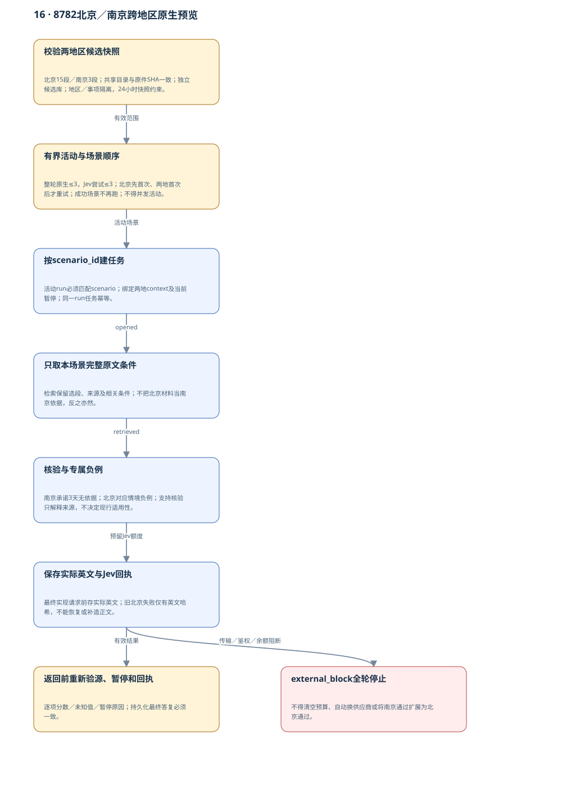

[SVG原图](diagrams/16-regional.svg) · [可编辑Mermaid源](diagrams/16-regional.mmd)

|节点|完整注释|源码|
|---|---|---|
|校验两地区候选快照|北京15段／南京3段；共享目录与原件SHA一致；独立候选库；地区／事项隔离，24小时快照约束。|[src/gov_mcp/regional_preview.py:check_context:56](../../src/gov_mcp/regional_preview.py#L56)|
|有界活动与场景顺序|整轮原生≤3，Jev尝试≤3；北京先首次、两地首次后才重试；成功场景不再跑；不得并发活动。|[src/gov_mcp/regional_preview.py:RegionalPreview.begin_run:193](../../src/gov_mcp/regional_preview.py#L193)|
|按scenario_id建任务|活动run必须匹配scenario；绑定两地context及当前暂停；同一run任务幂等。|[src/gov_mcp/regional_preview.py:RegionalPreview.open_query:230](../../src/gov_mcp/regional_preview.py#L230)|
|只取本场景完整原文条件|检索保留选段、来源及相关条件；不把北京材料当南京依据，反之亦然。|[src/gov_mcp/regional_preview.py:RegionalPreview.retrieve:248](../../src/gov_mcp/regional_preview.py#L248)|
|核验与专属负例|南京承诺3天无依据；北京对应情境负例；支持核验只解释来源，不决定现行适用性。|[src/gov_mcp/regional_preview.py:RegionalPreview.verify:260](../../src/gov_mcp/regional_preview.py#L260)|
|保存实际英文与Jev回执|最终实现请求前存实际英文；旧北京失败仅有英文哈希，不能恢复或补造正文。|[src/gov_mcp/regional_preview.py:RegionalLiveVerifier.__call__:145](../../src/gov_mcp/regional_preview.py#L145)|
|返回前重新验源、暂停和回执|逐项分数／未知值／暂停原因；持久化最终答复必须一致。|[src/gov_mcp/regional_preview.py:RegionalPreview.finalize:316](../../src/gov_mcp/regional_preview.py#L316)|
|external_block全轮停止|不得清空预算、自动换供应商或将南京通过扩展为北京通过。|[src/gov_mcp/regional_preview.py:RegionalPreview.verify:260](../../src/gov_mcp/regional_preview.py#L260)|

### 17 · 模型开关、翻译、分类与Jev校验

本次读取默认配置：inference_enabled=false、form_verifier_enabled=false；不检查或展示密钥值。

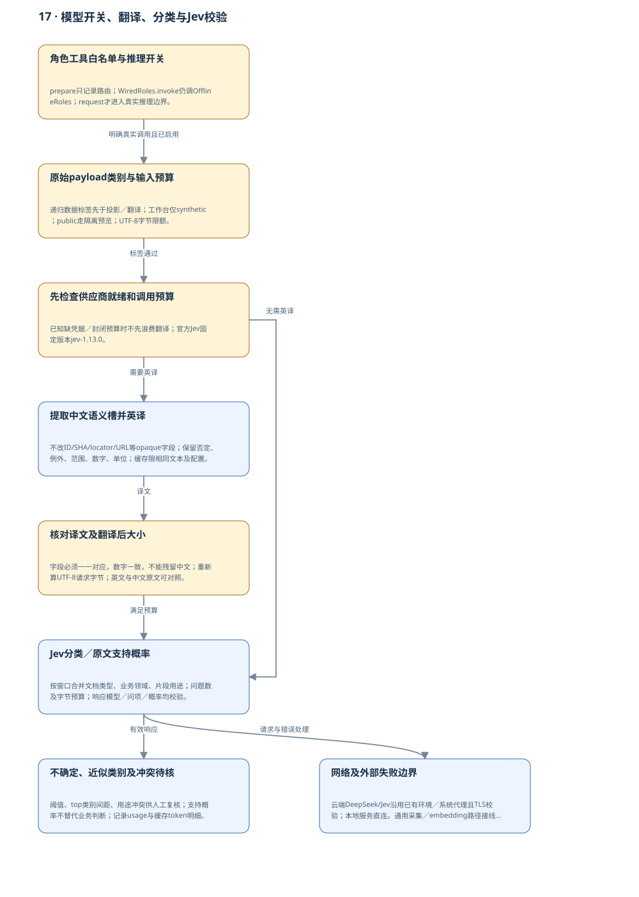

[SVG原图](diagrams/17-model.svg) · [可编辑Mermaid源](diagrams/17-model.mmd)

|节点|完整注释|源码|
|---|---|---|
|角色工具白名单与推理开关|prepare只记录路由；WiredRoles.invoke仍调OfflineRoles；request才进入真实推理边界。|[src/gov_mcp/decision/connections.py:Connections.request:98](../../src/gov_mcp/decision/connections.py#L98)|
|原始payload类别与输入预算|递归数据标签先于投影／翻译；工作台仅synthetic；public走隔离预览；UTF-8字节限额。|[src/gov_mcp/privacy.py:data_classes_allowed:4](../../src/gov_mcp/privacy.py#L4)|
|先检查供应商就绪和调用预算|已知缺凭据／封闭预算时不先浪费翻译；官方Jev固定版本jev-1.13.0。|[src/gov_mcp/classification.py:JevProvider.check_ready:65](../../src/gov_mcp/classification.py#L65)|
|提取中文语义槽并英译|不改ID/SHA/locator/URL等opaque字段；保留否定、例外、范围、数字、单位；缓存限相同文本及配置。|[src/gov_mcp/jev_translation.py:EnglishJevProvider:97](../../src/gov_mcp/jev_translation.py#L97)|
|核对译文及翻译后大小|字段必须一一对应，数字一致，不能残留中文；重新算UTF-8请求字节；英文与中文原文可对照。|[src/gov_mcp/jev_translation.py:EnglishJevProvider:97](../../src/gov_mcp/jev_translation.py#L97)|
|Jev分类／原文支持概率|按窗口合并文档类型、业务领域、片段用途；问题数及字节预算；响应模型／问项／概率均校验。|[src/gov_mcp/classification.py:classify_corpus:304](../../src/gov_mcp/classification.py#L304)|
|不确定、近似类别及冲突待核|阈值、top类别间距、用途冲突供人工复核；支持概率不替代业务判断；记录usage与缓存token明细。|[src/gov_mcp/classification.py:validate_response:255](../../src/gov_mcp/classification.py#L255)|
|网络及外部失败边界|云端DeepSeek/Jev沿用已有环境／系统代理且TLS校验；本地服务直连。通用采集／embedding路径接线需分别看源码。|[src/gov_mcp/deepseek.py:chat:48](../../src/gov_mcp/deepseek.py#L48)|

### 18 · 运行、心跳、维护与恢复

配置可启动≠当前运行；本图按实现描述，未读取私有运行目录或启动任何进程。

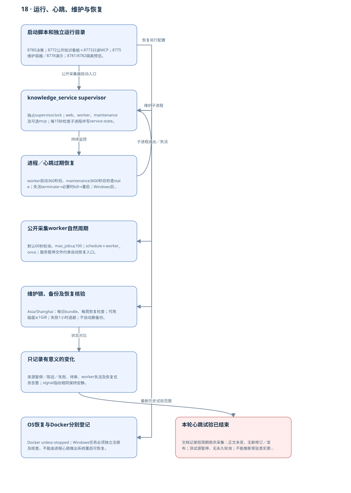

[SVG原图](diagrams/18-ops.svg) · [可编辑Mermaid源](diagrams/18-ops.mmd)

|节点|完整注释|源码|
|---|---|---|
|启动脚本和独立运行目录|8780决策；8772公开知识看板＋8773只读MCP；8775维护容器／8778演示；8781/8782隔离预览。|[scripts/start_knowledge_update.ps1:1](../../scripts/start_knowledge_update.ps1#L1)|
|knowledge_service supervisor|独占supervisor.lock；web、worker、maintenance及可选mcp；每15秒检查子进程并写service-state。|[src/gov_mcp/knowledge_service.py:supervise:15](../../src/gov_mcp/knowledge_service.py#L15)|
|进程／心跳过期恢复|worker启动360秒后、maintenance3600秒后检查stale；失活terminate→必要时kill→重启；Windows后台无可见窗口。|[src/gov_mcp/knowledge_service.py:supervise:15](../../src/gov_mcp/knowledge_service.py#L15)|
|公开采集worker自然周期|默认60秒轮询，max_jobs≤100；schedule＋worker_once；服务暂停文件约束自动恢复入口。|[src/gov_mcp/knowledge_cli.py:main:12](../../src/gov_mcp/knowledge_cli.py#L12)|
|维护锁、备份及恢复核验|Asia/Shanghai：每日bundle、每周恢复检查；可用磁盘≥1GiB；失败1小时退避；不自动删备份。|[src/gov_mcp/knowledge_maintenance.py:maintenance_tick:22](../../src/gov_mcp/knowledge_maintenance.py#L22)|
|只记录有意义的变化|来源暂停／陈旧／失败、待审、worker失活及恢复任务告警；signal指纹相同保持安静。|[src/gov_mcp/knowledge_maintenance.py:maintenance_tick:22](../../src/gov_mcp/knowledge_maintenance.py#L22)|
|OS恢复与Docker分别登记|Docker unless-stopped；Windows任务必须独立注册及核查，不能由进程心跳推出系统重启可恢复。|[src/gov_mcp/knowledge_startup.py:1](../../src/gov_mcp/knowledge_startup.py#L1)|
|本轮心跳试验已结束|文档记录短周期南京采集：正文未变、无新修订／发布；测试源暂停、无永久轮询；不能推断常驻真实更新已启用。|[docs/赛题3资料/心跳与主动知识更新测试-2026-10-18.md:1](../../docs/赛题3资料/心跳与主动知识更新测试-2026-10-18.md#L1)|

## 文件、函数、接口与条件明细

- [全部文件清单](文件清单.csv)：路径、字节数、类型；Python源码另有SHA256。
- [函数／类／模块索引](函数索引.csv)：签名、起止行及结构事件数。
- [条件、异常、返回和循环逐条明细](条件异常与返回明细.csv)：完整表达式和行号。
- [静态调用位置](调用位置.csv)：调用语法目标与行号；不宣称全量动态调用解析。
- [路由与MCP工具](路由与MCP工具.csv)：Route/Mount表达式及工具签名。
- [前端脚本与部署定位](前端脚本与部署定位.csv)：完整源代码见交互页，CSV提供文本级事件／请求／控制关键字／命令定位。
- [测试定义索引](测试定义索引.csv)：测试名称及位置，未运行。
- [完整扫描数据](静态扫描数据.json)：模块导入、SQL建表名、源码、函数事件、图节点与排除说明。
- [生成校验](生成校验.json)：AST解析结果、节点引用及图文件数。

## 已验证与未验证

本轮仅校验AST可解析、所有流程节点源码引用、图边连接、文档本地链接、HTML脚本语法和SVG渲染。未做浏览器交互实测，未复测真实模型、来源当前可达性、私有库发布数量或服务当前运行状态；历史状态以带日期的接续记录和证据报告阅读。

生成方式：在仓库根目录运行 `.venv/Scripts/python.exe scripts/build_flow_atlas.py`。生成器只解析代码与公开项目文件，不导入业务模块。新生成文件夹自动排除在自身扫描之外。
