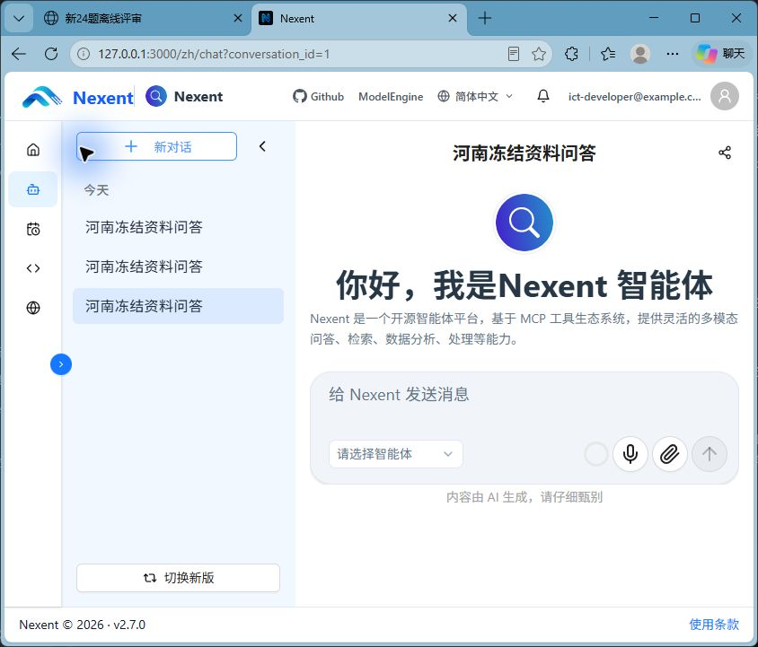

# Nexent 原生界面缺口截图

日期：2026-11-17。经用户明确授权上传 GitHub。

这是本机 Nexent 的真实窗口截图，未经裁剪或修改。登录后历史列表可见三条“河南冻结资料问答”，所选会话 1（新题 N01）显示会话标题，但正文为欢迎页，没有历史答复。

本图仅记录界面展示缺口，不作为三题答复截图或业务验收通过证据。已检查的 Nexent 调试路径跳过普通消息保存及普通消息流通道，与该现象一致；没有为截图补写聊天消息。

此前授权的三次原生调试已运行完成；此次查看、截图及上传新增模型调用为 0。截图中账号为本机配置的示例域名账号，未包含密码、密钥、原始答复或个人评分。
